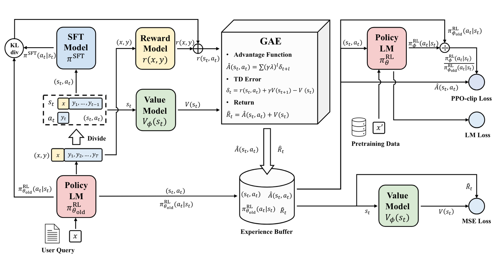
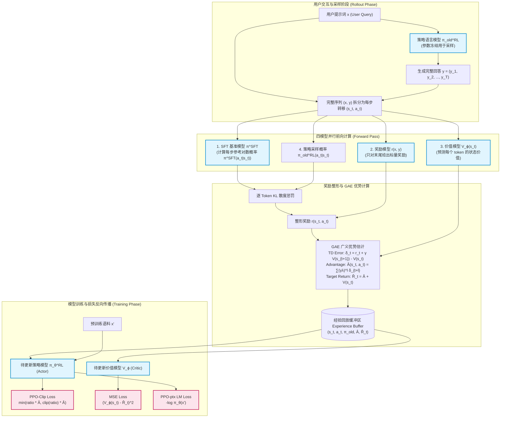
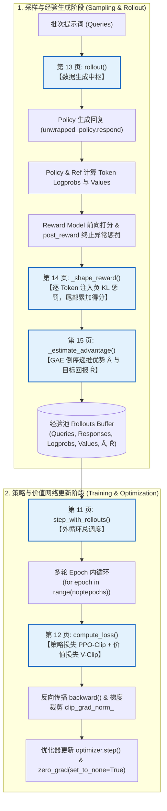
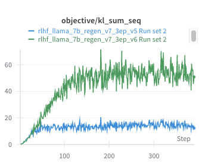
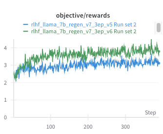
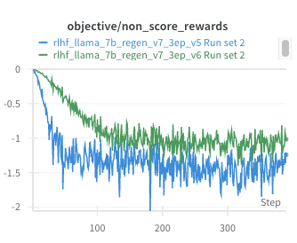

# 第 16 讲：后期训练 2 —— 基于可验证奖励的强化学习 (Lecture 16: Post-Training 2 - Reinforcement Learning from Verifiable Rewards)

## 第 1 页 (Page 1)

# 第 16 讲：后期训练 2

## 基于可验证奖励的强化学习 (Reinforcement Learning from Verifiable Rewards)

**CS336**

---

## 第 2 页 (Page 2)

### 课程至今的进展

预训练 + RLHF 让你能够得到类似 GPT-3.5 的模型……今天我们将一路走向 o1/r1。

---

## 第 3 页 (Page 3)

### 目标 —— 拓展强化学习（RL）的范围与能力

使用 RLHF：由于过度优化，我们无法干净利落地扩大规模。
我们能否在强化学习擅长的领域工作？在那些我们可以**精确地**优化我们想要的目标的领域？

*（配图展示了 AlphaGo 等 RL 取得突破的领域）*

---

## 第 4 页 (Page 4)

### 今日课程

1. **核心算法……**
   * PPO $\rightarrow$ GRPO
   * GRPO 变体
2. **案例研究**
   * Deepseek R1
   * Kimi K1.5
   * Qwen 3

---

## 第 5 页 (Page 5)

### 回顾：理论上的 PPO

对 PPO 中各种思想的简短（且高层级）介绍：

* **尝试 1：策略梯度 (Policy gradients)**（方差太大）
  $$\nabla_\theta \mathbb{E}_{p_\theta} [R(z)] = \mathbb{E}_{p_\theta} [R(z) \nabla_\theta \log p_\theta(z)]$$
* **尝试 2：TRPO**（在当前策略周围线性化问题）
* **尝试 3：PPO**（在某些 $\epsilon$ 处对比例进行剪切/裁剪）

---

## 第 6 页 (Page 6)

### PPO

用于在实际强化学习任务中优化奖励的策略梯度方法……

> 来源：PPO 发布博客 (2017) 以及 OpenAI Five (2019)

---

## 第 7 页 (Page 7)

### PPO —— 在概念层面上 (PPO at a Conceptual Level)

在纯概念与理论层面上，PPO 的优化目标非常简洁明了。OpenAI Spinning Up 将其标准流程归纳为经典的 **PPO-Clip 算法**：

---

#### 算法 1：PPO-Clip（截断近端策略优化）

* **输入**：初始策略参数 $\theta_0$，初始状态价值函数参数 $\phi_0$
* **算法主循环**：对迭代轮次 $k = 0, 1, 2, \dots$ 执行：
  1. **轨迹收集（Rollout）**：
     在环境中运行当前策略 $\pi_k = \pi(\theta_k)$，收集轨迹集合 $\mathcal{D}_k = \{\tau_i\}$。
  2. **计算待得回报（Rewards-to-go）**：
     针对每条轨迹中的每个时间步 $t$，计算折扣累积回报：
     $$\hat{R}_t = \sum_{t'=t}^T \gamma^{t'-t} r_{t'}$$
  3. **优势函数估计（Advantage Estimation）**：
     基于当前价值函数 $V_{\phi_k}$，计算优势估计值 $\hat{A}_t$（例如采用 GAE 广义优势估计）。
  4. **策略网络更新（Policy Update）**：
     通过随机梯度上升（如 Adam 优化器）最大化截断替代目标（PPO-Clip Objective），更新策略参数 $\theta$：
     $$\theta_{k+1} = \arg\max_\theta \frac{1}{|\mathcal{D}_k| T} \sum_{\tau \in \mathcal{D}_k} \sum_{t=0}^T \min \left( \frac{\pi_\theta(a_t \mid s_t)}{\pi_{\theta_k}(a_t \mid s_t)} \hat{A}^{\pi_{\theta_k}}(s_t, a_t), \; \text{clip}\left(\frac{\pi_\theta(a_t \mid s_t)}{\pi_{\theta_k}(a_t \mid s_t)}, 1 - \epsilon, 1 + \epsilon\right) \hat{A}^{\pi_{\theta_k}}(s_t, a_t) \right)$$
  5. **价值网络拟合（Value Function Fitting）**：
     通过均方误差（MSE）回归最小化价值拟合损失，更新价值网络参数 $\phi$：
     $$\phi_{k+1} = \arg\min_\phi \frac{1}{|\mathcal{D}_k| T} \sum_{\tau \in \mathcal{D}_k} \sum_{t=0}^T \left( V_\phi(s_t) - \hat{R}_t \right)^2$$

---

> **核心直觉**：
> 1. **策略网络（Actor）**：负责生成行为，目标是最大化加权优势函数，同时用截断比例 $1 \pm \epsilon$ 限制单步更新幅度，防止策略更新幅度过大跑飞。
> 2. **价值网络（Critic）**：负责基准评估，目标是准确预测给定状态下的期望未来回报，用来作为基线（Baseline）大幅降低策略梯度的方差。
> 
> ---
> 
> 💡 **学习注释：通用强化学习概念在语言模型（LLM）中的实体映射与特例解析**：
> 
> 本页展示的是经典通用强化学习（如机器人控制、Atari 游戏等马尔可夫决策过程 MDP）的标准算法流程。**语言模型（LLM）在本质上是该框架的一个特殊退化形式**，各数学符号的具体物理对应如下：
> 
> 1. **轨迹集合 $\mathcal{D}_k = \{\tau_i\}$：一个 Prompt 与一篇完整回答**
>    * **经典 RL 中**：一条轨迹 $\tau = (s_0, a_0, r_0, s_1, a_1, \dots, s_T, a_T, r_T)$ 记录了智能体从游戏开始到 Game Over 的完整交互历史。
>    * **LLM 场景中**：一条轨迹 $\tau$ 精确对应于**“一个输入提示词（Prompt）加上当前模型自回归生成的一整篇完整回答 $(x, y_1, y_2, \dots, y_T)$”**。
>    * **集合 $\mathcal{D}_k$**：即当前训练轮次（Iteration $k$）从题库中抽取的一批 Prompt（例如一个 Batch 的 512 道题目），并由策略模型各自生成出的 512 个完整问答样本，作为本轮采样的经验池（Rollout Buffer）。
> 
> 2. **时间步 $t$ 与动作 $a_t$：生成第 $t$ 个 Token**
>    * **经典 RL 中**：环境物理时钟推进的一个离散时间拍（如赛车游戏里的第 $t$ 帧）。
>    * **LLM 场景中**：**一个时间步 $t$ 精确对应于自回归解码生成第 $t$ 个 Token**。
>      * **状态 $s_t = (x, y_1, y_2, \dots, y_{t-1})$**：原始 Prompt 加上前 $t-1$ 个已生成的上文 Token。
>      * **动作 $a_t = y_t$**：模型在整个词表中挑选出的第 $t$ 个词。
>      * 若模型回答了 256 个词，该轨迹的时间步就是 $t = 1, 2, \dots, 256$。
> 
> 3. **折扣累积回报 $\hat{R}_t$ 与逐步衰减项 $\gamma^{t'-t}$：为什么在 LLM 中看不到了？**
>    * **通用 MDP 的数学含义**：
>      * $\gamma \in (0, 1]$ 是**折扣因子（Discount Factor）**。
>      * $\hat{R}_t = \sum_{t'=t}^T \gamma^{t'-t} r_{t'}$ 表示**“站在生成第 $t$ 个词的时刻，从此刻起到回答结束，未来所有奖励的折现求和（Rewards-to-go）”**。距离时刻 $t$ 越远的步数 $t'$（相距 $t' - t$ 步），其权重按 $\gamma^{t'-t}$ 指数衰减。
>      * **经典 MDP 设定它的原因**：对于无限步长的任务防止累积回报求和发散；且符合“即时奖励比遥远不确定的未来奖励更具价值”的直觉。
>    * **为什么在 Lecture 15 以及大模型的 RL 公式中完全看不到衰减项 $\gamma$？**
>      * **根本原因：大语言模型本质上是单轮决策的“情境老虎机（Contextual Bandit）”**！
>      * **奖励的极端稀疏性**：大模型生成中间每一个词的时候，外部环境根本不会给它实时打分（中间 token 的即时奖励 $r_t = 0, \forall t < T$）；直到模型吐出 `<eos>` 句子完结后，奖励模型（RM）才对整篇完整回答给出一个终局标量奖励 $R(x, y)$。
>      * **不能打折的物理机理**：一篇文章或一段代码是一个密不可分的**语义整体**。如果强行设置 $\gamma < 1$（如 0.9），会导致荒谬的语义畸变——模型在文章结尾写的标点符号被赋予极大权重，而在文章开头最关键的破题构思、推理主干反而被指数级折现贬值。
>      * **工程落地的简化（连接第 15 页的幽默注释）**：因此在工业级 LLM PPO 实现中，直接设定 **$\gamma = 1.0, \lambda = 1.0$**。此时 $\gamma^{t'-t} \equiv 1.0$，衰减项彻底消失！对于回答中的任意 Token 位置 $t$，待得回报恒等于最终总分：$\hat{R}_t \equiv R(x, y)$。这正是你在 Lecture 15 中看到的熟悉形式。

---

## 第 8 页 (Page 8)

### 实践中的 PPO —— 理论优美 vs 工程泥潭 (PPO in Practice)

> *“如果你看到有文章标题写成这样，你就知道自己要倒霉了……”*

幻灯片在此引用了两篇强化学习学术界与工业界的著名工作，揭示了一个残酷的行业事实：

1. **MIT 团队的“打脸”经典**：
   * 论文：*Engstrom et al., 2020: "Implementation Matters in Deep Policy Gradients: A Case Study on PPO and TRPO"*
   * **核心结论**：研究表明，PPO 宣称的理论核心（裁剪目标函数 PPO-Clip）在剥离了底层工程技巧后，性能并不比传统方法优越。**PPO 的优异表现绝大部分来自于其深埋在代码实现中的“代码级优化”（Code-level Optimizations）！**
2. **ICLR 经典长文**：
   * 博客：*Huang et al., 2022: "The 37 Implementation Details of Proximal Policy Optimization"*
   * 该文章梳理出了让 PPO 真正能够稳定运行的 **37 个关键代码级细节**（包括学习率退火、奖励缩放、梯度裁剪、正交初始化、优势白化、观测值归一化等）。

#### 主流强化学习开源库实现同一算法的性能差异（跑分实测）

下表展示了同一个 PPO 算法在不同开源库中的实测成绩差异（取自原幻灯片引用表格）：

| 强化学习开源库 (RL Library) | GitHub Stars | Benchmark 来源 | Breakout | Pong | BeamRider | Hopper | Walker2d | HalfCheetah |
| :--- | :--- | :--- | :--- | :--- | :--- | :--- | :--- | :--- |
| **OpenAI Baselines (`pposgd/ppo1`)** | 15k | Paper | 274.8 | 20.7 | 1590 | ~2250 | ~3000 | ~1750 |
| **OpenAI Baselines (`ppo2` commit 1)**| - | Docs | 114.26 | 13.68 | 1299.25 | 2316.16 | 3424.95 | 1668.58 |
| **OpenAI Baselines (`ppo2` commit 2)**| - | Blog | 409.26 | 20.59 | 2627.96 | 2448.73 | 3142.24 | 2148.77 |
| **Stable-Baselines3** | 8.1k | Docs | 398.03 | 20.98 | 3397.00 | 2410.43 | 3478.79 | 5819.09 |
| **CleanRL** | 4.6k | Docs | ~402 | ~20.39 | ~2131 | ~2685 | ~3753 | ~1683 |
| **Tianshou (天授)** | 7.5k | Paper/Docs | ~400 | ~20 | - | **7337.4** | 3127.7 | 4895.6 |
| **Ray / RLlib** | 31k | Repo | 201 | - | 4480 | - | - | **9664** |
| **OpenAI SpinningUp** | 9.7k | Docs | - | - | - | ~2500 | ~2500 | ~3000 |
| **ChainerRL** | 1.2k | Paper | - | - | - | 2719 | 2994 | 2404 |
| **Tonic** | 393 | Paper | - | - | - | ~2000 | ~4500 | ~5000 |

> **讲师警示**：纯看理论没有任何意义，同一个公式由于代码细节不同，得分可以从 1600 飙升到 9600。因此在语言模型中讨论 PPO，必须直接深入真实的工程实现代码！

---

## 第 9 页 (Page 9)

### PPO —— 语言模型的理想化（？）形式 (Idealization for LLMs)

在语言模型（LLM）背景下，PPO 的交互形式如下：
* **动作空间（Action）**：词表上的离散 Token。
* **状态（State）**：当前 Prompt 加上已经生成的上文序列。
* **奖励（Reward）**：大部分生成步骤的即时奖励为 0，只有当模型生成完毕在最后一个 Token 上，由奖励模型（RM）给出一个密集的整体标量分数。

#### Zheng et al., 2023: RLHF 四模型协同全景架构

在学术界最知名的开源 RLHF 解密工作之一 *Secrets of RLHF in Large Language Models (Zheng et al., 2023)* 中，揭示了运行 PPO-LLM 所需的沉重系统架构：





> **系统极其沉重的根源**：
> 训练过程中必须在 GPU 集群上同时保持 **4 个大模型实体**（Policy、Reference、Critic、Reward Model），显存消耗是常规训练的 4 倍，且通信开销极大！

---

## 第 10 页 (Page 10)

### PPO —— 来看一个工业级实现：AlpacaFarm

在真实落地中，Stanford 发布的 **AlpacaFarm** (*Dubois et al., 2023*) 提供了广被采纳的开源 PPO 工业级参考实现（SALMON、Fact-RLHF 等诸多后续研究均直接基于此代码开发）。

#### AlpacaFarm 实测对比基线（胜率表）

幻灯片展示了 AlpacaFarm 中不同对齐算法对决真实基准模型的胜率对比：

| 方法 (Method) | 模拟胜率 Simulated Win-rate (%) | 人类胜率 Human Win-rate (%) |
| :--- | :--- | :--- |
| **GPT-4** | 79.0 ± 1.4 | 69.8 ± 1.6 |
| **ChatGPT** | 61.4 ± 1.7 | 52.9 ± 1.7 |
| **PPO** | **46.8 ± 1.8** | **55.1 ± 1.7** |
| **DPO** | 46.8 ± 1.7 | - |
| **Best-of-1024 (拒绝采样)** | 45.0 ± 1.7 | 50.7 ± 1.8 |
| **Expert Iteration (专家迭代)** | 41.9 ± 1.7 | 45.7 ± 1.7 |
| **SFT 52k (纯指令微调)** | 39.2 ± 1.7 | 40.7 ± 1.7 |

> **关键洞察**：在当时的模型评测中，精心调优的 PPO 在人类偏好胜率上确实依然位列第一（55.1%），压过了纯 SFT、专家迭代甚至 Best-of-1024。接下来我们逐行拆解它的核心实现源码。
> 
> ---
> 
> 💡 **学习注释：AlpacaFarm 胜率表的深度背景与评测机制解析**：
> 
> 面对本页表格，初学者往往容易困惑于“AlpacaFarm 到底是什么”、“各方法之间如何竞争”，以及“模拟与人类胜率的真实内涵”。其核心逻辑梳理如下：
> 
> 1. **平台与选手的关系：AlpacaFarm 是“考场与沙盒”，各方法是“参赛考生”**
>    * **痛点背景**：在 2023 年初，大模型社区研究 RLHF 面临极高门槛——雇佣人类做一次偏好盲测需耗费数千美元和数周时间，且缺乏统一基准。
>    * **AlpacaFarm 的本质**：由 Stanford 团队（Dubois et al., NeurIPS 2023）发布，它**不是某一个单独的模型，而是一个用于研究、开发与对比各类后训练对齐算法的“低成本仿真沙盒实验场（Simulation Framework & Testbed）”**。
>    * **统一变量对比**：Stanford 团队以 LLaMA-7B 为统一基座，使用标准的 52k 指令集和相同的奖励模型，把当时主流的对齐算法（纯 SFT、专家迭代、Best-of-1024 推理期搜索、DPO、PPO）完整跑了一遍，进行同台公平对决。
> 
> 2. **胜率的基准标杆：全员挑战 `text-davinci-003`**
>    * 表中的胜率并不是模型之间互相打循环赛，而是**统一去挑战 OpenAI 当时最强大的商业指令模型标杆 —— `text-davinci-003`**（即未开放 ChatGPT 之前最强的 InstructGPT 完整版）。
>    * **胜率指标**：$\text{胜率} = \frac{\text{胜场} + 0.5 \times \text{平局}}{\text{总场数}}$。
>      * 胜率 $= 50\%$：表示该方法与 `text-davinci-003` 打平；
>      * 胜率 $> 50\%$：表示该方法在双盲对决中整体击败了 `text-davinci-003`；
>      * 胜率 $< 50\%$：表示该方法弱于基准标杆。
> 
> 3. **“模拟胜率”与“人类胜率”的裁判机制**
>    * **模拟胜率（Simulated Win-rate）**：
>      * **裁判**：采用 **GPT-4 充当自动化裁判（LLM-as-a-Judge）**。
>      * **机制**：将参赛模型的输出与 `text-davinci-003` 的输出随机匿名交换顺序，输入给 GPT-4 进行盲测判定。
>      * **特性**：耗时仅数分钟、单次评测仅需几美元，且 100% 可复现。
>    * **人类胜率（Human Win-rate）**：
>      * **裁判**：雇佣真实的专业人类众包评审员（Crowdsourced Annotators）。
>      * **机制**：在双盲环境下，由人类逐题阅读两份匿名回答并投票。
> 
> 4. **本表格揭示的两大里程碑级结论**
>    * **结论一：实锤了“大模型做裁判（LLM-as-a-Judge）”的高度可靠性**：
>      * 对比表格两列的排序：$\text{GPT-4} > \text{ChatGPT} > \mathbf{PPO} > \text{Best-of-1024} > \text{Expert Iteration} > \text{SFT 52k}$。
>      * GPT-4 自动裁判给出的模拟胜率与真实人类评审结果的排名相关系数高达 **0.98**！这直接奠定了后来大模型评测社区全面转向 GPT-4 自动打分（如 AlpacaEval、Chatbot Arena 辅助）的基础。
>    * **结论二：实锤了 PPO 的统治级实力，破除了“RL 无用论”**：
>      * 在人类胜率上，**PPO 拿下了 55.1%**，是所有开源 7B 模型算法中**唯一一个人类胜率击败了商业版 `text-davinci-003`（突破 50% 基准线）的方法**！
>      * 它大幅超越了纯监督微调 SFT（40.7%），超越了专家迭代（45.7%），甚至击败了在推理期暴力采样 1024 次的最佳候选输出（50.7%）。
>    * **承上启下**：正因为 AlpacaFarm 开源的这一套 PPO 实现真正打出了第一名的战绩，讲师在随后的第 11~15 页中，才正式带领我们去“白盒拆解”这套工业级源码，探寻强化学习在落地中的深层奥秘！

---

### 💡 工业级 PPO 实现总体脉络大观 (Pages 11~15 全局导读)

课件第 11~15 页的源码全部选自 Stanford 开源的 **AlpacaFarm (`ppo_trainer.py`)**。该部分按照**“顶层调度 $\to$ 目标损失 $\to$ 采样中枢 $\to$ 奖励整形 $\to$ 优势估计”**的严密工程逻辑，完整切片了一套工业级 PPO 训练系统的全部核心构件。

#### 一、全局数据流与函数调用拓扑

在真实训练的一个步长（Step）中，这 5 个关键函数的实际**调用顺序与协作拓扑**如下：



#### 二、四大网络实体与代码变量映射表

在标准的大语言模型 PPO 中，显存中存在 **4 个关键大模型角色**。在 AlpacaFarm 源码中，它们的变量名与物理职责对应如下：

| 角色通俗称谓 | 学术标准名称 | AlpacaFarm 代码变量名 | 参数是否更新？ | 核心输入与输出 |
| :--- | :--- | :--- | :---: | :--- |
| **主模型 (学生)** | **Actor (策略网络)** | **`self.policy`** (LM Head) | **是 (反向传播梯度更新)** | **输入**：序列 $(x, y)$<br>**输出**：`outputs["logprobs"]`（每个词的生成概率） |
| **基线评估器 (考评员)** | **Critic (价值网络)** | **`self.policy`** (Value Head) | **是 (反向传播梯度更新)** | **输入**：序列 $(x, y)$<br>**输出**：`outputs["values"]`（预测每个词位置的状态期望总分 $V(s_t)$） |
| **原版基准 (紧箍咒)** | **Reference Model (参考网络)** | **`self.ref_policy`** | **否 (永远冻结)** | **输入**：序列 $(x, y)$<br>**输出**：`outputs["ref_logprobs"]`（基准 SFT 吐词概率，用于算 KL） |
| **最终考官 (裁判)** | **Reward Model (奖励网络)** | **`self.reward_model`** | **否 (永远冻结)** | **输入**：完整问答文本 $(x, y)$<br>**输出**：`outputs["rewards"]`（整篇回答末尾打出的一个标量总分） |

> 💡 **架构细节：Actor 与 Critic 如何共享网络？**
> 在代码中，`self.policy` 底座是同一个 Transformer，但在顶层挂了两个不同的输出头：
> 1. **语言建模头（LM Head）**：输出词表维度的 logits，计算动作概率 `outputs["logprobs"]`（Actor）；
> 2. **价值标量头（Value Head）**：输出 1 维标量，预测每个 token 状态的期望累积价值 `outputs["values"]`（Critic）。

#### 三、Rollout 环节定位与生成的经验数据字典 (`rollouts`)

* **宏观环节定位**：Rollout 对应于**“在线动态采样与经验池构建（Online Experience Generation & Annotation）”**环节。PPO 属于同策略（On-Policy）算法，必须由最新模型现场生成、现场批改、现场学习。
* **数据存储形式**：处理完的数据打包为字典 `Dict[str, torch.Tensor]`。采样完成后，为了防止 4 模型同驻导致显存爆炸，全量数据会**立即 `.cpu()` 卸载至系统内存**中，内循环训练时再分批次送回 GPU。
* **张量形状与字段结构（以 Batch Size = $B$, Prompt 长度 = $L_{\text{query}}$, 回答长度 = $L_{\text{response}}$ 为例）**：
  * `"queries"`：`[B, L_query] (int64)`，输入的提示词 Token IDs；
  * `"query_attn_masks"`：`[B, L_query] (bool)`，提示词的注意力掩码；
  * `"responses"`：`[B, L_response] (int64)`，当前策略现场自回归生成的回答 Token IDs；
  * `"logprobs"`：`[B, L_response] (float32)`，Actor 吐出每个词的对数概率 $\log \pi_\theta(y_t \mid x, y_{<t})$；
  * `"ref_logprobs"`：`[B, L_response] (float32)`，冻结参考模型对应的对数概率 $\log \pi_{\text{ref}}(y_t \mid x, y_{<t})$；
  * `"values"`：`[B, L_response] (float32)`，Critic 预测每个词位置的状态价值估计 $V(s_t)$；
  * `"rewards"`：`[B] (float32)`，奖励模型打出的整篇回答标量总分；
  * `"non_score_rewards"`：`[B, L_response] (float32)`，逐 token 施加的负 KL 惩罚 $-\beta \cdot \text{KL}_t$；
  * `"shaped_rewards"`：`[B, L_response] (float32)`，逐词负 KL 惩罚并在句子最后一个有效词位置叠加标量总分的最终即时奖励；
  * `"advantages"`：`[B, L_response] (float32)`，GAE 递推并白化归一化后的优势函数 $\hat{A}_t$；
  * `"returns"`：`[B, L_response] (float32)`，监督 Critic 价值网络拟合的目标真实回报 $\hat{R}_t = \hat{A}_t + V(s_t)$。

---
## 第 11 页 (Page 11)

### 实践中的 PPO (外循环)：`step_with_rollouts`

代码来源于 `tatsu-lab/alpaca_farm` 的 `src/alpaca_farm/rl/ppo_trainer.py`：

```python
def step_with_rollouts(self, rollouts):
    """基于固定的采样数据 (rollouts)，在多个 epoch 内反复更新策略与价值网络。"""
    # 确保优化器已经由 Accelerate 包装，以支持多卡分布式与混合精度累积
    assert isinstance(self.optimizer, AcceleratedOptimizer), (
        "`optimizer` 必须经过 `accelerator.prepare` 包装，"
        "否则 `accelerator.accumulate` 上下文管理器无法正确禁用 `zero_grad` 或 `step`。"
    )
    # 将经验池 rollouts 数据打散封装为小批次迭代 DataLoader
    rollouts_dataloader = self.get_rollouts_dataloader(rollouts=rollouts)
    stats_list = []

    # 【外循环固定数据，内循环多次优化 (noptepochs 通常取 2~4)】
    for epoch_idx in range(self.args.noptepochs):
        for batch_idx, rollouts_batch in tqdm.tqdm(
            enumerate(rollouts_dataloader, 1), 
            disable=not self.accelerator.is_main_process, 
            desc="gradstep"
        ):
            # 使用 HuggingFace Accelerate 处理多卡梯度累积上下文
            with self.accelerator.accumulate(self.policy):
                # 1. 前向传播计算综合损失 (策略损失 pg_loss + 价值损失 vf_loss)
                ppo_loss, stats_for_this_step = self.compute_loss(rollouts_batch)
                
                # 2. 反向传播累积梯度
                self.accelerator.backward(ppo_loss)
                
                # 3. 梯度同步判定与梯度裁剪 (防止早期探索导致梯度爆炸)
                if self.accelerator.sync_gradients:
                    # ⚠️ 梯度范数在 RL 早期极易剧烈飙升 (almost blows up)，必须强制做范数截断
                    if self.args.max_grad_norm is not None:
                        self.accelerator.clip_grad_norm_(
                            self.policy.parameters(), self.args.max_grad_norm
                        )
                    stats_for_this_step["loss/grad_norm"] = self._compute_grad_norm()
                    stats_list.append(stats_for_this_step)
                
                # 4. 优化器单步参数更新
                self.optimizer.step()
                # 显存优化：置为 None 比赋 0 更彻底地释放中间梯度张量
                self.optimizer.zero_grad(set_to_none=True)
                
    return common.merge_dict(stats_list, torch.stack)  # 汇总并返回全流程训练指标
```

> 💡 **算法伪代码与核心逻辑解析**：
> 
> ```python
> 算法: step_with_rollouts(rollouts_data)
> 输入: 由 rollout() 采样好的完整经验数据包 rollouts_data
> ========================================================================================
> 1. 将经验池数据转换为可迭代的小批次数据加载器 DataLoader(rollouts_data)
> 
> 2. 【关键点 1：经验样本多轮高效复用】
>    # 在当前固定的 Rollout 经验数据上反复跑多个 Epoch (range(noptepochs))
>    for epoch = 1 to noptepochs:
>        for each batch in DataLoader:
>        
>            # 【关键点 2：分布式多卡梯度累积】
>            with accelerator.accumulate(policy):
>                # 2.1 调用 compute_loss 计算 Actor 与 Critic 的总损失
>                loss, stats = compute_loss(batch)
>                
>                # 2.2 反向传播求取梯度
>                accelerator.backward(loss)
>                
>                # 2.3 【关键点 3：梯度裁剪防早期爆炸】
>                if accelerator.sync_gradients:
>                    # ⚠️ 关键点：策略模型在 RL 早期极不稳定，必须通过 max_grad_norm 截断防崩
>                    accelerator.clip_grad_norm_(policy.parameters(), max_grad_norm)
>                    stats_list.append(stats)
>                
>                # 2.4 优化器步进更新权重
>                optimizer.step()
>                
>                # 【关键点 4：显存置空优化】
>                # 将梯度置为 None 而非 0，省去一次张量内存开销
>                optimizer.zero_grad(set_to_none=True)
> 
> 3. return 汇总后的全流程训练统计指标 stats
> ========================================================================================
> ```

---
## 第 12 页 (Page 12)

### 实践中的 PPO —— 损失计算：`compute_loss`

这是 PPO 最核心的损失计算逻辑，**揭示了一个关键细节：价值网络（Critic）同样需要做 Clip**！

```python
class PPOTrainer(rl_trainer.RLTrainer):

    def compute_loss(self, rollouts: Dict[str, Tensor]) -> Tuple[Tensor, Dict]:
        # 1. 解包数据并转移至当前 GPU 设备
        values, old_logprob, returns, advantages, queries, query_attn_masks, responses = common.prepare_inputs(
            common.unpack_dict(
                rollouts,
                keys=("values", "logprobs", "returns", "advantages", "queries", "query_attn_masks", "responses"),
            ),
            device=self.accelerator.device,
        )
        
        # 2. 当前策略模型重新前向传播 (同时经过 LM Head 与 Value Head)
        outputs = self.policy(queries, query_attn_masks, responses, temperature=self.args.temperature)

        # -------------------------------------------------------------
        # 细节 A: 价值损失计算 (Critic Loss with Value Clipping)
        # -------------------------------------------------------------
        vpred = outputs["values"]  # Critic 当前最新预测的每个 token 状态价值
        
        # ⚠️ 关键 Trick: 对 Critic 的预测做非线性裁剪，防止 Critic 单步跳得太猛带崩优势估计
        vpredclipped = torch.clamp(
            vpred,
            min=values - self.args.cliprange_value,
            max=values + self.args.cliprange_value,
        )
        vf_losses1 = (vpred - returns) ** 2.0
        vf_losses2 = (vpredclipped - returns) ** 2.0
        # 取两者最大值：悲观估计 (Pessimistic Loss)，严惩剧烈变动
        vf_loss = 0.5 * torch.maximum(vf_losses1, vf_losses2).mean()
        vf_clipfrac = (vf_losses2 > vf_losses1).to(torch.get_default_dtype()).mean()

        # -------------------------------------------------------------
        # 细节 B: 策略梯度损失计算 (Actor Loss with PPO-Clip)
        # -------------------------------------------------------------
        logprob = outputs["logprobs"]  # Actor 当前最新吐词对数概率
        # 重要性采样比率: ratio = π_θ(a|s) / π_old(a|s) = exp(log π_θ - log π_old)
        ratio = torch.exp(logprob - old_logprob)
        
        pg_losses = -advantages * ratio
        pg_losses2 = -advantages * torch.clamp(
            ratio, 
            min=1.0 - self.args.cliprange,   # 常用 cliprange = 0.2
            max=1.0 + self.args.cliprange
        )
        # 取两者最大值：代码中最小化负收益，等价于最大化悲观下界
        pg_loss = torch.maximum(pg_losses, pg_losses2).mean()
        pg_clipfrac = (pg_losses2 > pg_losses).to(torch.get_default_dtype()).mean()

        # -------------------------------------------------------------
        # 最终综合损失 = 策略损失 + vf_coef * 价值损失
        # -------------------------------------------------------------
        loss = pg_loss + self.args.vf_coef * vf_loss
        return loss, dict(
            loss=loss, pg_loss=pg_loss, vf_loss=vf_loss,
            ratio=ratio.mean(), pg_clipfrac=pg_clipfrac, vf_clipfrac=vf_clipfrac
        )
```

> 💡 **算法伪代码与核心逻辑解析**：
> 
> ```python
> 算法: compute_loss(batch)
> 输入: 单批次经验数据 (queries, responses, old_logprob, values, returns, advantages)
> ========================================================================================
> 1. 数据转移至 GPU，执行 self.policy 前向传播:
>    outputs = policy.forward(queries, responses)
>    vpred   = outputs["values"]    # Critic 输出的状态预估值 V(s_t)
>    logprob = outputs["logprobs"]  # Actor 输出的当前对数概率 log π_θ(a_t|s_t)
> 
> 2. ---------------- 价值网络损失计算 (Critic Loss) ----------------
>    # 【关键点 5：Critic 价值网络的双重悲观裁剪 Trick (Value Clipping)】
>    # ⚠️ 关键点：若 Critic 单步步子迈大，会导致下游优势估计 A 混乱，进而带崩策略模型
>    vpred_clipped = clamp(vpred, min = values - cliprange_v, max = values + cliprange_v)
>    
>    vf_loss1 = (vpred - returns) ^ 2
>    vf_loss2 = (vpred_clipped - returns) ^ 2
>    # 取两者最大值：选择误差惩罚更大的悲观上界
>    vf_loss  = 0.5 * mean(max(vf_loss1, vf_loss2))
> 
> 3. ---------------- 策略梯度损失计算 (Actor Loss) ----------------
>    # 【关键点 6：重要性采样比率 (Importance Sampling Ratio)】
>    ratio = exp(logprob - old_logprob)  # 即 π_θ(a_t|s_t) / π_old(a_t|s_t)
>    
>    # 【关键点 7：PPO-Clip 策略替代目标】
>    pg_loss1 = -advantages * ratio
>    pg_loss2 = -advantages * clamp(ratio, 1 - cliprange, 1 + cliprange) # 常用 1±0.2
>    # 取最大损失：等价于理论上取最小目标 (Pessimistic Lower Bound)
>    pg_loss  = mean(max(pg_loss1, pg_loss2))
> 
> 4. ---------------- 综合损失加权融合 ----------------
>    total_loss = pg_loss + vf_coef * vf_loss
>    return total_loss, stats
> ========================================================================================
> ```

---
## 第 13 页 (Page 13)

### 实践中的 PPO —— Rollouts 采样阶段

Rollout 负责调用各模型交互并组装经验回放池，逻辑极其沉重：

```python
    def rollout(self, queries_data) -> Dict[str, Tensor]:
        """使用当前策略生成采样轨迹，并协调 4 个大模型组装经验池。"""
        # 全部模型进入评估模式，冻结 Dropout
        self.policy.eval()
        self._make_fsdp_happy()
        unwrapped_policy = self.accelerator.unwrap_model(self.policy, keep_fp32_wrapper=True)
        self.ref_policy.eval()
        self.reward_model.eval()

        rollouts = []
        for batch_idx, batch in tqdm.tqdm(enumerate(queries_data), desc="rollout"):
            queries, query_attn_masks = common.unpack_dict(...)
            
            # 1. 【策略自回归生成回答】：unwrapped_policy.respond()
            respond_outputs = unwrapped_policy.respond(queries, query_attn_masks, temperature=self.args.temperature)
            (responses,) = common.unpack_dict(respond_outputs, ("responses",))

            # 2. 【概率与价值重估】：分别通过 Policy 与 RefPolicy 前向获取每个词的 logprobs 与 values
            rollouts_batch = {"queries": queries, "query_attn_masks": query_attn_masks, "responses": responses}
            policy_outputs = self.policy(**rollouts_batch, temperature=self.args.temperature)
            ref_policy_outputs = self.ref_policy(**rollouts_batch, temperature=self.args.temperature)
            
            # policy 吐出 logprobs (Actor) 和 values (Critic)
            rollouts_batch.update(common.unpack_dict(policy_outputs, ("logprobs", "values", "entropies")))
            # ref_policy 吐出 ref_logprobs (用于计算 KL)
            rollouts_batch.update({f"ref_{k}": v for k, v in ref_policy_outputs.items()})

            # 3. 【奖励模型评估】：文本反分词与跨 Tokenizer 重分词 (Retokenization)
            text_queries, text_responses = ... # batch_decode 还原为纯文本
            text_sequences = [q + r for q, r in zip(text_queries, text_responses)]
            # ⚠️ 关键点：若 Policy 与 Reward Model 的分词器不同，必须用 RM 的分词器重新编码
            sequences, responses = ... 
            
            # 3.1 奖励模型前向：内容主考官通读全文打出原始标量分
            reward_outputs = self.reward_model(**sequences)
            # 3.2 考纪复核：检查是否正常以终止符结尾，对中途截断的半截子回答施加严重惩罚 (如 -10.0)
            reward_outputs = self.post_reward(reward_outputs, responses.input_ids)
            rollouts_batch.update(reward_outputs)

            # 4. 【奖励整形】：注入逐 Token 的负 KL 散度惩罚并在末尾累加任务奖励
            shape_reward_outputs = self._shape_reward(
                rewards=rollouts_batch["rewards"],
                responses=rollouts_batch["responses"],
                logprobs=rollouts_batch["logprobs"],
                ref_logprobs=rollouts_batch["ref_logprobs"],
            )
            rollouts_batch.update(shape_reward_outputs)
            
            # 5. 【显存卸载】：生成完立即将整个 batch 卸载到 CPU 内存，防止 GPU OOM
            rollouts.append({k: v.cpu() for k, v in rollouts_batch.items()})

        # 6. 【跨批次拼接并集中估计优势】：批量计算 GAE 更有利于优势标准化 (Whitening)
        rollouts = common.merge_dict(rollouts, merge_fn=torch.cat)
        advantages = self._estimate_advantage(
            rewards=rollouts["shaped_rewards"].to(self.accelerator.device),
            values=rollouts["values"].to(self.accelerator.device),
        )
        return {**rollouts, **advantages}
```

> 💡 **算法伪代码与核心逻辑解析**：
> 
> ```python
> 算法: rollout(queries_batch)
> 输入: 待采样的提示词 queries_batch
> ========================================================================================
> 1. 冻结所有模型，进入推理评估模式:
>    policy.eval(), ref_policy.eval(), reward_model.eval()
> 
> 2. 【步骤 A：生成回答】
>    # 调用当前策略内核自回归解码生成完整文本回答 y
>    responses = unwrapped_policy.generate(queries, temperature)
> 
> 3. 【步骤 B：概率与状态价值重估】
>    # Policy 前向: 获取当前策略吐词概率 logprobs (Actor) 与状态价值 values (Critic)
>    policy_out     = policy.forward(queries, responses)
>    # RefPolicy 前向: 获取基准 SFT 模型的参考概率 ref_logprobs (用于后续算 KL)
>    ref_policy_out = ref_policy.forward(queries, responses)
> 
> 4. 【步骤 C：奖励模型打分与考纪复核】
>    # 【关键点 8：Tokenizer 不一致的 Retokenization 陷阱】
>    # ⚠️ 关键点：若 Policy 与 RM 分词器不同，必须先 decode 回纯文本再重新 tokenize
>    sequences = rm_tokenizer(decode(queries + responses))
>    
>    # 4.1 原始考官审卷：通读全文给出语义质量标量总分 (如 +3.5)
>    reward_outputs = reward_model.forward(sequences)
>    
>    # 4.2 【关键点 9：post_reward 异常终止惩罚机制】
>    # ⚠️ 关键点：检查结尾是否包含合法终止符 (<eos>)；若因长度超限被强切，直接砍为极低负分 (-10.0)
>    reward_outputs = post_reward(reward_outputs, responses)
> 
> 5. 【步骤 D：奖励整形与显存卸载】
>    # 5.1 注入逐词负 KL 散度并在句末累加任务总分 (第 14 页函数)
>    shaped_rewards = _shape_reward(rewards, responses, logprobs, ref_logprobs)
>    
>    # 【关键点 10：立即转存 CPU 内存】
>    # ⚠️ 关键点：4 个大模型同驻极度消耗显存，收集完毕立即转存 CPU
>    rollouts_cpu.append(batch.cpu())
> 
> 6. 【步骤 E：整批优势递推计算】
>    # 调用第 15 页函数：基于整批经验计算 GAE 优势与白化归一化
>    advantages = _estimate_advantage(shaped_rewards, values)
> 
> 7. return 打包好的经验池字典 (queries, responses, logprobs, values, advantages, returns)
> ========================================================================================
> ```

---
## 第 14 页 (Page 14)

### 实践中的 PPO —— 奖励整形 (Reward Shaping)

在 AlpacaFarm 中，奖励整形的真实代码如下：

```python
def _shape_reward(
    self, rewards: Tensor, responses: Tensor, logprobs: Tensor, ref_logprobs: Tensor
) -> Dict[str, Tensor]:
    # 细节 1: 理论上是计算精确的 KL 散度，但实现中采用单样本采样估计: logp - ref_logp
    # 细节 2: 【单边非对称截断 Trick：torch.clamp(..., min=0.0)】
    # ⚠️ 关键点：如果新策略在某个词上的概率比旧策略更小 (logp < ref_logp)，则截断为 0，不予奖励！
    kl = torch.clamp(logprobs - ref_logprobs, min=0.0)
    
    # 逐 token 的负 KL 惩罚: r_KL = -β * KL
    non_score_rewards = -self.kl_ctl.value * kl
    shaped_rewards = non_score_rewards.clone()
    
    # 细节 3: 【尾部边界对齐】：仅在序列的最后一个有效非 padding Token 处加上真实的标量任务奖励
    terminal_positions = (responses != self.tokenizer.pad_token_id).sum(dim=1) - 1
    shaped_rewards[list(range(rewards.size(0))), terminal_positions] += rewards
    
    return dict(shaped_rewards=shaped_rewards, non_score_rewards=non_score_rewards, kl=kl)
```

> 💡 **算法伪代码与核心逻辑解析**：
> 
> ```python
> 算法: _shape_reward(rewards, responses, logprobs, ref_logprobs)
> 输入: 标量任务奖励 rewards, 生成序列 responses, 策略概率 logprobs, 基准概率 ref_logprobs
> ========================================================================================
> 1. 估计逐 Token 的单样本 KL 散度:
>    kl_divergence = logprobs - ref_logprobs
> 
> 2. 【关键点 11：单边非对称 KL 截断 Trick (防崩塌核心)】
>    # ⚠️ 关键点：若新策略概率低于参考概率 (logp < ref_logp)，负 KL 惩罚 (-β*KL) 会变成正奖励！
>    # 这会导致模型通过随机乱码反向刷分。强制 clamp(min=0.0) 确保“只惩罚漂移，绝不奖远离”！
>    clipped_kl = clamp(kl_divergence, min = 0.0)
> 
> 3. 计算逐 Token 负 KL 惩罚:
>    non_score_rewards = - kl_coef * clipped_kl
>    shaped_rewards    = clone(non_score_rewards)
> 
> 4. 【关键点 12：尾部有效 Token 边界对齐】
>    # ⚠️ 关键点：在含 Padding 的 Batch 中，利用非 pad 计数精确定位回答句末索引:
>    last_token_idx = count_non_pad_tokens(responses) - 1
>    
>    # 仅在最后一个有效 Token 处加上奖励模型的真实总分:
>    shaped_rewards[each_sample, last_token_idx] += rewards[each_sample]
> 
> 5. return 包含了逐词负 KL 惩罚与尾部任务得分的 shaped_rewards 字典
> ========================================================================================
> ```

---
## 第 15 页 (Page 15)

### 实践中的 PPO —— 广义优势估计 (GAE)

在强化学习中，优势函数衡量了“在此刻选择这个动作，比当前状态的平均期望好多少”：
$$\hat{A}_t^{\text{GAE}(\gamma, \lambda)} := \sum_{l=0}^{\infty} (\gamma\lambda)^l \delta_{t+l}^V \quad \text{其中} \quad \delta_t^V = r_t + \gamma V(s_{t+1}) - V(s_t)$$

#### AlpacaFarm 源码实现与幽默细节：

```python
def _estimate_advantage(self, rewards: Tensor, values: Tensor) -> Dict[str, Tensor]:
    """广义优势估计 (Generalized Advantage Estimation, Schulman et al. 2015)"""
    if self.args.whiten_rewards:
        rewards = torch_ops.whiten(rewards, shift_mean=False)
        
    lastgaelam = 0
    advantages_reversed = []
    gen_length = self.args.response_len
    
    # 【从后向前倒序动态规划求解优势 (从序列末尾往前扫)】
    for t in reversed(range(gen_length)):
        nextvalues = values[:, t + 1] if t < gen_length - 1 else 0.0
        # 1. 计算单步时序差分误差: δ_t = r_t + γ * V(s_{t+1}) - V(s_t)
        delta = rewards[:, t] + self.args.gamma * nextvalues - values[:, t]
        # 2. 递推广义优势累计: Â_t = δ_t + (γ * λ) * Â_{t+1}
        lastgaelam = delta + self.args.gamma * self.args.lam * lastgaelam
        advantages_reversed.append(lastgaelam)
        
    # 反转列表得到正序优势: [0, 1, ..., T-1]
    advantages = torch.stack(advantages_reversed[::-1], dim=1)
    # 计算价值网络拟合目标: Target Returns = Â_t + V(s_t)
    returns = advantages + values
    
    # 细节 4: 【整批优势白化处理 (Whiten: 零均值、单位方差)】
    # ⚠️ 关键点：标准化优势能大幅消除不同 Prompt 难度差异带来的方差，稳定梯度更新
    advantages = torch_ops.whiten(advantages, shift_mean=True)
    return dict(returns=returns, advantages=advantages)
```

> 💡 **算法伪代码与核心逻辑解析**：
> 
> ```python
> 算法: _estimate_advantage(shaped_rewards, values)
> 输入: 逐 Token 整形奖励 shaped_rewards, Critic 预测价值 values
> ========================================================================================
> 1. 初始化倒序累加器 last_gae_lam = 0, advantages = []
> 
> 2. 【关键点 13：倒序动态规划递推】
>    # 从序列末尾向开头逆向循环 (t = T-1 down to 0)
>    for t = (gen_length - 1) down to 0:
>        next_value = values[t + 1] if t < gen_length - 1 else 0.0
>        
>        # 2.1 计算单步 TD 误差: δ_t = r_t + γ * next_value - values[t]
>        delta = shaped_rewards[t] + γ * next_value - values[t]
>        
>        # 2.2 递推广义优势累积:
>        last_gae_lam = delta + (γ * λ) * last_gae_lam
>        advantages.append(last_gae_lam)
> 
>    advantages = reverse(advantages)  # 翻转回正向时序
> 
>    # 【关键点 14：老虎机（Contextual Bandit）特例下的极简退化】
>    # 💡 幽默细节：大模型生成本质是老虎机问题，设 γ = 1.0, λ = 1.0 时：
>    # GAE 递归直接退化为: Â_t = (从当前步 t 到末尾的真实累积回报) - values[t]
> 
> 3. 计算用于拟合 Critic 的目标回报:
>    returns = advantages + values
> 
> 4. 【关键点 15：整批优势白化 (Advantage Whitening)】
>    # ⚠️ 关键点：在整批样本维度将优势拉回到零均值、单位方差，防止梯度震荡
>    advantages = (advantages - mean(advantages)) / (std(advantages) + 1e-8)
> 
> 5. return dict(returns = returns, advantages = advantages)
> ========================================================================================
> ```

---
## 第 16 页 (Page 16)

### 在 PPO 训练中你期望看到什么曲线？(Expected Curves)

原课件展示了基于 LLaMA-7B 运行 AlpacaFarm PPO 时的典型 WandB 监控曲线图：

| 1. 序列累积 KL 散度 (`objective/kl_sum_seq`) | 2. 奖励模型总分 (`objective/rewards`) | 3. 负 KL 惩罚分 (`objective/non_score_rewards`) |
| :---: | :---: | :---: |
|  |  |  |
| 从 0 逐步爬升，最终在 15~20 附近平稳震荡收敛 | 从 2.0 左右持续稳步增长至 3.5~4.0 | 从 0 随散度增大下降至 -1.0~-1.5 后保持稳定 |

> **健康训练的标志**：
> 1. 整体奖励稳步上升；
> 2. KL 惩罚逐步拉大但迅速进入平台期（Plateau），绝不能无限发散；
> 3. 由于是一个稳定的 Bandit 设置，曲线应当呈现清晰的单调提升态势。

---

## 第 17 页 (Page 17)

### 为什么我们还需要另一个强化学习算法……？

#### 为什么不用 PPO？
* 实践中实现非常复杂。
* 价值模型（极其消耗显存，且训练时需要额外的超参数微调）。

#### 为什么不用 DPO？
* 数据本质上不是成对的（或者不符合 Bradley-Terry 对比的形式）。
* DPO 是离线的（虽然后来可以通过迭代使其在线化）。

---

## 第 18 页 (Page 18)

### 新来的竞争者：GRPO

#### 什么是 GRPO？
* 从 PPO 出发（许多部分是相似的）。
* **移除价值函数/优势计算网络（Critic）**。
* **将优势计算为“组内的 Z 分数（z-score）”**。

在在线（online）情况下（即 rollout + 立即更新），这仅仅是使用组内归一化奖励的策略梯度。

* **GRPO 优势计算公式**：
  $$A_i = \frac{r_i - \text{mean}(r_1, r_2, \dots, r_G)}{\text{std}(r_1, r_2, \dots, r_G)}$$

---

## 第 19 页 (Page 19)

### GRPO 非常简单（多亏了没有价值网络……）

你可以（而且人们确实在这么做）编写极小型的 GRPO 实现：
* 计算每个 rollout 的奖励
* 进行每个组的均值/方差归一化
* 计算 KL 惩罚项
* 在损失上进行梯度更新

> 我们可以参考这个例子：[nano-aha-moment](https://github.com/McGill-NLP/nano-aha-moment)

---

## 第 20 页 (Page 20)

### 优势计算同样非常简单

基本上就是最“原生”的 GRPO 设置。
这里的主要区别仅在于标准差计算中加入的 $10^{-4}$ 稳定性常数。

---

## 第 21 页 (Page 21)

### 它表现如何？

**来自原论文的 GRPO 表现**：
* 优于拒绝采样微调（RFT，即仅对正确答案进行强化）。
* 从**过程监督（process supervision）**中获得了一些收益。
* 我们稍后会回到这个问题……

---

## 第 22 页 (Page 22)

### 仔细思考 GRPO 的目标函数……

GRPO 与 PPO 之间的关键区别：优势函数的计算方式。
这好吗？稍微偏离一下，回顾一下强化学习基础（Sutton and Barto）：
> **基准化（Baselining）**：我们可以从奖励中减去任何与状态相关的项（而不改变梯度的期望值）。

---

## 第 23 页 (Page 23)

### GRPO 没有使用“有效”的基准线

除以标准差项并不是一个能够保持梯度无偏性的有效基准（baseline）。

> **什么是 GRPO 的无偏梯度版本？**

参见 Liu et al 2025（这非常接近于留一法（leave-one-out）的 REINFORCE 算法）。
另外，注意左侧长度归一化项（length-normalizer）的修改。

---

## 第 24 页 (Page 24)

### GRPO 的长度偏差 (Length biases)

这些项起了什么作用？
* **标准差（Stdev）** —— 给太简单或太难的问题赋予过高的权重。
* **长度归一化** —— 会导致对长度的偏好。

> **这个修复起到了什么作用？**

---

## 第 25 页 (Page 25)

### 案例研究

让我们来看一些使用基于可验证奖励的强化学习（RLVR）的代表性开源模型：

* **DeepSeek-R1**
  * 近期众多 RLVR 探索的核心。
  * 包含许多有趣的细节。
* **Kimi K1.5**
  * 与 R1 同期推出，同样使用 RLVR。
  * 提供了与 R1 互补的技术细节。
* **Qwen 3**
  * 最近的开源推理模型尝试。
  * 低数据量下的 RLVR。

---

## 第 26 页 (Page 26)

### DeepSeek-R1

这篇论文引发了不小的社会现象……

**R1 有什么瞩目之处？**
* 性能超越了 OpenAI o1。
* 开源了强化学习配方（且相当简单）。
* 终结了关于蒙特卡洛树搜索（MCTS）和过程奖励模型（PRMs）必要性的投机猜想。
* 提供了有关 SFT 的见解（包括 R1-Zero 和蒸馏版 R1）。

---

## 第 27 页 (Page 27)

### 算法 —— GRPO

他们建立在 DeepSeekMath 中 GRPO 成果的基础之上……
但他们在 R1 中**没有**使用过程监督（process supervision），稍后会详细说明。

---

## 第 28 页 (Page 28)

### 受控设置 —— R1-Zero

* **设置**：
  * **奖励（Rewards）**：
    * 准确性奖励（答案是否正确？）
    * 格式奖励（是否使用了思维标签 `<think>` 和 `</think>`）
  * **数据**（未公开）
  * **基座模型**：DeepSeek-V3
* **结果**：比 OpenAI o1 稍微差一点点。

---

## 第 29 页 (Page 29)

### 有趣的现象（？）

* 训练期间思维链（CoT）长度不断增长。
* 涌现出“顿悟”（aha）时刻？

---

## 第 30 页 (Page 30)

### 但迈步也许有些夸大了

来自 Dr. GRPO 论文的一些后续分析：
* 推理长度的增长是因为目标函数有偏吗？
* 基座模型本身就已经具备了“顿悟”能力？

> 💡 **学习注释：Dr. GRPO 对 DeepSeek-R1-Zero 两大“神话”现象的学术去魅与数学解剖**：
> 
> 在 DeepSeek-R1-Zero 论文中，有两个最具轰动效应、甚至被外界赋予了拟人化心智解读的现象（见第 29 页）：**“思维链长度自发暴涨”** 与 **“涌现‘顿悟’（Aha Moment）自我纠错”**。然而，后续 Sea AI Lab 等团队在重磅论文 **Dr. GRPO (*GRPO Done Right*)** 中对这两大现象进行了严格的数学推导与实证分析，揭示了背后的科学真相：
> 
> ---
> 
> #### 1. 质疑一深度解剖：推理长度增长是因为目标函数有偏吗？
> 
> * **核心矛盾与直觉困惑**：
>   在纯数学或代码验证（RLVR）任务中，评测机在回答结束时打出的奖励/优势 $A_i$（如对得 $+1$，错得 $-1$）是一个**与输出序列长度完全无关的全局标量**。既然 $A_i$ 只是一个常数标量，为什么还会发生长度累加导致的梯度爆炸？又为什么很多开源库会主动去“除以长度 $T$”？
> 
> * **梯度累加与爆炸的数学成因**：
>   虽然奖励 $A_i$ 是标量，但大模型是自回归逐词生成的，整条轨迹的对数概率为各词求和：$\log \pi_\theta(y_i \mid x) = \sum_{t=1}^{T_i} \log \pi_\theta(y_{i,t} \mid x, y_{i,<t})$。
>   根据策略梯度定理，整条回答产生的梯度为：
>   $$g_i = \left( \sum_{t=1}^{T_i} \nabla_\theta \log \pi_\theta(y_{i,t}) \right) \cdot A_i$$
>   每个词的梯度 $\nabla_\theta \log \pi_\theta$ 是一个千亿维度的高维向量。在一段自洽的解题推理中，相邻 Token 的梯度方向通常高度正相关。
>   * 如果回答只有 100 个词，这里是 100 个向量累加；
>   * 如果思考链长达 8192 个词，这里是 **8192 个向量持续累加**再乘 $A_i$！
>   这会导致总梯度范数（Gradient Norm）暴涨数十倍，在神经网络反向传播中直接引发数值溢出（FP16/BF16 NaN）或优化器权重震荡。
> 
> * **除以 $T$ 的工程惯性与 SFT vs RL 的致命冲突**：
>   在传统监督微调（SFT）中，交叉熵损失默认会对每个样本除以其有效长度 $T_i$（$L_{\text{SFT}} = -\frac{1}{T_i} \sum_{t=1}^{T_i} \log \pi_\theta$）。因为 SFT 的每个词都有独立标签（稠密监督），除以 $T_i$ 相当于计算平均预测正确率，梯度尺度非常稳定。
>   许多开源强化学习库在实现 GRPO / PPO 时，**顺手沿用了 SFT 的习惯**，对每条序列计算 Loss 时除以了自身的长度 $T_i$。然而，**在强化学习中，除以 $T_i$ 相当于把整篇回答的奖惩平摊稀释到了每个字头上，酿成了严重的数学偏置**：
>   * **做错时（$A_i < 0$）：写得越长，挨打越轻（惩罚严重稀释）**！
>     若总惩罚为 $-1$：简短错误（$T=100$）的单 Token 惩罚为 $\frac{-1}{100} = -0.01$；而长篇大论、胡说八道的错误（$T=8000$）单 Token 惩罚却仅有 $\frac{-1}{8000} = -0.000125$！
>     **模型在梯度下降中瞬间学会了“钻空子”**：只要面临难题不确定，拼命输出车轱辘废话、把思考链无限拉长，做错时挨的打就会被稀释 80 倍！
>   * **做对时（$A_i > 0$）**：简炼秒杀难题的短回答（$T=50$）每个 Token 获得的梯度激励（$\frac{+1}{50}$）远大于详尽长推导（$\frac{+1}{5000}$）。
>   这种机制客观诱导了模型的**“冗长刷分（Verbosity Gaming）”**与**“避险式字数膨胀”**。
> 
> * **Dr. GRPO 的无偏解法（全局 Token 归一化）**：
>   为了兼顾“防止长序列梯度爆炸”与“避免长度偏置”，Dr. GRPO 提出**不能在样本内部除以各自的 $T_i$，而必须在整批（Batch）维度除以统一的全局有效 Token 总数**：
>   $$\text{有偏实现（样本级归一化）}: \quad L = \frac{1}{|G|} \sum_{i=1}^{|G|} \left( \frac{1}{T_i} \sum_{t=1}^{T_i} \text{Loss}_{i,t} \cdot A_i \right)$$
>   $$\text{Dr. GRPO 无偏实现（全局 Token 归一化）}: \quad L = \frac{1}{\sum_{i=1}^{|G|} T_i} \sum_{i=1}^{|G|} \sum_{t=1}^{T_i} \text{Loss}_{i,t} \cdot A_i$$
>   全局总 Token 数 $\sum T_i$ 是一个与具体样本无关的常数。修正后，做错时写废话越多，累加的总惩罚依然实打实地更多。实验实测表明，移除长度偏差后，**模型的思维链长度增长显著平缓，证明原先的失控暴涨很大程度上是被有偏目标函数“奖励”出来的虚假繁荣**。
> 
> ---
> 
> #### 2. 质疑二深度解剖：基座模型本身就已经具备了“顿悟”能力？
> 
> * **原版宣称的“Aha Moment（顿悟时刻）”**：
>   模型在推理中突然输出诸如 *“Wait, wait, let me re-evaluate this... Ah! That was a mistake, let me rethink from scratch...”*，被外界盛赞为“强化学习让 AI 第一次自主诞生了人类般的反思心智与自我纠错能力”。
> 
> * **去魅实证：基座先验（Latent Capability）与强化学习提权（Probability Amplification）**：
>   1. **预训练语料早已蕴含海量反思模式**：以 DeepSeek-V3 为例，其预训练海量语料包含极其丰富的人类数学草稿、代码调试讨论、GitHub Issue 和学术纠错对话，其中类似 *“Wait, let me double check…”* 的语言模式出现过数百万次。基座模型在预训练完成时，内部早已精确编码了这套自检与修正的语言概率分布。
>   2. **强化学习是“模式激活”，不是“心智创造”**：在生成探索阶段，模型只是以一定概率随机走到了预训练潜伏的“Wait, let me rethink...”分支上；一旦该分支碰巧蒙对了答案、获得了 $+1$ 的 Reward，GRPO 的策略梯度便迅速推高该分支的 Logprob。**RL 只是充当了放大器和探照灯，把预训练中沉睡的模式激活成了高概率通路**。
>   3. **能力退化与恢复的假象**：消融实验显示，在纯 RL 初期，剧烈探索往往先打乱了基座原有的解题逻辑；随后在奖励引导下，模型逐步“重新找回”了预训练已有的高质量解题模板，这一恢复过程容易被误读为突兀的“顿悟”。
> 
> ---
> 
> #### 3. 核心认知对比总结
> 
> | 争议现象 (Page 29) | 原版 R1-Zero 浪漫解读 | Dr. GRPO 等后续严谨科学真相 (Page 30) |
> | :--- | :--- | :--- |
> | **思维链长度激增** | 纯 RL 自发学会了分配更多测试期计算量（Test-time Compute）以深入解题。 | **有偏损失函数导致的避险副作用**：Loss 中除以 $T_i$ 导致“做错时写得越长惩罚被摊得越薄”，诱导了病态凑字数；全局归一化后长度增长显著平缓。 |
> | **Aha 顿悟反思时刻** | 纯强化学习从零诞生了自主纠错、反思求证的人性化心智。 | **基座固有潜伏能力的激活与提权**：预训练语料中本就充满反思套路，RLVR 只是利用奖励机制锁定了已有的概率模式。 |

---


## 第 31 页 (Page 31)

### 进一步提升性能 —— R1

**R1 vs R1-Zero 的关键区别**：
* **SFT 初始化（冷启动）**。
* **思维链的语言一致性奖励**（避免语言混杂）。
* **不可验证的奖励**（在第二阶段引入）。

> 训练流程：DeepSeek-V3 $\rightarrow$ 推理 SFT $\rightarrow$ 强化学习 (GRPO) $\rightarrow$ 最终的 SFT/RLHF。

---

## 第 32 页 (Page 32)

### SFT 初始化（冷启动）

与 DeepSeek-R1-Zero 不同，为了防止从基座模型直接开始 RL 训练时出现的早期不稳定冷启动阶段，对于 DeepSeek-R1，我们构建并收集了少量的长思维链（CoT）数据来微调模型，作为初始的 RL 策略。为了收集这些数据，我们探索了多种方法：使用以长思维链为示例的少样本提示词、直接提示模型生成包含反思和验证的详细回答、收集可读格式的 DeepSeek-R1-Zero 输出，以及通过人工标注员进行后处理精简结果。

> 从传统的（长）思维链出发，然后辅以额外的验证（表述比较模糊）。
* **声称的好处**：可解释性。
* **注意**：数据的具体来源并不完全清晰。

---

## 第 33 页 (Page 33)

### 针对推理/数学的 SFT

即使是极少量的样本，对于引导（bootstrap）语言模型的推理能力也非常有效。

> 只需要 1k 个数学和科学问题 + 来自 Gemini / R1 的长思维链数据即可。

---

## 第 34 页 (Page 34)

### 强化学习（RL）步骤

RL 部分基本上是相同的。
* **细微区别**：引入了额外的语言一致性奖励（惩罚）。
* 关于“语言切换（mixed languages）”的注解非常有趣 —— 强化学习天然地会导致语言混合？

> 💡 **学习注释：语言一致性奖励（Language Consistency Reward）的数理机制、工业演进与技术豁免**：
> 
> 在 DeepSeek-R1 的强化学习阶段，针对 R1-Zero 遗留的“中英文夹杂、逻辑跳跃、可读性差”等顽疾，特别引入了语言一致性规则奖励。围绕该机制的数理定义、公式变量拆解与现代工业落地实践，核心要点梳理如下：
> 
> ---
> 
> #### 1. 产生根源：纯 RL 为什么天然诱导语言混杂（Mixed Languages）？
> * **多语言表征套利（Representation Arbitrage）**：预训练语料中英文数理逻辑、代码密度最高，表征路径最短、注意力衰减最慢；模型自回归生成时会本能选择“阻力最小、算力最经济”的词汇通路（如英文连词 *“Therefore, let...”* 往往比中文推导更紧凑）。
> * **奖励机制的“唯结果论”**：RLVR 验证器只看最终结果（如 `\boxed{42}`）是否正确，对中间思考过程的形式不施加任何约束，导致模型自发收敛出一种“语法混乱但逻辑自洽的机造混合语（Chinglish / Pidgin）”。
> 
> ---
> 
> #### 2. 具体数学表达式与核心变量拆解
> 
> ##### 公式一：语言一致性奖励定义
> $$R_{\text{lang}} = \frac{1}{N} \sum_{i=1}^N \mathbb{I}\left(w_i \in \mathcal{L}_{\text{target}}\right) \in [0, 1]$$
> 
> * **核心变量与函数语义分解**：
>   * $\text{CoT} = (w_1, w_2, \dots, w_N)$：模型在 `<think>` 与 `</think>` 标签之间生成的长思维链词元序列。
>   * $w_i$：思维链序列中的第 $i$ 个单词（Word）或分词单元（Token）。在工程实现中，中文按单字/词切分，英文按空格或词形切分。
>   * $N$：思维链中参与统计的有效词汇总数（$N = |\text{CoT}|$）。
>   * $\mathcal{L}_{\text{target}}$：**目标语言词汇空间**。由用户输入的提示词（Prompt）语种严格决定（若用户用中文提问，$\mathcal{L}_{\text{target}}$ 即为中文字符与词表；若为英文提问，则为英文词表）。
>   * $\mathbb{I}(\cdot)$：**指示函数（Indicator Function）**。当满足条件（即 $w_i$ 属于目标语言 $\mathcal{L}_{\text{target}}$）时输出 $1$，否则输出 $0$。
>   * $R_{\text{lang}}$：标量分值，落在区间 $[0, 1]$ 内。$1.0$ 代表全篇 100% 遵循目标语言，数值越低代表混入的外语杂质越多。
> 
> ##### 公式二：GRPO 复合奖励聚合函数
> $$R = R_{\text{acc}} + \lambda_{\text{format}} \cdot R_{\text{format}} + \lambda_{\text{lang}} \cdot R_{\text{lang}}$$
> 
> * **核心变量与函数语义分解**：
>   * $R$：对模型单条生成轨迹（Trajectory）给出的**最终复合标量奖励（Total Scalar Reward）**。在 GRPO 中，该标量用于计算组内标准化优势：$\hat{A}_i = \frac{R_i - \text{mean}(\{R_j\}_{j=1}^G)}{\text{std}(\{R_j\}_{j=1}^G)}$。
>   * $R_{\text{acc}}$（**任务准确性奖励**）：基于确定性规则的硬核验证（Rule-based Ground-truth Verification）。数学题通过符号解析器（如 SymPy、MathVerify）比对答案；代码题通过沙箱单元测试判断是否通过（Pass@1）。通常取二值离散标量 $R_{\text{acc}} \in \{0, 1\}$。
>   * $R_{\text{format}}$（**格式规范奖励**）：结构合规性检验函数。严格检查输出是否按规定包含 `<think>`、`</think>` 标签，且思维与结论严格分离。合规给 $1$，违规给 $0$ 或负惩罚。
>   * $\lambda_{\text{format}}, \lambda_{\text{lang}}$（**辅助奖励加权系数**）：平衡主要解题目标与辅助对齐行为的超参数。实践中通常设定为 $\lambda \ll 1$（如 $0.05 \sim 0.1$），确保解题正确性始终占据绝对主导地位，防止模型“为刷语言分而故意放水做题”（防 Reward Hacking）。
> 
> * **性能 vs 可读性的残酷权衡**：论文消融实验表明，强制加入 $R_{\text{lang}}$ 约束了模型的思考自由度，导致数学推理基准表现**微幅下降（Slight degradation）**；但为了换取符合人类预期的可读性，工业落地中必须接受这一对齐代价。
> 
> ---
> 
> #### 3. 现代工业实践的主流演进：“草稿纸自由，最终答卷严格”
> 随着对长思考模型的认知深入，当前业界（如 OpenAI o1/o3、Claude 3.7、主流开源团队）不再普遍推崇在 RL 阶段强惩罚思考语种，而是演进为新范式：
> * **思考与回答解耦（Decoupling）**：思维链（CoT）本质是模型的“动态计算缓存/草稿纸”。允许模型在 `<think>` 内自由用英文、伪代码高效推导，释放最大智力上限；
> * **答卷严格对齐**：仅在 `</think>` 之后的 Final Response 强制严格遵循用户语言；或在前端采用轻量模型对原始 CoT 做摘要重写呈现。
> * **SFT 冷启动软引导**：用高质量单语言长 CoT 数据做前置 SFT，以更温和的先验引导取代 RL 阶段的多目标硬惩罚。
> 
> ---
> 
> #### 4. 技术载体豁免方案：如何避免代码与公式被“误伤”退化？
> 若粗暴统计全篇语言比例，模型为了避罚会发生**“代码中文化/拼音化”、“拒绝写 LaTeX 公式”**等严重奖励黑客现象。工业界的成熟解法是引入**自然语言脱敏算子**：
> 
> ##### 公式三：技术载体脱敏与纯文本过滤算子
> $$\text{Text}_{\text{eval}} = \text{Response} \setminus \left( \mathcal{S}_{\text{code}} \cup \mathcal{S}_{\text{math}} \cup \mathcal{S}_{\text{whitelist}} \right)$$
> 
> * **核心集合与算子语义分解**：
>   * $\text{Response}$：模型在 `</think>` 之后生成的最终答卷文本。
>   * $\mathcal{S}_{\text{code}}$：通过抽象语法树（AST）或 Markdown 解析器匹配出的所有代码载体集合，包括多行代码块 ```` ```lang ... ``` ```` 及行内代码 `` `code` ``。
>   * $\mathcal{S}_{\text{math}}$：通过正则匹配出的所有 LaTeX 数学公式集合（如 `$$...$$` 与 `$...$`）。
>   * $\mathcal{S}_{\text{whitelist}}$：通用技术专有名词集合（如 PyTorch, CUDA, API, CPU, Transformer 等国际通用词汇）。
>   * $\setminus$ 与 $\cup$：集合差集（剔除）与集合并集。
>   * $\text{Text}_{\text{eval}}$：剥离全部技术载体后剩下的**纯自然语言阐述段落**。语种占比检测仅针对 $\text{Text}_{\text{eval}}$ 进行，彻底免除英文代码与数学公式对语言分数的“误伤”。
> * **裁判模型规则明确（LLM-as-a-Judge Rubrics）**：在评测 Prompt 中明文规定“代码及公式属于国际标准技术语法，不得计入语言违规”。
> * **行业黄金范式**：最终形成**“中文讲思路与逻辑，英文写代码与注释，公式走标准 LaTeX”**的专业平衡。
> 
> ---


## 第 35 页 (Page 35)

### 最终的 SFT/RLHF

通常的后期训练过程发生在基于可验证奖励的强化学习（RLVR）或推理强化学习之后。

#### 1. SFT 阶段 (2 个 Epoch)
* **推理数据**：不可验证的任务（例如“写出 X 的证明”），使用 DeepSeek-V3 作为裁判（600k 样本）。
* **非推理数据**：传统的 DeepSeek-V3 SFT 数据集（200k 样本）。

#### 2. RLHF 阶段
* 在这里复用 R1-Zero 风格的推理 RLHF。
* 针对不可验证的任务，采用 DeepSeek-V3 的 RLHF 管线，仍然使用 GRPO（进行 RLHF 对齐）。

> 💡 **学习注释：DeepSeek-R1“四阶段后训练（$\text{SFT}_1 \to \text{RL}_1 \to \text{SFT}_2 \to \text{RL}_2$）”范式深度解剖**：
> 
> 本页揭示了 DeepSeek-R1 最具独创性的系统工程设计：打破了传统大模型“一次 SFT + 一次 RL”的线性流程，演进为精密的**“四阶段交替闭环”**：
> $$\text{Base} \longrightarrow \mathbf{SFT_1} \text{ (冷启动)} \longrightarrow \mathbf{RL_1} \text{ (纯推理探索)} \longrightarrow \mathbf{SFT_2} \text{ (本页：综合熔炉)} \longrightarrow \mathbf{RL_2} \text{ (本页：最终对齐)}$$
> 
> ---
> 
> #### 1. 为什么必须切成两轮？—— $\text{RL}_1$ 之后的“偏科怪胎”困境
> 经由 $\text{RL}_1$（纯理科 RLVR）训练后，模型的数学与编程智力虽然被推至世界顶级，但也成了极端偏科的模型：
> 1. **通用能力崩坏**：日常聊天、多轮对话、文学创作、事实问答等通用能力因缺乏训练而严重退化（灾难性遗忘）；
> 2. **思考病态冗余**：模型形成了“逢题必长考”的思维惯性，问“法国首都是哪”也会神经质般空耗数千字思考；
> 3. **安全合规缺失**：纯奖励驱动只认做题对错，缺乏通用人类价值观（Helpful & Harmless）的约束。
> 
> ---
> 
> #### 2. 前后两轮 SFT 的本质区别（$\text{SFT}_1$ vs $\text{SFT}_2$）
> 
> * **第一阶段冷启动（$\text{SFT}_1$）**：
>   * **定位与规模**：仅包含数千条高质量长 CoT 样本的“探索种子（Seed）”；
>   * **核心任务**：破冰与引导，教会基座模型“如何用 `<think>` 进行结构化思考”，避免从零做纯 RL 时的早期崩溃。
> * **第二阶段大规模综合 SFT（$\text{SFT}_2$，本页第 1 节）**：
>   * **定位与规模**：高达 **800k** 样本的“全能大熔炉（Furnace）”，微调 2 个 Epoch；
>   * **两路数据精密融合**：
>     1. **推理数据（600k 样本）**：利用 $\text{RL}_1$ 训练出的强检查点对数理难题做**拒绝采样（Rejection Sampling）**，只沉淀答案正确、思路优雅的高质量长 CoT；对于主观软证明等不可验证任务，调用 DeepSeek-V3 充当裁判打分过滤；
>     2. **非推理/通用数据（200k 样本）**：注入百科、创意写作、角色扮演等传统对话数据，**严格不包含思维链（No CoT）**，明确教会模型“日常闲聊直接作答，切勿多余长考”。
> 
> ---
> 
> #### 3. 前后两轮 RL 的本质区别（$\text{RL}_1$ vs $\text{RL}_2$）
> 
> * **第一阶段推理强化学习（$\text{RL}_1$）**：
>   * **核心目标**：单点突破，不惜代价将纯数学与代码解题智力逼至物理极限；
>   * **奖励机制**：**纯规则驱动（Rule-only）**。非黑即白（单元测试 AC 为 $+1$、答案匹配为 $+1$），不使用任何神经网络奖励模型。
> * **第二阶段全场景对齐强化学习（$\text{RL}_2$，本页第 2 节）**：
>   * **核心目标**：在守住顶尖推理能力的前提下，完成全场景的实用性、易用性与安全价值观对齐；
>   * **奖励机制**：**双轨混合驱动（Hybrid Reward）**：
>     1. **客观理科任务**：继续沿用基于规则的 RLVR（确保顶级数理能力永不退化）；
>     2. **主观文科与不可验证任务**：复用 DeepSeek-V3 的偏好奖励模型（Reward Model）或 LLM-as-a-Judge，在全能模型上完成多场景的偏好收网。
> 
> ---
> 
> #### 4. 核心对比总结矩阵
> 
> | 维度 | $\text{SFT}_1$ (冷启动) | $\text{RL}_1$ (纯推理探索) | $\text{SFT}_2$ (综合熔炉，本页) | $\text{RL}_2$ (全局对齐，本页) |
> | :--- | :--- | :--- | :--- | :--- |
> | **主要使命** | 破冰，建立思考规范 | 极限施压，突破智力上限 | 能力蒸馏固化，文理双修 | 全场景安全与偏好对齐 |
> | **任务范畴** | 极少数量理科难题 | 客观可验证任务 (数学/代码) | 600k 强推理 + 200k 通用对话 | 全场景混合任务 (理科+文科) |
> | **思维链策略** | 纯长 CoT 示范 | 自发探索超长思维链 | **有分有合**：难题长考，闲聊直答 | 动态自适应思考 |
> | **奖励机制** | 无 (监督学习) | 纯规则判卷 (编译器/解答匹配) | 无 (监督学习) | **双轨制**：理科走规则，文科走偏好 |
> 
> ---


## 第 36 页 (Page 36)

### R1 的表现如何？

它非常优秀（不过你早就知道了）。

*(展示了 DeepSeek-R1 在各种基准测试上超越 Claude 3.5 Sonnet 和 GPT-4o 的对比图表。)*

---

## 第 37 页 (Page 37)

### 知识蒸馏 —— 我们能让非推理模型具备推理能力吗？

#### 蒸馏管线：
* 让 DeepSeek-R1 生成思维链轨迹（多达 800k 个！）。
* 通过蒸馏（即在这些生成的 CoT 轨迹上做微调）来教导 Qwen 2.5 等较小的模型。

---

## 第 38 页 (Page 38)

### 其他相关观察

在论文中有一个专门介绍“失败尝试”的章节：
* **过程奖励模型 (PRMs)**（如 PRM800k, DeepSeekMath）—— 在大规模 RL 训练中，自动标注可能不准，而人工标注无法扩展，还容易面临“奖励黑客（reward hacking）”问题。
* **蒙特卡洛树搜索 (MCTS)** —— 搜索空间大，且 Token 生成不像下棋，难以有清晰的边界。

> 💡 **学习注释：大模型中的 MCTS 设想做法与失败原因简析**：
> 
> * **设想做法（移植 AlphaGo）**：将解题过程视为博弈树。以“当前问题+已知步骤”为状态，以“生成下一步推理”为动作，由大模型展开多个分支，结合价值模型评估或模拟（Rollout）到底检查答案，通过反向回溯找出最优解题树路径。
> * **宣告放弃的三大死穴**：
>   1. **分支空间无限爆炸**：自然语言是开放连续的表达，分支因子远超棋盘固定的 361 步；
>   2. **步骤（Step）边界模糊**：缺乏天然回合制，按 Token 搜深度过深，按段落搜会切碎自回归注意力连续性；
>   3. **价值评估极度昂贵且不可靠**：步骤级模型（PRM）易被幻觉忽悠（奖励黑客），而自回归模拟到底的吞吐成本高到无法工业化并行。
> * **范式结论**：外部复杂的“显式树搜索”被全面淘汰，最终让位于直接在**一维原生长思维链（Native CoT）内部自我纠错**的极简纯 RL 方案。

---


## 第 39 页 (Page 39)

### Kimi K1.5

**Kimi k1.5 技术报告 —— 联合发布**

#### 为什么我们要研究这一个模型？
* 与 DeepSeek-R1 同时发布。
* 同样通过强化学习（RL）击败了 OpenAI o1。

---

## 第 40 页 (Page 40)

### 长思维链（Long CoT）推理策略

#### 关键步骤：
* **数据集构建**（基于难度的过滤）。
* **SFT**（针对长思维链进行冷启动）。
* **RL**（使用他们自己设计的策略梯度损失函数）。

---

## 第 41 页 (Page 41)

### 数据筛选与 SFT

#### 数据筛选 (Data curation)：
* 在数学风格的设置下进行标准筛选，平衡不同的主题。
* 排除多选题和判断题（防止模型由于瞎猜猜对而导致的假阳性 false positives）。
* 仅选择基座模型在 8 次独立采样中（best-of-8）全部失败的例子。

#### SFT：
技术报告中描述较少，仅仅被描述为“提示词工程”（暗示可能是通过大模型蒸馏获得的数据）。

---

## 第 42 页 (Page 42)

### Kimi 强化学习 (Kimi RL)

在 Kimi 中，使用的是基于参考的奖励模型。
* 强化学习算法的设计灵感来自于类 DPO 的推导。
  > （利用非参数化假设，对 $r$ 进行闭式求解）
* 采用平方损失（squared loss）作为替代损失函数。
* 带有正则化项的、有基准线的策略梯度。

> 💡 **学习注释：从 DPO、GRPO 到 Kimi k1.5 RL 的演进脉络与损失函数严格定义**：
> 
> 本页概述了 Moonshot AI 在 **Kimi k1.5** 中提出的一套极简、高稳定的强化学习算法框架。为了彻底厘清其背后的数学机理，我们将 **DPO**、**GRPO** 与 **Kimi RL** 的核心机制与损失函数放在同一坐标系下进行严格对比：
> 
> ---
> 
> #### 1. 基石回顾：DPO 与 GRPO 的机制与损失函数
> 
> ##### (1) DPO（Direct Preference Optimization, 2023）
> * **核心思想**：基于离线成对偏好数据 $(x, y_w, y_l)$ 与 Bradley-Terry 偏好模型，利用带 KL 正则的最优闭式解将配分函数 $Z(x)$ 精确对消，将强化学习降维为二元分类。
> * **损失函数定义**：
>   $$L_{\text{DPO}}(\theta) = -\mathbb{E}_{(x, y_w, y_l) \sim \mathcal{D}} \left[ \log \sigma \left( \beta \log \frac{\pi_\theta(y_w \mid x)}{\pi_{\text{ref}}(y_w \mid x)} - \beta \log \frac{\pi_\theta(y_l \mid x)}{\pi_{\text{ref}}(y_l \mid x)} \right) \right]$$
> * **在数理推理（RLVR）中的局限**：DPO 本质是“相对排序分类器”，只能学习“谁比谁好”，无法直接拟合客观绝对分值（如数学题对得 1 分、错得 0 分）；且 Sigmoid 激活函数在两端存在饱和区，限制了极端探索。
> 
> ##### (2) GRPO（Group Relative Policy Optimization, 2024）
> * **核心思想**：针对每个 Prompt 采样一组候选回答 $G = \{y_1, \dots, y_K\}$，以组内均值和标准差归一化计算优势 $\hat{A}_i$，彻底省去 Critic 价值网络，沿用 PPO-Clip 目标进行策略更新。
> * **损失函数定义**：
>   $$L_{\text{GRPO}}(\theta) = -\frac{1}{|G|} \sum_{i=1}^{|G|} \frac{1}{T_i} \sum_{t=1}^{T_i} \min\left( \frac{\pi_\theta(y_{i,t})}{\pi_{\text{old}}(y_{i,t})} \hat{A}_i, \, \text{clip}\left(\frac{\pi_\theta(y_{i,t})}{\pi_{\text{old}}(y_{i,t})}, 1-\epsilon, 1+\epsilon\right) \hat{A}_i \right) + \beta \mathbb{D}_{\text{KL}}(\pi_\theta \parallel \pi_{\text{ref}})$$
>   其中组内优势标量为：$\hat{A}_i = \frac{r(x, y_i) - \text{mean}(\{r_j\})}{\text{std}(\{r_j\})}$。
> * **局限**：强依赖非线性的 PPO 截断超参 $\epsilon$，易受前述回复长度归一化偏差影响，优化动力学较为敏感。
> 
> ---
> 
> #### 2. Kimi k1.5 的核心设计动机：RL 任务的“唯结果论（Outcome-oriented）”本质
> 
> 之所以 Kimi k1.5 必须对 DPO 进行重构，最关键的底层诱因在于：**在数学与编程等深度推理场景中，强化学习任务是彻底的“唯结果论（Outcome-oriented / Result-driven）”！**
> 
> * **传统 DPO 在“唯结果论”场景下的致命水土不服**：
>   * **无法处理“全对”或“全错”的探索现实**：DPO 脱胎于主观偏好对齐（如语气更礼貌、排版更优美），依赖成对比较 $(y_w, y_l)$。但在数理推理探索中，同一个 Prompt 下经常发生**全班做错（全 0 分）**或**全班做对（全 1 分）**。此时根本无法构造有意义的胜负对，强行配对会产生虚假的梯度噪音；
>   * **相对排序 vs 绝对真理**：DPO 只在乎“谁比谁强”（相对分类），而唯结果论的理科题只认“答案是否正确（绝对 1.0 / 0.0）”。用 Sigmoid 拟合相对胜负无法直接把策略导向“拿满绝对满分”的目标，且在对数比率较大时容易陷入梯度饱和区，扼杀极端探索。
> 
> * **Kimi k1.5 的破局点：直接利用客观结果的确定性标量**：
>   * 正因为任务是“唯结果论”，代码通过测试即为 $r=1$，未通过即为 $r=0$。奖励 $r(x, y)$ 是**真实、客观且无需拟合的绝对硬信号**；
>   * Kimi 的核心蜕变在于：**不再拐弯抹角做成对两两比较，而是直接对单条轨迹的点态绝对收益建立回归！**
>   * 通过引入同一问题下一组采样的平均得分作为基准线 $b(x) = \bar{r}(x)$，直接衡量当前回答的客观结果是否超越了该题的平均水平 $(r - b)$；
>   * 全错时（$r=0, b=0$）净优势为 0，自然平稳过渡，绝不会强行制造错误梯度。
>   
> 基于这一“唯结果论”的本质，Kimi 实现了三大关键重构：
> 1. **从“成对相对排序 (Pairwise Classification)”转为“单样本点态评估 (Pointwise Regression)”**；
> 2. **从“对消配分函数”转为“用基准线 $b(x)$ 吸收配分函数”**；
> 3. **从“Logistic 交叉熵分类”转为“最小二乘平方损失回归 (Squared Loss)”**。
> 
> ---
> 
> #### 3. Kimi k1.5 RL 的严格数学定义与求导展开
> 
> ##### (1) 理论推导起点（非参数化最优闭式解）
> 在带 KL 惩罚的目标 $\max_\pi \mathbb{E}[r(x, y)] - \beta \mathbb{D}_{\text{KL}}(\pi \parallel \pi_{\text{ref}})$ 下，对策略形式不设参数化限制时，全局最优策略 $\pi^*$ 满足：
> $$\pi^*(y \mid x) = \frac{1}{Z(x)} \pi_{\text{ref}}(y \mid x) \exp\left( \frac{1}{\beta} r(x, y) \right)$$
> 两边取对数并移项，得到理论最优策略的对数概率增益与奖励的恒等式：
> $$\beta \left( \log \pi^*(y \mid x) - \log \pi_{\text{ref}}(y \mid x) \right) = r(x, y) - \underbrace{\beta \log Z(x)}_{\text{仅依赖于 } x \text{ 的基准线 } b(x)}$$
> 
> ##### (2) Kimi k1.5 平方替代损失函数（Squared Surrogate Loss）定义
> 既然理论最优解要求左侧的对数比率严格等于右侧的净收益，Kimi 直接采用**最小二乘平方损失（Mean Squared Error）**构造优化目标：
> 
> $$L_{\text{Kimi}}(\theta) = \mathbb{E}_{x \sim \mathcal{D}, y \sim \pi_{\text{old}}(\cdot|x)} \left[ \left( \beta \left( \log \pi_\theta(y \mid x) - \log \pi_{\text{ref}}(y \mid x) \right) - \big( r(x, y) - b(x) \big) \right)^2 \right]$$
> 
> * **核心符号与变量定义**：
>   * $\pi_\theta$：当前正在更新的待优化策略模型；
>   * $\pi_{\text{ref}}$：冻结不变的初始参考模型（基准锚点）；
>   * $\beta$：KL 正则化强度超参数（控制策略偏离参考模型的惩罚力度）；
>   * $r(x, y)$：环境给出的真实客观奖励（如代码沙箱通过为 1，失败为 0）；
>   * $b(x)$：基于提示词 $x$ 的条件基准线（Baseline，工程上常取一组 rollout 回复的平均得分 $\bar{r}(x)$，起到消去配分函数 $Z(x)$ 并减小方差的作用）。
> 
> ##### (3) 梯度展开：自然蜕化为“带基准线与自适应正则项的策略梯度”
> 将上述平方损失 $L_{\text{Kimi}}(\theta)$ 对策略参数 $\theta$ 求一阶导数：
> 
> $$\nabla_\theta L_{\text{Kimi}} \propto \mathbb{E} \left[ \left( \underbrace{\big( r(x, y) - b(x) \big)}_{\text{有基准线的超额优势项}} - \underbrace{\beta \log \frac{\pi_\theta(y \mid x)}{\pi_{\text{ref}}(y \mid x)}}_{\text{自适应 KL 漂移反向拉力项}} \right) \cdot \nabla_\theta \log \pi_\theta(y \mid x) \right]$$
> 
> * **物理机理剖析**：
>   1. **策略梯度主体**：外层是标准的 REINFORCE 策略梯度项 $\nabla_\theta \log \pi_\theta(y \mid x)$；
>   2. **优势驱动**：当获得的真实奖励高于基准线（$r - b > 0$）时，强力推动该回答的生成概率；
>   3. **内置安全气囊**：负号项 $-\beta \log \frac{\pi_\theta}{\pi_{\text{ref}}}$ 充当了显式正则化项——当模型某次探索过度偏离参考模型时，对数比值剧增，自动产生强烈的负向反作用力压制过激更新。
> 
> ---
> 
> #### 4. 三大算法全景对比总结矩阵
> 
> | 维度 | DPO (2023) | GRPO (2024, DeepSeek) | Kimi k1.5 RL (2025, Moonshot) |
> | :--- | :--- | :--- | :--- |
> | **数据与探索形态** | 离线成对偏好 $(y_w, y_l)$ | 在线组内多路采样 $\{y_1, \dots, y_K\}$ | 在线单样本/组内采样 |
> | **是否需要 Critic？** | 否 (解析闭式解对消) | 否 (组内统计均值归一化) | **否 (平方回归直接逼近)** |
> | **损失函数形态** | 二元交叉熵分类损失 (Logistic) | 替代策略梯度损失 (PPO-Clip) | **最小二乘平方损失 (Squared Loss)** |
> | **奖励信号利用方式** | 仅利用两两相对好坏符号 | 组内白化标准化优势 $\hat{A}_i$ | **显式拟合绝对超额收益 $(r - b)$** |
> | **数值稳定性机制** | Sigmoid 压缩 (两端易饱和) | PPO 截断 $[1-\epsilon, 1+\epsilon]$ | **平方误差导数天然内置线性平滑与 KL 惩罚** |
> 
> ---


## 第 43 页 (Page 43)

### Kimi 中的长度控制

Kimi 的目标函数不像 GRPO 那样有严重的长度偏差问题，但他们仍然希望进一步压缩思维链（CoT）的长度。

#### 为每个批次（batch）引入长度奖励 (Length Reward)：
$$\text{len\_reward}(i) = \begin{cases} \lambda & \text{如果 } r(x, y_i, y^*) = 1 \\ \min(0, \lambda) & \text{如果 } r(x, y_i, y^*) = 0 \end{cases}$$
其中 $\lambda = 0.5 - \frac{\text{len}(i) - \text{min\_len}}{\text{max\_len} - \text{min\_len}}$

#### 如何解释这一设计？
* $\lambda$ 的取值范围在 $[0.5, -0.5]$ 之间，组内较长的序列惩罚更大（$\lambda$ 偏负）。
* **正确答案** 被鼓励越短越好。
* **错误答案** 被鼓励比 rollout 长度范围的中点还要短（即被强力截断）。
* （由于这会影响模型性能，他们仅在训练的**后期**才启用该机制）。

> 💡 **学习注释：Kimi k1.5 长度控制机制深度解析与工程权衡**：
> 
> ---
> 
> ### 1. 变量含义与数学几何映射
> * $x$：输入提示词（Prompt / 问题）。
> * $y_i$：针对问题 $x$ 采样的第 $i$ 个模型候选输出序列（Rollout trajectory）。
> * $y^*$：标准真实答案（Ground Truth）。
> * $r(x, y_i, y^*) \in \{0, 1\}$：任务最终准确率奖励（0 为错误，1 为正确）。
> * $\text{len}(i)$：第 $i$ 个候选回答的 token 长度。
> * $\text{min\_len}, \text{max\_len}$：当前同一个 prompt 采样的所有候选回答中的最短长度与最长长度。
> * **归一化因子与长度惩罚项 $\lambda$**：
>   $$\lambda = 0.5 - \frac{\text{len}(i) - \text{min\_len}}{\text{max\_len} - \text{min\_len}} \in [-0.5, +0.5]$$
>   - 当 $\text{len}(i) = \text{min\_len}$（组内最短）时：$\lambda = 0.5 - 0 = +0.5$（获得最大长度奖励）。
>   - 当 $\text{len}(i) = \text{mid\_len}$（组内长度中位数/均值点）时：$\lambda = 0$（不奖不罚）。
>   - 当 $\text{len}(i) = \text{max\_len}$（组内最长）时：$\lambda = 0.5 - 1 = -0.5$（承受最大长度扣分惩罚）。
> 
> ---
> 
> ### 2. 分段奖励函数设计与防作弊机理 (Anti-Gaming)
> | 回答状态 | 长度表现 | $\lambda$ 取值 | 实际 $\text{len\_reward}(i)$ | 行为引导意图 |
> | :--- | :--- | :--- | :--- | :--- |
> | **正确 ($r=1$)** | 最短 ($\text{len} \to \text{min}$) | $\lambda > 0$ (最高 $+0.5$) | $+0.5$ | **极大鼓励**：推理精炼、言简意赅直接切中要害。 |
> | **正确 ($r=1$)** | 偏长 ($\text{len} > \text{mid}$) | $\lambda < 0$ (最低 $-0.5$) | 负数惩罚 | **轻微抑制**：虽然做对了，但存在过多冗余啰嗦废话。 |
> | **错误 ($r=0$)** | 极短 ($\text{len} < \text{mid}$) | $\lambda > 0$ | $\min(0, \lambda) = 0$ | **严禁作弊**：若直接给正奖，模型会学会“秒放弃/乱答一句话”来套取 $+0.5$ 长度分；设为 0 彻底堵死漏洞。 |
> | **错误 ($r=0$)** | 偏长 ($\text{len} > \text{mid}$) | $\lambda < 0$ (最低 $-0.5$) | 负数惩罚 (最高 $-0.5$) | **强力打击**：严惩又臭又长的错误思考，抑制“反复自言自语”的死循环。 |
> 
> ---
> 
> ### 3. 核心思辨：为什么“错误且长”要倒扣分？
> * **直觉困惑**：“长答案是否代表模型在努力推理（失之毫厘），而短答案可能是直接放弃？为什么惩罚长的错误？”
> * **强化学习中的真实病态行为 (Pathological Failure Modes)**：
>   1. **无限无效自纠错死循环**：模型进入“Wait, let me double check... No, wait...”的冗长幻觉套路，消耗上万 token 却毫无有效信息增益。
>   2. **CoT 长度作弊与膨胀 (Length Cheating)**：模型误以为“写得越长越像正规思考”，容易演化出靠输出车轱辘废话欺骗奖励的退化模式。
>   3. **吞吐量与部署成本灾难**：错误的长序列严重占满显存 KV Cache，导致训练与推理吞吐崩塌。
> 
> ---
> 
> ### 4. 工业界如何平衡“深度探索”与“冗长惩罚”？
> 1. **分阶段退火（严格在训练后期引入）**：
>    * **前期（探索阶段）**：禁用长度奖励（权重为 0），鼓励模型放开长度、自由探索复杂的思考链条与“啊哈时刻（Aha moment）”。
>    * **后期（精炼阶段）**：模型已具备解题能力后，启动长度控制，剪除无用冗余枝节，提高信息密度与推理效率。
> 2. **组内相对归一化而非绝对阈值**：
>    * 采用 batch 内动态的 $\text{min\_len}$ 与 $\text{max\_len}$ 相对计算，不设死绝对 token 数上限；对于天生复杂的难题，大家都很长时依然保持公平比较。
> 3. **难度驱动的课程学习 (Difficulty-aware Balancing)**：
>    * 结合题目难度动态缩放惩罚：对高难奥数/复杂竞赛题放宽长度容忍度，对简单问答/基础计算严格收紧。
> 4. **结合过程奖励模型 (PRM)**：
>    * 工业界更理想的方案是配合步步打分（PRM）或定位首次出错步（Error Step），精准针对错误分支截断，而非简单粗暴按总字数定性。


---

## 第 44 页 (Page 44)

### 额外细节

#### 课程学习 (Curriculum)：
* 为数据集分配难度标签，训练过程从易到难。
* 采样问题的概率与 $(1 - \text{success\_rate})$ 成正比，以避免重复训练已解决的问题。

#### 奖励 (Rewards)：
* **代码**：采用具有标准答案（ground truth）的问题，动态生成新的测试用例进行评测。
* **数学**：使用 800k 样本训练一个专门判断“回答等价性”的思维链（CoT）奖励模型。

> 💡 **学习注释：强化学习中的课程学习（Curriculum Learning）机制与算力聚焦**：
> 
> ---
> 
> ### 1. 为什么深度推理强化学习必须做课程学习？
> 在数学、编程等高难度推理（RLVR）任务中，如果采用朴素的随机抽题训练，会遭遇两个极端困境：
> 1. **全 0 奖励陷阱（探索冷启动失败）**：
>    * 面对竞赛压轴难题（如奥数、Codeforces 2500+），初始模型哪怕采样 16 或 64 次，**全部做错（命中率 0%）**；
>    * 由于全组得分皆为 0，组内没有任何成功路径可供对比，**有效强化学习梯度为 0**，白白烧掉昂贵的推理算力却学不到任何东西。
> 2. **全 1 奖励饱和（无效刷水题）**：
>    * 面对“$1+1=?$”等简单题，模型每次都能 100% 做对，所有候选回答全是满分，同样无法产生区分度梯度，继续训练毫无信息增益。
> 
> ---
> 
> ### 2. Kimi k1.5 的课程学习两步落地策略
> 
> #### (1) 静态分级：从易到难的阶段式推进 (Staged Progression)
> * **离线难度标注**：按题库来源或教师模型评估，将题目分级（如基础运算 $\to$ 常规应用题 $\to$ 综合大题 $\to$ 竞赛压轴题）；
> * **循序渐进放行**：训练初期先在低难度题目上建立起严谨的逐步推导格式与符号演算基础；中后期逐步解锁难题，让模型能利用前面积累的子逻辑模块拼装出更复杂的长链推理。
> 
> #### (2) 动态自适应调度：基于掌握度的概率加权 (Adaptive Re-weighting)
> * **数学调度准则**：
>   $$P(x) \propto 1 - \text{success\_rate}(x)$$
>   其中 $\text{success\_rate}(x) \in [0, 1]$ 为模型近期在该题上的平均正确率。
> * **三类题目的自适应流动**：
>   * **已完全掌握题 ($\text{success\_rate} \to 1.0$)**：采样概率趋向于 0，迅速移出主训练池，彻底避免无效刷水题；
>   * **核心突破题 ($\text{success\_rate} \approx 0.2 \sim 0.6$)**：处于模型认知的**“最近发展区（Zone of Proximal Development）”**，成功与失败分支并存，提供最纯净、方差最适中的强化学习梯度，获得最高权重的密集训练；
>   * **完全不可解题 ($\text{success\_rate} = 0.0$)**：配合静态分级过滤或准入门槛（如至少偶然做对过 1 次才激活动态加权），防止模型把算力死磕在不可解死胡同。
> 
> ---
> 
> ### 3. 课程学习全景价值对比
> 
> | 维度 | 朴素强化学习 (Naive RL) | Kimi 课程学习 (Curriculum RL) |
> | :--- | :--- | :--- |
> | **数据抽取方式** | 全数据集无差别均匀随机抽取 | **静态按难易分级 + 动态按掌握度调权** |
> | **梯度有效性** | 难题频现全 0、简单题频现全 1，梯度频繁失效 | **持续将采样聚焦在有正负对比的“临界攻坚题”上** |
> | **算力利用率** | 大量昂贵的 Rollout 浪费在已掌握与完全不可解题目上 | **把 100% 的推理与训练算力压在最高价值的信息增益区** |


---

## 第 45 页 (Page 45)

### 强化学习基础设施 (RL Infra)

强化学习的系统和算力利用效率方面极其重要。

#### 为什么强化学习的效率很难提升？
* **同策略（On-policy）意味着必须有 rollouts**，这需要大量的推理计算（推理速度较慢）。
* 从训练阶段切换到 rollout 推理阶段，通常涉及不同的底层框架。
* 极长且长度参差不齐的思维链（CoTs）会导致批处理（batches）负载极度不均衡。

---

## 第 46 页 (Page 46)

### Kimi 的 RL 架构细节 (混合部署框架)

* **训练阶段**：Megatron-LM 和 vLLM 在不同的容器中执行，通过 `checkpoint-engine` 垫片进程进行封装。训练时运行 Megatron，完成后卸载 GPU 显存，准备将权重同步给 vLLM。
* **推理阶段**：vLLM 开始运行，通过 Mooncake 接收来自 Megatron 的最新权重。完成 Rollout 后，停止 vLLM 进程并释放显存。
* **后续训练阶段**：显存交还给 Megatron，重新装载并开始下一轮的训练梯度计算。

> 💡 **学习注释：Megatron-LM、vLLM 与 Mooncake 混合部署架构深度解析**：
> 
> ---
> 
> ### 1. 核心组件定位与分工
> 在长思维链（CoT）强化学习中，系统面临严重的“训推两极化”矛盾：没有任何单一框架能兼顾极致推理与极致训练。
> * **Megatron-LM（训练担当）**：
>   * NVIDIA 开源的王者级**分布式训练框架**；
>   * 专精于大模型的反向传播与梯度更新，精通张量并行（TP）、流水线并行（PP）与上下文并行（CP），但在自回归逐 token 生成时效率极低。
> * **vLLM（推理与采样担当）**：
>   * UC Berkeley 开源的业界标杆级**高吞吐推理引擎**；
>   * 专精于 Rollout 阶段的长思维链生成，核心技术为 **PagedAttention** 与连续批处理（Continuous Batching），能将显存中的 KV Cache 碎片率降到最低并实现超高并发，但完全不支持梯度反向传播。
> * **Mooncake（月饼 —— 权重传输与共享存储层）**：
>   * Moonshot AI（月之暗面）研发的**分布式文件系统 / KVCache 与权重高速中转引擎**；
>   * 传统强化学习每步更新后，若把几百 GB 权重写入硬盘再由推理引擎读出，磁盘 I/O 延迟巨大；Mooncake 基于节点间 RDMA 高速网络与分布式共享内存实现**跨框架秒级权重无缝同步**。
> 
> ---
> 
> ### 2. 为什么课件中的叙述顺序先写“训练”后写“推理”？（视角差异说明）
> * **算法逻辑自然顺序（因果闭环）**：
>   从 RL 的因果逻辑看，正常顺序必然是**“先由策略推理生成回答（Rollout）$\to$ 获得奖励打分 $\to$ 计算损失并更新参数（Training）”**。
> * **课件的系统工程视角（权重流向视角）**：
>   课件之所以从“训练阶段”切入，是因为系统架构师关注的核心命题是**“新权重的生产者与消费者流动关系”**——以 Megatron 训练产生最新权重为起点，通过 `checkpoint-engine` 与 Mooncake 移交，流向权重消费者 vLLM；完成 Rollout 后显存再归还给 Megatron。
> 
> ---
> 
> ### 3. 完整闭环执行流水线
> 
> ```
> ┌────────────────────────────────────────────────────────┐
> │                 物理 GPU 集群 (分时复用显存)             │
> └───────────────────────────┬────────────────────────────┘
>                             │
>    [阶段一：采样推理]        │        [阶段二：梯度训练]
> ┌─────────────────────────┐ │   ┌─────────────────────────┐
> │          vLLM           │ │   │       Megatron-LM       │
> │ (独占显存作为 KV Cache) │ │   │ (独占显存计算梯度/反传) │
> │ 自回归生成长思维链 CoT  │ │   │ 优化器更新参数 θ_new    │
> └───────────┬─────────────┘ │   └───────────┬─────────────┘
>             │               │               │
>             ▼ 轨迹与奖励数据  │               ▼ 新权重写入
>             └───────────────┼───────────────┘
>                             │
>                   [ Mooncake 内存中转 ]
>              (RDMA 毫秒级广播最新权重给 vLLM)
> ```
> 
> 1. **Rollout 采样阶段（vLLM 独占 GPU）**：vLLM 将显存全量分配给 KV Cache，高并发生成轨迹并获取环境奖励；完成后释放显存。
> 2. **梯度更新阶段（Megatron-LM 独占 GPU）**：Megatron 装载显存，基于刚才采集的轨迹执行反向传播，更新模型参数。
> 3. **热交接阶段（Mooncake 秒级流转）**：Megatron 将新权重推入 Mooncake 内存层后释放显存；vLLM 唤醒并拉取新权重，开启下一轮迭代。


---

## 第 47 页 (Page 47)

### 扩展结果 (Scaling Results)

我们已经知道它大致能比肩或击败 OpenAI o1。对于只在数学数据上训练的小型模型，也展现出类似的增长趋势。

---

## 第 48 页 (Page 48)

### 消融实验 / 与专家迭代的对比

> **核心疑问**：我们能否避免强化学习中“负梯度更新”（惩罚错误回答）的开销，仅仅从正样本（正确回答）中学习？

---

## 第 49 页 (Page 49)

### 最后一个案例研究 —— Qwen 3

性能好于 OpenAI o1 和 DeepSeek-R1（尽管它的发布时间更晚）……
提供了关于规模扩展和数据配比的有趣结果。

---

## 第 50 页 (Page 50)

### 整体脉络

如图所示，推理强化学习（Reasoning RL，如 R1）是在最开始进行的，SFT/RLHF 在推理强化学习之后进行，然后才是对较小模型的知识蒸馏（distillation）。

---

## 第 51 页 (Page 51)

### SFT + 推理强化学习 (Reasoning RL)

到目前为止我们已经熟悉这一套做法了，Qwen 也大量借鉴了这些方法：
* **基于难度进行过滤**（类似 Kimi，使用 best-of-n 过滤）。
* **去除模型不需要思维链（CoT）就能直接答对的简单问题**。
* **去除与验证集太相似的数据**。
* **对思维链的质量进行人工筛选**（区分“瞎蒙蒙对”与“真正懂了”）。
* **仅在 3995 个精选样本上使用 GRPO 进行强化学习训练**。

---

## 第 52 页 (Page 52)

### Qwen 3 的独特创新点

**思维模式融合 (Thinking mode fusion)** —— 用以控制思维链（CoT）的推理长度：
1. **通过标签混合“非思考模式”与“思考模式”数据**（使用特殊的 `<think>` 和 `/no_think` 标签）。
2. **通过特殊字符串进行提前终止（Early stopping）控制**（如果模型思考长度达到用户设定阈值，手动截断并插入停止思考词，让模型直接输出回答）。

---

## 第 53 页 (Page 53)

### 测试时扩展性 (Test-time Scaling)

*(图表展示了随着思考 Token 预算的增加，模型在 AIME'24、AIME'25、LiveCodeBench 和 GPQA Diamond 基准上的准确率随之提升的趋势。)*

> 💡 **学习注释：测试时扩展（Test-time Scaling）与思考 Token 预算的工程控制机理**：
> 
> ---
> 
> ### 1. 核心困惑：思考 Token 预算（Thinking Budget）是如何生效的？
> 初学者常问：“设定思考预算 $B$ 是否意味着到了 token 上限就直接粗暴截断？”
> * **绝对不能生硬截断整段输出**：若直接在达到最大 token 处停止生成，模型极大概率还卡在思维链半途（草稿纸推导阶段），根本还没吐出最终结论，导致直接“交白卷”，准确率断崖式归零。
> * **真实的有效实现：思维链阶段性截断与答案强行引导（Thinking-stage Early Stopping）**。
> 
> ---
> 
> ### 2. 思考预算发挥作用的三大核心机制
> 
> #### (1) 思维链强制收尾与引导注入（Forced Early Stopping via Prompt Injection）
> 这与第 52 页的“提前终止”直接呼应，是单次生成控制中最核心的工程落地手段：
> 1. **动态监控解码长度**：推理引擎实时监控 `<think>` 标签内生成的 token 数量；
> 2. **命中预算阈值触发截断**：当思考 token 数达到预设预算 $B$ 时，**立即强行截断思维链并注入闭合与引导词**：
>    ```text
>    ... (推导到达预算阈值) ... </think>\n\n基于以上推导，最终答案是：
>    ```
> 3. **保留小窗口完成最终作答**：系统额外保留 100~200 token，迫使模型从“漫无边际的探索模式”瞬间转入“总结归纳模式”，利用已有推导直接给出最终答案（如 `\boxed{...}`）。
> 4. **训练端配合（Thinking Mode Fusion）**：在 SFT/RL 阶段专门混入提前截断并收尾的数据，使模型具备极强的服从性——只要看见 `</think>` 就会立刻整合已有结论作答，绝不崩溃。
> 
> #### (2) 系统级提示词的自主节奏规划 (Budget-conditioned Self-pacing)
> 在 Prompt 中预先注入预算档位（如 `[Budget: Low/Medium/High]` 或显式字数约束），模型在推理时会自主规划思考粒度：
> * **小预算**：跳过冗余的自我怀疑和多次复算，直接单线快速推导；
> * **大预算**：自主展开多分支假设、反例检验与深入反思。
> 
> #### (3) 并行采样与多数投票的预算平铺 (Parallel Search / Majority Voting)
> 在图表展现的测试时扩展定律中，Token 预算 $B$ 还经常用于横向搜索空间的扩展：
> * **单路深思考 vs 多路浅探索**：同样消耗 $16\text{k}$ token 预算，既可以生成 1 条深度思考链，也可以并行采样 16 条各自 $1\text{k}$ token 的独立思考路径并执行**多数投票（Majority Voting / Best-of-N）**；
> * 图表中的准确率抬升曲线，正是模型通过“单路深思”与“多路搜索”共同将推理算力转化为性能收益的直接体现。


---

## 第 54 页 (Page 54)

### 不同阶段的配比

注意，在融入了通用对齐（general purpose RLHF）之后，模型的数学/STEM 能力会出现轻微的下降（税收效应）。

---

## 第 55 页 (Page 55)

### Agent 强化学习 (Agentic RL)

**Qwen 3 Coder Next** —— 基于下一代 Qwen 3 开发，专门针对 Agent 能力进行了后期训练。

---

## 第 56 页 (Page 56)

### 中期训练 (Midtraining)

**代码及其他中期训练数据源**：
* **GitHub**：长上下文“仓库级别”数据（合并文件）达 6000 亿 Token；包含伴随 RAG 检索的 Pull Request 仓库状态上下文。
* **Common Crawl**：代码与文本混合的文档，以及基于大模型解析 of HTML。
* **合成数据**：大语言模型提示词生成的代码问答、通过在各种环境中运行编码 Agent 积累的动作轨迹。
* **指令遵循与 Fill-in-the-middle (FIM) 填充数据**。

> 💡 **学习注释：代码大模型中期训练（Midtraining）全景解析与数据管线**：
> 
> ---
> 
> ### 1. 概念澄清：中期训练（Midtraining）是 SFT 还是 RL？
> **结论**：中期训练本质上**既不是 SFT，也不是 RL，而是高密度高质量的“继续预训练（Continued Pre-training）”**，依然采用自监督的自回归下一个 Token 预测（Next-token Prediction）范式。
> * **全流程生态位对照**：
>   1. **通用预训练 (Pre-training)**：10T+ Token，通用杂乱互联网文本，基础常识与通用语言建模（窗口通常较小，如 4k~8k）；
>   2. **中期训练 (Midtraining)**：**~600B Token（正是本阶段！）**，窗口扩展至 32k~128k，专门输入数千亿高质量代码仓库、技术文档与复杂推演，重在**内化长文本记忆力、跨文件代码拓扑理解与工程直觉**；
>   3. **指令监督微调 (SFT)**：~千万级别 Token，对话问答格式对齐；
>   4. **强化学习 (Reasoning/Agentic RL)**：~千到万题级别，基于沙箱测试反馈与环境奖励激活深思。
> 
> ---
> 
> ### 2. 上下文是如何拼接喂给模型的？
> 
> #### (1) 仓库级长上下文（Repo-level Context Packing）
> 为破除单文件阅读造成的跨文件类/函数调用盲区，管线将仓库文件整合为拓扑有序的单一长序列：
> * **结构模板**：包含仓库根目录 `<file_tree>` 树状图，并按**依赖拓扑序**（被调用的底层基础模块在前，上层业务与测试入口在后）使用 `<file_separator path="...">` 依次拼接代码内容；
> * **收益**：模型自回归推导业务代码时，注意力机制已在前文看到了依赖的类和方法签名。
> 
> #### (2) 伴随 RAG 检索的 Pull Request 仓库上下文
> GitHub 上的每一个 PR 构成天然的“需求 $\to$ 检索 $\to$ 修复”闭环，用于提前为代码智能体（SWE-Agent）打牢数据底座：
> * **拼接结构**：
>   ```text
>   [Issue / 需求描述]      ── 用户提交的 Bug 现象与报错堆栈信息
>   [RAG 检索代码上下文]     ── 检索器根据 Issue 抓取的 Top-K 相关文件核心片段
>   [PR 解决方案 (Diff)]    ── 最终提交的代码修补补丁 (Patch / Diff)
>   ```
> * **收益**：模型内化了“阅读报错 $\to$ 观察检索到的局部上下文 $\to$ 生成精确修补代码”的工程认知链条。
> 
> ---
> 
> ### 3. 核心工程挑战：如何避免超大代码库撑爆上下文上限？
> 工业级代码库通常包含数十万行代码，为避免溢出模型物理窗口（如 32k/64k/128k），工业界采用四层防爆与压缩体系：
> 
> | 防爆与压缩层级 | 具体实施策略 | 适用仓库规模 | 压缩效果 |
> | :--- | :--- | :--- | :--- |
> | **1. 粗粒度过滤剪枝** | 剔除编译缓存 (`node_modules/`, `build/`)、静态大文件、自动生成代码 (`*.min.js`, `*.pb.go`) 与第三方依赖 (`vendor/`) | 全部仓库 | 去除 80%+ 干扰与非代码体积 |
> | **2. 子模块功能域切分** | 遇到大型项目时，按逻辑边界拆分为独立的子工程样本（如前端组件包、后端 API 模块、数据库迁移包） | 中大型模块化仓库 | 将庞大项目规整到 16k~64k 黄金区间 |
> | **3. 语法感知骨架压缩 (AST Stubs)** | 核心修改文件保留完整代码；远端被依赖文件利用 Tree-sitter **仅保留类定义与函数签名 (Signature Stubs)，函数体用 `...` 省略** | 中型跨文件项目 | 代码体积瞬间压缩 80%~90%，保留完整调用语义 |
> | **4. 局部子图 RAG 检索拼装** | 对于超大型巨石项目，**绝不尝试全库拼接**，仅精准检索 Issue 相关的 Top-3~5 个核心代码片段及其一阶依赖 | 超大型单体巨石项目 | 上下文严格锁定在 8k~16k 精准区间 |


---

## 第 57 页 (Page 57)

### 专家模型 (Expert Models)

通过特化得到各种专家模型：网页开发专家、用户体验 (UX) 专家、单轮问答专家、软件工程 (SWE) 专家，再通过知识蒸馏融合成 **Qwen 3 Next Coder**。

> 💡 **学习注释：为什么不直接微调？“先分头特化再蒸馏融合”的技术哲学与多范式深度对比**：
> 
> ---
> 
> ### 1. 核心困惑与本质澄清
> 初学者常问：“既然拥有四大领域的训练数据，为什么不把数据混在一起直接对原模型做**混合微调**？或者对原模型做**逐领域分阶段串行微调**？为什么非要走‘1个底座 $\to$ 4个专家 $\to$ 蒸馏融合回1个模型’的曲折路线？蒸馏是对原模型做还是新做一个？”
> 
> * **操作本质澄清**：
>   * 蒸馏是对**原基础模型（Midtrained Base）**重新做融合训练；
>   * 4 个专家充当“教师模型（Teachers）”，各自在封闭的真实物理沙箱中运行并筛选出通过测试的黄金轨迹，最终作为极高置信度的教学数据集中喂回原模型。
> 
> ---
> 
> ### 2. 为什么不能“直接混合微调”？亦不能“逐领域分阶段串行微调”？
> 
> #### (1) 为什么不能“直接多任务混合微调”？—— 遭遇【梯度冲突】与【异构沙箱环境不可行性】
> * **算法与优化死锁（梯度方向冲突与行为互斥）**：
>   * 单轮问答 (QA) 追求“开门见山、代码精简、零冗余”，而软件工程 (SWE) 必须“先查目录、检索定位、深度反思展开长思维链、最后输出 patch”，UX 专家则强依赖工具调用 JSON 格式；
>   * 不同任务反向传播的梯度在参数空间中方向相反（负内积），参数反复震荡，各项任务互相拉扯抵消，最终导致模型“样样通，样样松”，甚至在推理时逻辑精神分裂。
> * **系统与基础设施灾难（异构沙箱环境无法统一挂载）**：
>   * 四大任务的反馈评测依赖**底层物理机制完全不同的异构环境**：Web 依赖无头浏览器（Headless Chrome）+ VLM 视觉打分；SWE 依赖数千个隔离的 Linux Docker 跑编译与 pytest；UX 依赖 API 拦截器与协议校验；
>   * 在同一个千卡分布式训练集群上，**根本无法搭建并实时调度一个同时挂载了真实浏览器、Docker 集群与工具拦截器的“怪物级统一混合环境”**，环境冲突与延迟会直接拖死整个训练。这从工程可行性上直接一票否决了直接混合微调。
> 
> #### (2) 为什么不能“逐领域分阶段串行微调”？—— 遭遇【灾难性遗忘与顺序漂移】
> 既然并行混训会打架，那串行（先训 Web $\to$ 再训 UX $\to$ 再训 QA $\to$ 最后训 SWE）是否可行？
> * **灾难性遗忘 (Catastrophic Forgetting)**：神经网络缺乏生物大脑的突触固化机制，后序任务的梯度更新会粗暴覆盖前序任务的参数。训完第四阶段，第一阶段的 Web 代码排版与审美已被严重破坏或遗忘殆尽；
> * **顺序高度敏感 (Order Sensitivity)**：排在最后的任务拥有霸道的话语权。若把 SWE 放最后，模型处理所有简单题都会变得极其过度冗长；若把 QA 放最后，模型的多轮 Agent 工具链排错能力将严重退化；
> * **工程迭代脆弱性**：若其中某一阶段的数据集或 prompt 需要微调，整个长达数周的串行流水线必须从头推倒重跑，迭代敏捷性归零。
> 
> ---
> 
> ### 3. Qwen 3 “分头特化再蒸馏融合”的破局之道
> 
> 这一架构同时完美破解了混合微调与串行微调的死穴：
> 1. **数据飞轮（以小博大，批量生产领域高质量数据）**：
>    * 真实高质量的 GitHub Issue 补丁与视觉审美标注极其稀缺；
>    * 先用少量种子黄金数据特化出垂直专家，再让各专家在沙箱中大规模自主生成数以万计的候选回答，并用严格的单测/VLM 自动化过滤，**以极低成本扩增出数十倍领域级黄金蒸馏数据集**。
> 2. **化解梯度冲突与遗忘风险**：
>    * **特化期各自单向冲刺**：4 个专家各自奔向领域最优，不用兼顾其他任务；
>    * **蒸馏期平稳行为拟合**：原模型面对的是一份配比均衡的静态高质量数据集，以标准语言建模目标模仿专家的成熟行为，既无反向传播梯度互斥，也无时间差带来的记忆覆盖。
> 3. **异构沙箱与评测环境的物理隔离**：
>    * Web（Headless Chrome 浏览器 + VLM）、SWE（Linux Docker 单测沙箱）、UX（API 拦截器）在物理上分流至轻量专用环境；
>    * 汇聚到蒸馏阶段时，主模型只需在纯文本分布式千卡集群上进行高效训练，系统架构极其健壮且解耦。
> 
> ---
> 
> ### 4. 三大训练路线全景对比矩阵
> 
> | 维度 | 路线 A：直接多任务混合微调 | 路线 B：逐领域分阶段串行微调 | 路线 C：Qwen 3 分头特化 + 蒸馏融合 |
> | :--- | :--- | :--- | :--- |
> | **数据利用** | 依赖有限原生标注，易数据饥渴 | 依赖有限原生标注，易数据饥渴 | **数据飞轮 (以小博大)**：专家批量生产海量沙箱验证数据 |
> | **参数空间优化** | **严重梯度冲突**，互相抵消 | 单任务无冲突，但**严重偏科** | **打破梯度冲突**：特化单向冲刺，蒸馏统一吸收 |
> | **知识保留** | 共同退化（各项均平庸） | **致命灾难性遗忘**（后序覆盖前序） | **完全免疫遗忘**：全领域高质量样本在同一时间配比灌输 |
> | **工程与系统** | 难以挂载全套异构沙箱环境 | 流水线强耦合，改动需全盘重跑 | **高度解耦**：沙箱物理隔离，各领域并发独立快速迭代 |


---

## 第 58 页 (Page 58)

### Web 开发 / UX / 问答专家

* **网页开发专家**：在通过校验的“有效网页代码”（结合多模态模型 VLM 与 Agent 动作验证）上进行 SFT。
* **UX 专家**：在多种工具调用格式上进行训练。
* **问答专家**：标准的单轮代码生成 —— 提供更大规模的数据。

---

## 第 59 页 (Page 59)

### Agent 环境构建

自动化的、类似于 SWE-bench 风格的测试与训练环境构建（包含 800k 个任务）。

---

## 第 60 页 (Page 60)

### Agent 强化学习

*(图表引自论文，展示了在包含防止奖励黑客阻断器（reward-hacking blocker）的设置下，Agent 随着训练步骤的推进，解决 SWE-bench 问题的成功率和平均步数的变化趋势。)*

---

## 第 61 页 (Page 61)

### 今日回顾

1. **过度优化（Overoptimization）是一个普遍难题**。在窄领域（narrow domains）中进行强化学习是其一种解决方案。
2. **GRPO 非常简单**（虽然有些许有偏性缺陷），并促成了基于可验证奖励的强化学习（RLVR）的成功。
3. 业界涌现出许多成功的经验配方（如 DeepSeek-R1、Kimi 1.5、Qwen 3）。
