# 第 17 讲：多模态大模型 (Multimodal Models)

> **核心议题**：从纯文本大语言模型 (Text $\rightarrow$ Text) 演进至跨越文本、图像、音频与视频的统一多模态大模型 (Omni Models)。

- **往期内容**：纯文本语言模型（Token 预测、Transformer 架构、系统优化与后训练对齐）
- **多模态世界**：真实世界的信息是多模态共存的（文本、高分辨率图像、视频流、连续音频信号、3D 场景等）


### 终极目标：原生全能模型 (Omni Model)
- **通用输入理解**：能够接收任意模态的任意组合输入（图像、视频、音频、纯文本）；
- **通用输出生成**：能够自回归或扩散生成任意模态的任意组合输出。

### 当前技术现状与核心约束
- **Transformer 的普适性**：基于自注意力机制的 Transformer 架构在各类序列建模中表现极其卓越，是现代多模态模型的核心底座；
- **Token 化的世界**：Transformer 依赖 Token 序列进行计算（无论是离散离散 Token 还是连续 Embedding Token），每个 Token 代表一段语义信息单元；
- **核心工程挑战**：文本的分词与 Token 化已非常成熟，但**非文本模态（图像、音频、视频）如何高效、无损且具语义可压缩性地转换为 Token**，是多模态模型最具挑战性的核心课题。

### 本讲两大核心问题：
1. **多模态输入与理解**：如何高效编码非文本数据（如高分辨率图像、长视频）并注入大语言模型？
2. **多模态输出与生成**：如何统一建模并自回归生成连续/离散非文本数据（如直接生成图像或音频）？

> 💡 **学习注释：多模态核心直觉与全生命周期训练流水线（前置导读）**：
> 
> ---
> 
> ### 1. 核心心智模型：“万物皆可 Token 化”
> * **语言模型的本质**：纯文本 LLM 的底座（Transformer）并不直接处理 ASCII 字符，而是处理一串高维连续向量序列 $[T, d_{\text{text}}]$。
> * **视觉像素如何“伪装”成 Token？**
>   主流视觉语言模型（VLM）遵循标准三步走流水线：
>   ```
>   输入图片 (RGB 像素)
>          │
>          ▼
>   【1. 切块 Patchify】：像切网格一样切为 14x14 像素块 (Patches)
>          │
>          ▼
>   【2. 视觉编码器 ViT】：独立提取每个 Patch 的特征向量 [N, d_v]
>          │
>          ▼
>   【3. 模态投影层 Projector】：线性层/MLP 映射坐标系至 [N, d_text]
>          │
>          ▼
>   得到“连续视觉伪词元 (Visual Tokens)” [N, d_text]
>          │
>          ▼ 与用户文本词向量直接前后拼接
>   [系统提示词, 视觉 Token 1, ..., 视觉 Token N, 用户问题 Token]
>          │
>          ▼
>   输入标准 Transformer 语言模型进行统一自注意力计算！
>   ```
> * **底座 LLM 的视角**：在语言模型看来，这些 Visual Tokens 就如同用户输入了一串未登记在离散字典中的“外语生僻词向量”，自注意力机制（Self-Attention）天然具备跨模态信息聚合能力。
> 
> ---
> 
> ### 2. 工业级多模态标准三阶段训练流水线
> 若一开始就全量放开模型参数进行图文混合训练，大模型已具备的复杂语言逻辑与常识将遭受严重的**灾难性遗忘**。工业界标准范式采用分阶段递进演进：
> 1. **阶段一：跨模态特征预对齐 (Feature Alignment)**
>    * **策略**：**冻结**昂贵的视觉编码器和底座 LLM，**仅训练**中间轻量的投影层 Projector；
>    * **数据**：海量粗粒度网络弱标注图文对（如 Web 爬取的 Alt-text 旁注）；
>    * **目的**：以极低算力代价快速建立视觉空间到文本空间的坐标系初对齐，完全不伤及 LLM 的核心语言能力。
> 2. **阶段二：端到端多模态预训练 (Joint Pre-training)**
>    * **策略**：解冻 LLM（及部分视觉编码器），进行全参数/大比例联合更新；
>    * **数据**：大规模图文交错数据（Interleaved Image-Text，如带插图的维基百科、教材、高质量排版网页）；
>    * **目的**：使模型学会在复杂长上下文中交替理解图文，建立深层的跨模态因果推理链。
> 3. **阶段三：多模态指令微调与强化学习 (Visual Instruction Tuning & RL)**
>    * **策略**：结合人类指令格式的高质量对话微调，并引入强化学习（RLVR/RLHF）；
>    * **数据**：精细标注的图表推理、OCR 转录、几何证明、多轮视觉问答及长思维链 (Vision CoT) 数据；
>    * **目的**：对齐人类真实意图，消除视觉幻觉，提升复杂多模态问答与自主行动规划精度。

---

## 1. 图像特征对齐与视觉编码器 (Vision Encoders)

### 1.1 CLIP (对比式语言-图像预训练, OpenAI 2021)
[论文链接: CLIP (Radford et al., 2021)](https://arxiv.org/abs/2103.00020)

#### 背景与动机
- **传统计算机视觉**：依赖 ImageNet 等由人工精细标注的封闭分类类别标签，泛化能力受限且难以拓展至开放词汇；
- **核心构想**：能否直接利用互联网上自然存在的数亿海量“（图像, 旁注文本）”对进行无监督/弱监督对齐预训练？

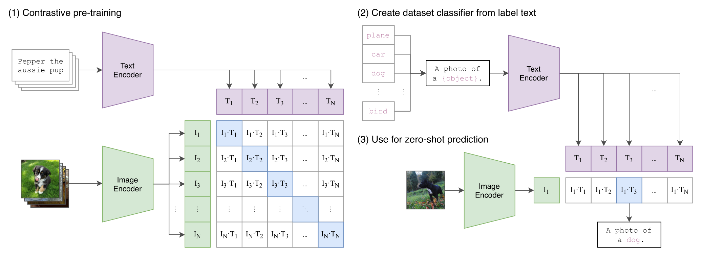

#### 对比学习方法 (Contrastive Learning)
- 采样一个超大 Batch 的图像-文本对（例如 $N = 32,768$）；
- 分别通过**图像编码器 (Vision Encoder)** 与**文本编码器 (Text Encoder)** 提取特征向量并做 $L_2$ 归一化；
- 构建 $N \times N$ 的余弦相似度矩阵；
- **双向对齐目标**：
  1. 对每一幅图像，将其在 Batch 内与真实配对文本的余弦相似度最大化（InfoNCE 损失）；
  2. 对每一段文本，将其与真实配对图像的余弦相似度最大化；
  3. 对角线上的 $N$ 个正样本对概率最大化，非对角线上的 $N(N-1)$ 个负样本对概率最小化。

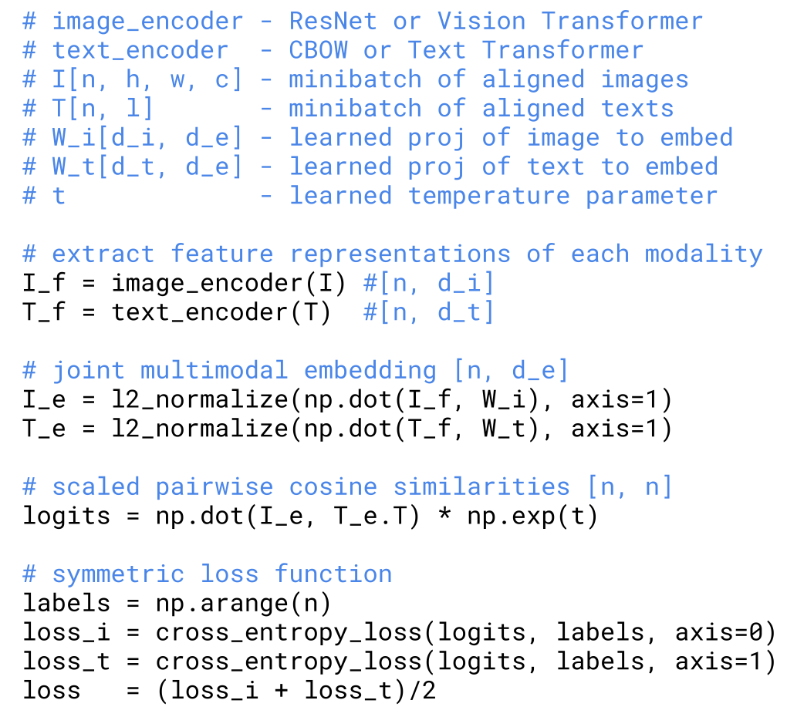

> 💡 **学习注释：CLIP 对比学习（InfoNCE）训练机制与“非对角线负样本最小化”的数学本质**：
> 
> ---
> 
> ### 1. 没有预定义分类词表，如何算交叉熵？（把 Batch 变成“$N$ 选 1 连连看单选题”）
> * **传统分类 vs 对比学习**：传统监督学习中，每个样本独立对应一个静态词表标签，样本间互不交互；而 CLIP 面对无固定类别标签的网络图文对，巧妙地**将同一个 Batch 内的其他 $N-1$ 个样本动态抓来充当当前样本的“错误干扰项（负样本）”**。
> * **构建 $N \times N$ 相似度矩阵与对角线标签**：
>   * 将 $N$ 张图与 $N$ 段文本编码并做 $L_2$ 归一化后，两两内积得到得分矩阵 $S_{i,j} = e^t (v_i \cdot u_j)$；
>   * **主对角线上的 $N$ 个元素 $(i=j)$** 是原本配对的**正样本**；**非对角线上的 $N(N-1)$ 个元素 $(i \neq j)$** 全是张冠李戴的**负样本**；
>   * **按行看（以图找文 $\text{I}\to\text{T}$）**：第 $i$ 行是一道 $N$ 选 1 单选题，正确类别下标永远是 `i`；**按列看（以文找图 $\text{T}\to\text{I}$）**：第 $j$ 列的正确类别下标永远是 `j`（对应伪代码中的 `labels = np.arange(n)`），行与列双向交叉熵取平均即得 CLIP 的对称 InfoNCE 损失。
> 
> ---
> 
> ### 2. 核心追问：交叉熵公式 $\mathcal{L}^{(i)} = -\log P_{i,i}$ 表面只写了正样本，“最小化 $N(N-1)$ 个非对角线负样本”体现在哪里？
> 所有的非对角线负样本都**藏在 Softmax 的分母里**，通过以下三重机制被强烈压制（最小化）：
> 1. **代数展开视角（拆开分母看本质）**：
>    将第 $i$ 行的分母拆分为“1 个对角线正样本 + 同行 $N-1$ 个非对角线负样本”并利用 $\log\frac{A}{B} = \log A - \log B$ 展开：
>    $$\mathcal{L}_{\text{I}\to\text{T}}^{(i)} = -\log \frac{\exp(S_{i,i})}{\exp(S_{i,i}) + \sum_{j \neq i} \exp(S_{i,j})} = \underbrace{- S_{i,i}}_{\text{第一项：推高正样本}} + \underbrace{\log \left( \exp(S_{i,i}) + \sum_{j \neq i} \exp(S_{i,j}) \right)}_{\text{第二项：压低同行 } N-1 \text{ 个非对角线负样本}}$$
>    要使损失 $\mathcal{L}^{(i)}$ 最小化，既要让第一项的对角线正样本得分 $S_{i,i}$ **最大化**，又必须让第二项对数里的 **$N-1$ 个非对角线负样本得分 $S_{i,j} \ (j \neq i)$ 最小化**！全矩阵共 $N$ 行，合起来正好把全部 $N(N-1)$ 个非对角线负样本全部最小化。
> 2. **概率守恒视角（分蛋糕零和博弈）**：
>    Softmax 将第 $i$ 行的概率总和锁死为 $P_{i,i} + \sum_{j \neq i} P_{i,j} = 1$。要求对角线正样本概率 $P_{i,i} \to 1$，在数学上等价于强行将同行所有非对角线负样本的概率之和挤压至 $\sum_{j \neq i} P_{i,j} \to 0$。
> 3. **微积分梯度视角（难负例自动挖掘）**：
>    反向传播对任意非对角线负样本 $S_{i,k} \ (k \neq i)$ 求偏导可得：
>    $$\frac{\partial \mathcal{L}^{(i)}}{\partial S_{i,k}} = +P_{i,k} > 0 \implies S_{i,k} \leftarrow S_{i,k} - \eta \cdot P_{i,k}$$
>    每个非对角线负样本都会受到正比于其当前混淆概率 $P_{i,k}$ 的向下惩罚梯度——而且越容易让模型混淆认错的“难负例（Hard Negative，当前 $P_{i,k}$ 大）”，受到的打压力度越猛烈！

#### 数据集与数据预处理
- **WIT-400M 数据集**：从全网抓取 4 亿个（图像, 文本）对（OpenAI 未公开发布，后被社区通过 [LAION-5B (Schuhmann et al., 2022)](https://arxiv.org/abs/2212.07143) 与 OpenCLIP 开源复现）；
- **图像预处理流程**：
  1. 真实网页图片分辨率各异（任意长宽比 $W \times H$）；
  2. 使用双三次插值 (Bicubic Interpolation) 将短边等比缩放至 336 像素；
  3. 中心裁剪 (Center Crop) 截取中间的 $336 \times 336$ 区域输入编码器。

#### 视觉与文本编码器架构
- **视觉编码器 (Vision Encoder)**：探索了 ResNet-50 与 [Vision Transformer (ViT, Dosovitskiy et al., 2020)](https://arxiv.org/pdf/2010.11929)；
  - 最终选用 **ViT-L/14@336px**（Large 规模，将图像切分为 $14 \times 14$ 的 Patch，支持 $336 \times 336$ 输入分辨率）；
  - 采用 Attention Pooling 替代简单的平均池化（以全局激活均值作为 Query 进行交叉注意力汇聚）。
- **文本编码器 (Text Encoder)**：63M 参数的 12 层 GPT-2 Transformer 解码器，以最高层的 `[EOS]` Token 特征作为整段文本的全局语义表示。

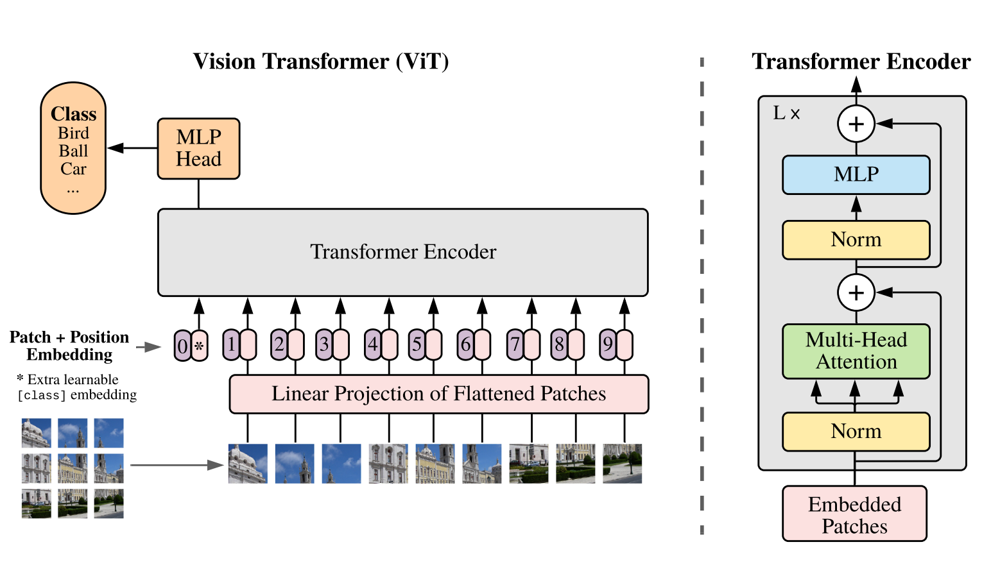

#### 标志性成果与算力效率
- **零样本分类突破**：在 ImageNet-1K 上，未经任何监督微调的 Zero-Shot CLIP 准确率直接超越了在 120 万标注图片上训练的经典有监督 ResNet-50；
- **对比学习 vs 生成式预测**：直接通过图像生成文本的自回归模型在计算效率上远逊于基于对比排序的 CLIP 目标，CLIP 在相同算力下学到了更稠密的语义特征！

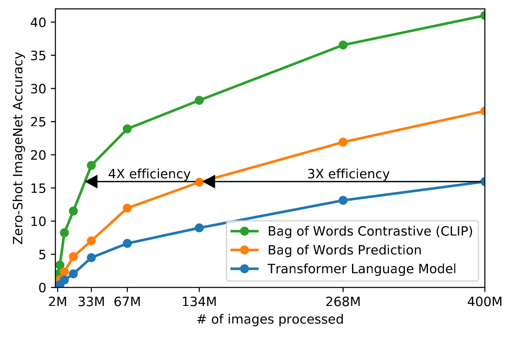

> 💡 **学习注释：Zero-Shot 零样本分类机制与“对比学习 vs 生成式预测”效率差异**：
> * **为什么叫“未经监督微调的 Zero-Shot CLIP”？（把封闭分类转化为图文匹配）**：
>   * **传统有监督 ResNet-50**：末端挂载写死的 1000 维线性分类头，必须在 ImageNet-1K 的 128 万张人工标注训练集图片上进行有监督训练/微调，一旦遇到新类别即刻失效；
>   * **Zero-Shot CLIP**：预训练从未见过 ImageNet 训练集，也没有分类头。测试时直接用 1000 个类别名套入模板 `"A photo of a {类别名}."` 喂入文本编码器，**现场合成 1000 个文本特征向量充当动态分类权重**，测试图片提取特征后与之做余弦相似度内积即可直接完成零样本分类（`0` 样本微调即超越有监督 ResNet-50）。
> * **为什么“生成式预测”训练视觉编码器的算力效率远逊于对比学习（慢 10 倍以上）？**
>   * **生成式预测（Image-to-Text 自回归交叉熵）**：输入图像特征，强迫文本解码器逐词（Token-by-Token）预测配对文本并计算交叉熵损失。由于网络野生配文充斥着大量与画面无关的噪声（如文件名 `DSC_0982`、拍摄日期、宠物昵称、网页广告词及语法虚词），逐词生成迫使模型耗费绝大部分算力去拟合无法从像素推断的文本噪声，反向传播回视觉编码器的有效梯度极度稀疏；
>   * **CLIP 对比学习**：无需逐字默写配文，只需提取图文双方唯一共有的**核心语义交集**即可在 Batch 连连看中胜出，天然过滤了文本表面噪声，使每一分算力都刀刀见血地用于雕刻高层视觉语义。

#### CLIP 的局限性
1. 依赖极大的 Batch Size（32K+），跨卡全局 Softmax 通信开销高昂；
2. 图像被粗暴中心裁剪缩放至 $336 \times 336$，丢失了细粒度高分辨率细节（如小文本 OCR 与小物体检测）；
3. 仅对齐了全局图像级语义，缺乏空间局部定位能力。

> 💡 **学习注释：视觉 Token 表征、预训练范式与“CLIP 语义瓶颈”深度解析**：
> 
> ---
> 
> ### 1. 核心困惑：视觉 Patch 无法枚举，输入端为什么不需要“视觉词表”？
> * **离散语言 vs 连续视觉的本质鸿沟**：
>   * 文本是离散符号，词表大小有限且可枚举（如 32k~150k），文本分词映射为离散整数 ID（Token ID）；
>   * 若将图片切为 $14 \times 14$ 像素块（包含 $14 \times 14 \times 3 = 588$ 个 RGB 浮点数），可能的颜色组合高达 $256^{588}$，在数学上根本无法构建有限离散词表。
> * **主流 VLM 的输入表征破局方案 —— 连续嵌入向量（Continuous Embeddings）**：
>   * 输入端**根本不经过离散词表查表**！
>   * 原始 Patch 像素向量 $x_{\text{patch}} \in \mathbb{R}^{588}$ 直接通过一个线性投影层映射为连续向量 $e_{\text{patch}} \in \mathbb{R}^{d_v}$；
>   * 连续几何空间 $\mathbb{R}^{d_v}$ 拥有近乎无限的容量，不存在“词表溢出”；视觉特征提取过程本质上是**信息瓶颈压缩（Information Bottleneck）**，过滤底层像素噪音，保留高层几何与语义。
> 
> ---
> 
> ### 2. 视觉编码器为什么不用“自回归预测下一个 Patch”？
> * 图像是**二维连续空间结构**，缺乏文本从左到右的因果时序因果链；若强行用因果掩码做 Next-patch 预测，既违反空间对称性，又会被极度稠密的高频纹理细节拖垮。
> * 因此主流视觉预训练只有两大成熟范式：
>   1. **图文对比学习（Contrastive Learning / CLIP）**：通过大规模图文余弦相似度拉近图文距离，天生赋予视觉特征以高维语言语义；
>   2. **掩码图像建模（Masked Autoencoding / MAE）**：随机盖住 75% 的 Patch，强迫 ViT 还原像素 MSE 误差，建立空间几何与轮廓敏感度。
> 
> ---
> 
> ### 3. 核心思辨：图文对文字过于简略，是否会导致视觉细节丢失（CLIP 语义瓶颈）？
> 这一直觉极其敏锐！这正是早期以 CLIP 为底座的 VLM（如初代 LLaVA）在工业界遭遇的最严重痛点 —— **CLIP 的语义坍缩（CLIP Information Collapse）**：
> * **成因**：网络图文对的文本非常简略（如 *“A cat on a sofa”*）。CLIP 的对比学习目标只在乎宏观概念是否对齐，模型在反向传播中会**主动过滤掉与图文匹配无关的局部微观细节**（如笔触、纹理、轻微瑕疵）。导致面对“找茬”或两幅相似画作对比时，CLIP 抽出的特征几乎完全重合，模型“视而不见”。
> * **工业界三大前沿破解对策**：
>   1. **多塔特征融合（CLIP + DINOv2 / MAE）**：同时引入未经语言弱化的密集自监督模型（如 DINO），拼接低层密集像素特征与高层语义特征；
>   2. **密集详细描述（Dense Captioning）**：用千字长文全面刻画图像所有局部微观细节，强迫表征保留细粒度特征；
>   3. **动态高分辨率切图（AnyRes / Dynamic High-Res）**：保留原生分辨率切片（详见后文 2.2 节）。

### 1.2 SigLIP (基于 Sigmoid 损失的图像-语言预训练, Google 2023)
[论文链接: SigLIP (Zhai et al., 2023)](https://arxiv.org/abs/2303.15343)

#### 核心算法革新：Sigmoid 二分类替代全局 Softmax
- **CLIP 的 Softmax 损失**：将一个 Batch 内的所有负样本作为多分类的分母归一化项，导致**损失函数与 Batch Size 深度绑定**，且多卡分布式训练必须进行高开销的 All-Gather 梯度同步通信；
- **SigLIP 的 Sigmoid 损失**：将对比学习重构为独立的**二分类交叉熵 (BCE)** 任务：
  - 对配对的 $(I_i, T_i)$ 正样本对：最大化 $\sigma(z_I \cdot z_T)$；
  - 对不配对的 $(I_i, T_j)$ 负样本对：最小化 $\sigma(z_I \cdot z_T)$。

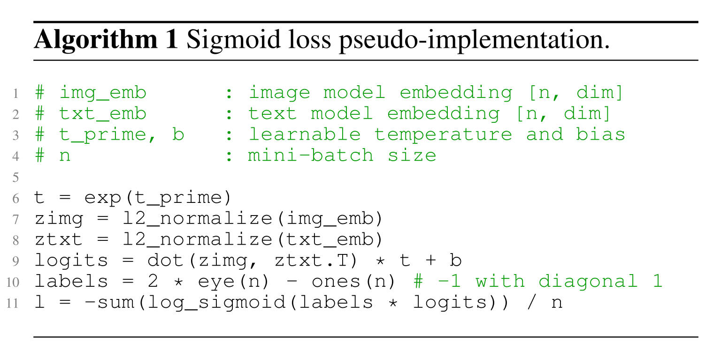

#### 数据集与惊人的计算效率
- **WebLI 数据集**：从全网抓取的 10 亿级图文对，利用自动化 OCR 提取图片文字，仅保留前 10% 极高质量对（支持 100 种多语言）；
- **极致的并行加速**：
  - CLIP：在 256 块 TPUv3 上训练 10 天；
  - SigLIP：在仅 32 块 TPUv4 上训练 5 天即可达到甚至超越 CLIP 的性能，显存占用与计算开销大幅下降！


#### 批次解耦特性
- 彻底解耦了 Batch Size 与损失函数计算，在较小 Batch Size（如 16K~32K）下依然能保持极高稳定性，已成为现代视觉语言模型（如 LLaVA OneVision、Qwen3-VL、Gemma-2-VL）事实上的主流视觉编码器底座。

> 💡 **学习注释：从 CLIP 到 SigLIP —— 为什么把“$N$ 选 1 单选题”改成“$N^2$ 道独立是非判断题”是一场工程革命？**：
> 
> ---
> 
> ### 1. CLIP 的致命痛点：被 Softmax 全局分母绑架的 Batch Size 与跨卡通信噩梦
> * **学习难度被 Batch Size 绑架**：在 CLIP 的 Softmax 分母 $\sum_{j=0}^{N-1} \exp(S_{i,j})$ 中，若 Batch Size $N$ 较小（如 $N=16$），从 16 个随机选项里挑出正确文本过于容易，模型无法学到深层细粒度语义；只有当 $N=32,768$ 时，批次内才混有足够多的相似难负例，迫使模型精雕细琢。
> * **分布式通信与显存灾难**：32,768 的超大 Batch 分布在数百张 GPU/TPU 上，但为了算出横跨整行/整列的全局归一化分母，每张卡在每步迭代时都必须将特征广播给所有其他卡（`All-Gather`），并在显存中硬生生拼出一个 $32768 \times 32768$（超 10 亿个浮点数）的巨型矩阵。
> 
> ---
> 
> ### 2. SigLIP 的核心破局：用独立 Sigmoid 二分类取代全局 Softmax
> * **从“单选题”变为“是非判断题”**：SigLIP 彻底抛弃了跨行/跨列的归一化竞争，直接对矩阵里的**每一个格子 $(i, j)$ 独立做一道“是否配对”的二分类是非判断题**：
>   * **定义标签 $y_{i,j}$**：主对角线正样本 $(i=j)$ 标签为 $y_{i,j} = +1$；非对角线负样本 $(i \neq j)$ 标签为 $y_{i,j} = -1$。
>   * **为什么 Sigmoid 函数的输入可以统一写成 $y_{i,j} \cdot z_{i,j}$？**
>     记单个格子的带偏置内积得分为 $z_{i,j} = t \cdot (v_i \cdot u_j) + b$，送入 Sigmoid 函数 $\sigma(x) = \frac{1}{1 + e^{-x}}$：
>     * **如果是正样本 ($y_{i,j} = +1$)**：我们希望模型判定“配对”的概率 $\sigma(z_{i,j})$ 趋近于 $1$（即 $z_{i,j}$ 越大越好）；
>     * **如果是负样本 ($y_{i,j} = -1$)**：我们希望模型判定“配对”的概率 $\sigma(z_{i,j})$ 趋近于 $0$。根据 Sigmoid 函数的中心对称性质 $1 - \sigma(z_{i,j}) = \sigma(-z_{i,j})$，这完全等价于**希望 $\sigma(-z_{i,j})$ 趋近于 $1$（即 $z_{i,j}$ 越小、越负越好）**！
>     * **正负样本的优雅统一**：将上述两种情况合并，无论正负样本，我们都希望 $\sigma(y_{i,j} \cdot z_{i,j}) \to 1$！对其取负对数 $-\log \sigma(y_{i,j} \cdot z_{i,j})$，即得统一的二分类 Logistic Loss：
>       $$\mathcal{L}_{\text{SigLIP}} = -\frac{1}{N} \sum_{i=0}^{N-1} \sum_{j=0}^{N-1} \log \frac{1}{1 + \exp\left(-y_{i,j} \cdot (t \cdot v_i \cdot u_j + b)\right)}$$
> * **三大工程与算法红利**：
>   1. **彻底消灭全局分母**：损失函数变成 $N^2$ 个完全独立的加和项，无需在单卡显存中构建完整的 $N \times N$ 巨型矩阵；多卡之间可通过环形传递（Ring-pass）每次只传一小块特征、算完立刻释放显存；
>   2. **与 Batch Size 彻底解耦**：每个图文对只与绝对阈值（可学习偏置 $b$）对比，Batch Size 的大小不再改变损失函数的物理意义，在中小批次下依然稳定收敛；
>   3. **可学习负偏置 $b$ 的冷启动保护**：由于矩阵中正负样本极度悬殊（$N$ 个正样本 vs $N(N-1)$ 个负样本），SigLIP 将偏置初始化为较大负数（如 $b = -10$），让模型在训练初期默认预测“所有图文均不配对”，避免初期海量负样本产生的巨大梯度将网络冲垮。

## 2. 视觉语言模型注入范式 (Injecting Visual Tokens into LLMs)

### 2.1 LLaVA (大型语言与视觉助手, 2023)
[论文链接: LLaVA (Liu et al., 2023)](https://arxiv.org/abs/2304.08485)

#### 核心架构模板
1. **视觉编码器**：冻结的 CLIP ViT-L/14；
2. **多模态投影层 (Projector)**：简单的单层线性投影矩阵 $W$（将视觉特征维度映射到大语言模型的词嵌入空间）；
3. **文本解码器**：Vicuna / LLaMA 底座大语言模型。

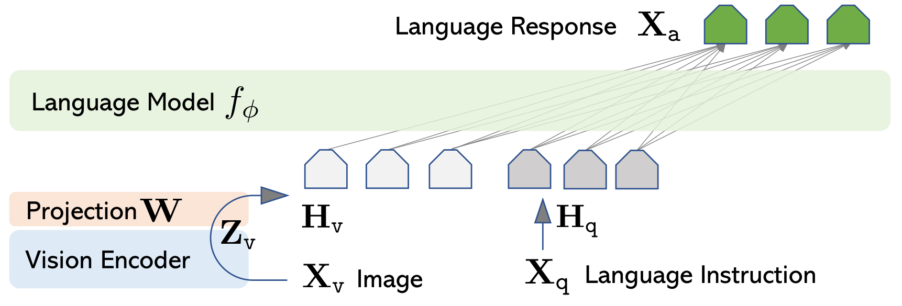

#### 基于 GPT-4 的多模态指令合成数据
- 利用 MS-COCO 图像已有的边界框 (Bounding Box) 与人工标注 Caption；
- 提示 GPT-4 仅凭结构化文本描述合成出 15.8 万条高质量多轮视觉问答、深度推理与对话数据；

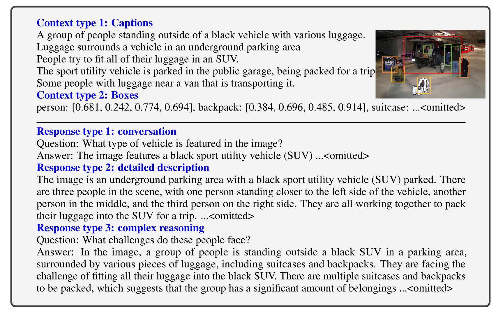

#### 两阶段极简训练策略
- **阶段 1（特征对齐 Pre-training）**：冻结视觉编码器和语言模型，仅训练线性映射层 $W$，使视觉 Token 投影到 LLM 词向量空间；
- **阶段 2（端到端指令微调 Visual SFT）**：保持视觉编码器冻结，同时微调投影层 $W$ 和大语言模型参数。


> 💡 **学习注释：模态对齐投影层（Projector）的工作原理与训练机理**：
> 
> ---
> 
> ### 1. 投影层（Projector）到底扮演了什么角色？
> * 视觉编码器（如 CLIP ViT）输出的特征维度为 $d_v$（例如 1024），而底座语言模型（如 LLaMA）的词嵌入空间维度为 $d_{\text{text}}$（例如 4096）；
> * 投影层 $W$（或双层 MLP）本质上是一个**跨模态坐标转换器（同声传译器）**：
>   $$H_v = W \cdot Z_v \in \mathbb{R}^{N \times d_{\text{text}}}$$
>   它将视觉特征从视觉几何空间平移、缩放、旋转投影到大语言模型的词嵌入空间中。
> 
> ---
> 
> ### 2. 为什么冻结两头只训投影层就能实现“语义对齐”？
> * **语言模型的“语义引力场”**：冻结的 LLM 在预训练时已经建立起了极其稳固的词嵌入语义流形（如“狗”与“草地”的词向量彼此相邻）；
> * **被迫对齐的传译器**：在阶段 1 特征对齐训练中，视觉编码器和 LLM 均被冻结，输入形如 `[Visual_Tokens, "一只在草地上奔跑的狗"]`，优化目标依然是 LLM 最擅长的**自回归 Next-token 交叉熵损失**；
> * **数学结果**：由于大模型不准动，**反向传播梯度全部且只能作用于投影层 $W$**，迫使投影层想方设法调整参数，把图像里提取出的特征“恰好翻译成”能够触发 LLM 正确预测后续文本 Token 的隐状态向量！


### 2.2 LLaVA OneVision (全能视觉与 AnyRes 动态分辨率, 2024)
[论文链接: LLaVA-OneVision (Li et al., 2024)](https://arxiv.org/pdf/2408.03326)

#### 核心升级点
- **编码器与底座**：采用 SigLIP 视觉编码器 + 2 层 MLP 投影层 + Qwen-2 72B 语言模型；
- **AnyRes 动态高分辨率切片技术**：
  - 痛点：传统 CLIP 将图片强制缩放至 $336 \times 336$ 会造成图表与 OCR 文本严重模糊；
  - 方案：根据原图宽高比，将图片动态切分为 $a \times b$ 个网格切片（每个切片独立以原生分辨率送入 SigLIP），同时保留一张全局缩略图，拼接后生成丰富的视觉 Token 序列。

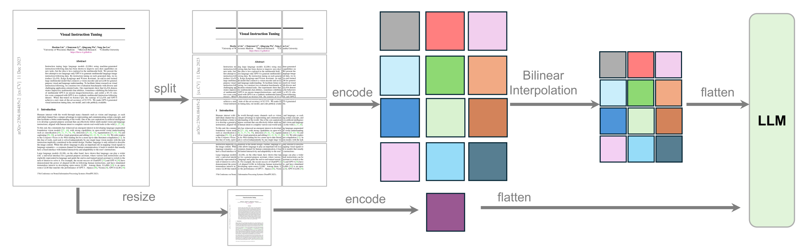

> 💡 **学习注释：AnyRes“网格切片（Sub-image Crop）”与 ViT“像素块（Patch Token）”的两级切分辨析**：
> * **核心防混点**：AnyRes 切出的 $a \times b$ 个“网格切片”**绝不是直接把每个网格当成 1 个 Patch Token**，而是**把每个网格切片当成一张完整的 $384 \times 384$ 标准子图**来独立编码！
> * **两级切分尺寸账本（以 $768 \times 768$ 高清图输入 SigLIP@384px 为例）**：
>   1. **第 1 级（宏观切子图 Tile/Crop）**：将原图切分为 $a \times b = 2 \times 2 = 4$ 张原生清晰度的 **$384 \times 384$ 局部子图**，同时将原图等比缩小保留 $1$ 张 **$384 \times 384$ 全局缩略图**，合计得到 $4 + 1 = 5$ 张标准尺寸子图；
>   2. **第 2 级（微观切 Patch Token）**：将这 $5$ 张 $384 \times 384$ 子图分别独立送入砍掉末端全局池化层的 SigLIP（内部按 $14 \times 14$ 像素切块），**每一张子图都会产出 $(384 / 14)^2 = 27 \times 27 = 729$ 个视觉 Patch Token**！最终拼接（或对局部子图池化降维后拼接）形成数千个高密度视觉 Token 送入 LLM。
> * **为什么有了高清局部子图，还要保留 1 张全局缩略图？**
>   因为每张局部子图是独立进 SigLIP 编码的，彼此看不见对方，跨网格边界的物体或表格线会被生生切断；**全局缩略图充当“全景地图”**（提供整体构图与跨格方位感），**$a \times b$ 张局部子图充当“高倍放大镜”**（提供无损微观细节与 OCR 文字），两者结合实现宏观与微观兼备。

#### 统一单图、多图与视频输入 (Single Image, Multi-Image, Video)
- **单图像**：采用 AnyRes 获得高密度高分辨率 Token（注：**AnyRes** 即 **Any Resolution** 的缩写，指代前文将任意长宽比原图动态切分为 $a \times b$ 个网格子图并外加 1 张全局缩略图的做法）；
- **多图对比**：每张图采用基础分辨率切片，控制整体上下文长度；
- **视频序列**：按固定帧率抽帧，每帧采用低分辨率编码，实现模态长度的动态均衡。

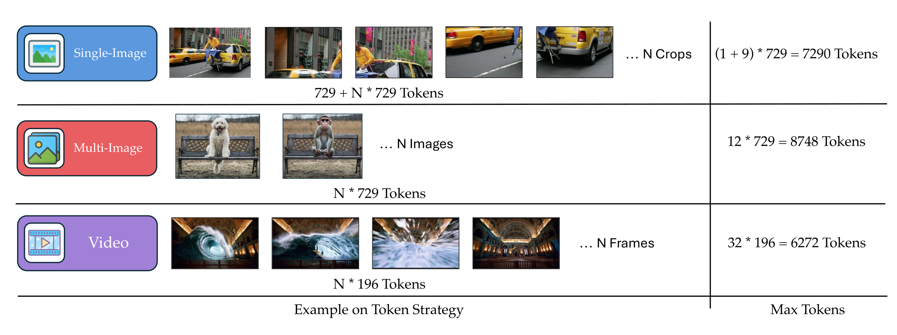

#### 跨模态知识迁移 (Modality Transfer)
- 在单图上学习的图表分析能力可平滑泛化到多图对比；
- 在单图 OCR 与多图关联上训练的模型，能零样本迁移至复杂的操作系统 GUI Agent 交互定位任务中！

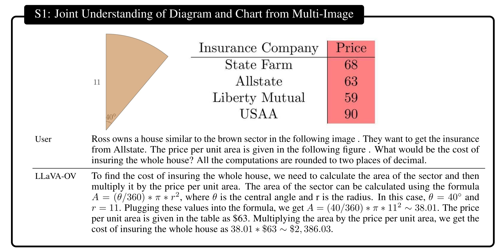
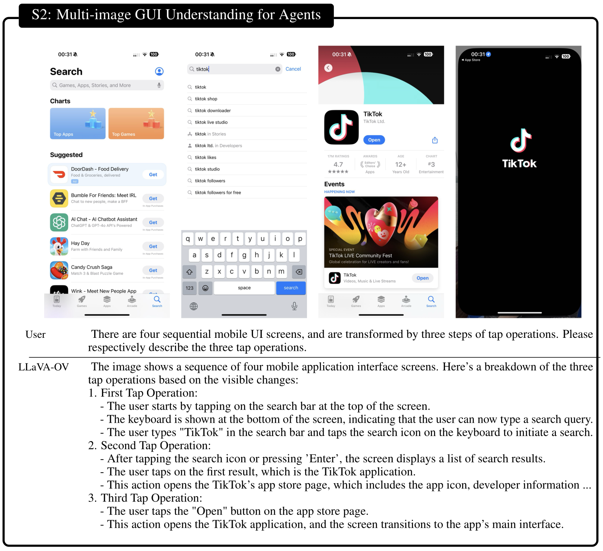

### 2.3 Qwen-VL 系列演进 (Qwen-VL $\rightarrow$ Qwen2-VL $\rightarrow$ Qwen3-VL)

#### 1. 初代 Qwen-VL (2023)
[论文链接: Qwen-VL (Bai et al., 2023)](https://arxiv.org/abs/2308.12966)
- **视觉编码器**：OpenCLIP ViT-bigC ($14 \times 14$ Patch)；
- **Cross-Attention 压缩适配器**：引入一层交叉注意力层结合 2D 绝对位置编码，将任意分辨率图片固定压缩为 256 个视觉 Token；
- **三阶段递进训练**：
  1. 阶段 1：海量弱标注数据预训练（冻结 LLM，训练视觉编码器与适配器）；
  2. 阶段 2：高质量多任务多分辨率训练（放开全量参数更新）；
  3. 阶段 3：多模态对话与指令对齐（冻结视觉编码器，微调适配器与 LLM）。

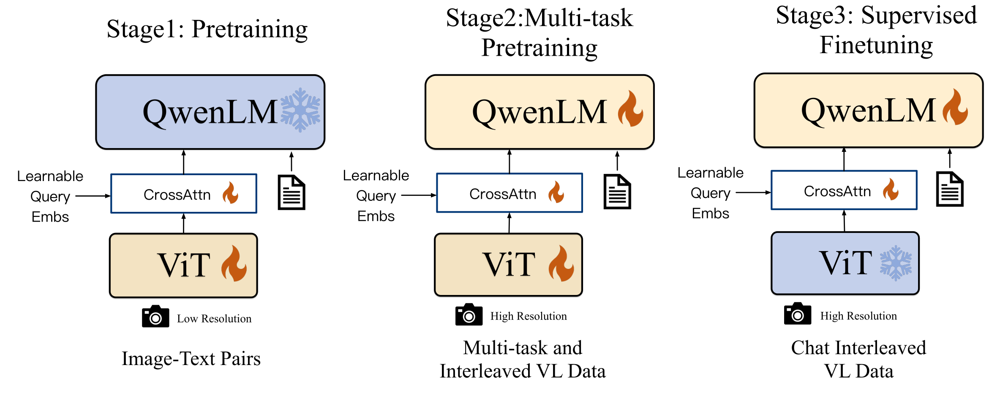

> 💡 **学习注释：初代 Qwen-VL 的 Cross-Attention 压缩机制与矩阵/向量展开解析**：
> 
> ---
> 
> ### 1. 为什么一层交叉注意力能把任意 $N$ 个图像块（如 $1024$ 个）固定压缩成 $256$ 个 Token？
> * **线性投影的局限**：LLaVA 的线性层 $W$ 只能改变特征维度（$[1024, d_v] \to [1024, d_{\text{text}}]$），无法缩减 Token 数量 $1024$。
> * **注意力输出长度铁律**：注意力的输出序列长度永远**只由 Query ($Q$) 的数量决定**，与被查询的 Key/Value ($K, V$) 长度无关。初代 Qwen-VL 预设了 **$256$ 个可学习的查询探针向量** $Q_{\text{learn}} \in \mathbb{R}^{256 \times d}$，去查询图像的 $1024$ 个 Patch（$K, V \in \mathbb{R}^{1024 \times d}$）：
>   $$\underbrace{Q_{\text{learn}}}_{[256 \times d]} \times \underbrace{K^T}_{[d \times 1024]} \xrightarrow{\text{Softmax}} \underbrace{A}_{[256 \times 1024]} \xrightarrow{\times \underbrace{V}_{[1024 \times d]}} \underbrace{\text{Output}}_{[256 \times d]}$$
>   中间代表原图 Patch 数量的内维 $1024$（或任意分辨率下的 $N$）在矩阵乘法中直接被消去，输出永远固定为 $256$ 个视觉 Token！
> 
> ---
> 
> ### 2. 核心拆解：$A \ ([256 \times 1024]) \times V \ ([1024 \times d])$ 的矩阵/向量内部展开
> 如果只有 1 套长度为 $1024$ 的注意力权值，对 $1024$ 个图像向量 $v_i \in \mathbb{R}^{1 \times d}$ 加权求和 $\sum_{i=1}^{1024} a_i v_i$ 后只会得到 **1 个**输出向量。为了得到 **$256$ 个**不同的输出视觉向量 $\text{out}_k \ (k=1,\dots,256)$，矩阵 $A$ 提供了 **$256$ 行独立的注意力权重方案**，每一行都满足：
> $$\text{out}_k = \sum_{i=1}^{1024} a_{k, i} \cdot v_i \quad (k = 1, 2, \dots, 256)$$
> 将矩阵乘法按内部元素与行向量完全展开，形式如下：
> $$\underbrace{\begin{bmatrix} \text{out}_1 \\ \text{out}_2 \\ \vdots \\ \text{out}_{256} \end{bmatrix}}_{\text{浓缩输出的 256 个视觉 Token } [256 \times d]} = \underbrace{\begin{bmatrix} a_{1,1} & a_{1,2} & \cdots & a_{1,1024} \\ a_{2,1} & a_{2,2} & \cdots & a_{2,1024} \\ \vdots & \vdots & \ddots & \vdots \\ a_{256,1} & a_{256,2} & \cdots & a_{256,1024} \end{bmatrix}}_{\text{注意力权重矩阵 } A \ [256 \times 1024]\text{（256 套加权配方）}} \times \underbrace{\begin{bmatrix} v_1 \\ v_2 \\ \vdots \\ v_{1024} \end{bmatrix}}_{\text{原图 Patch 向量 } V \ [1024 \times d]}$$
> * **列维度 $1024$ 的含义**：代表原图切出的 $1024$ 个原始图像块特征向量 $v_1 \sim v_{1024}$（原材料）；
> * **行维度 $256$ 的含义**：代表由 $256$ 个查询探针决定的 **$256$ 套独立加权方案**（比如第 1 行重点给左上角 Patch 赋高权重以合成 $\text{out}_1$，第 2 行重点给物体中心赋高权重以合成 $\text{out}_2$），$256$ 行并行加权即浓缩出 $256$ 个输出 Token。
> * **为什么要结合 2D 绝对位置编码？**
>   为了防止在 $\sum_{i=1}^{1024} a_{k,i} v_i$ 加权汇聚时丢失原图的二维空间方位感，Qwen-VL 将 $256$ 个 Query 排成 $16 \times 16$ 网格、将 $1024$ 个 Key 排成 $32 \times 32$ 网格，在计算注意力前双双注入 $(x, y)$ 2D 绝对位置编码，确保每个探针精准对齐原图对应的二维空间区域。

---

#### 2. Qwen2-VL: 动态原生分辨率与多模态旋转位置编码 (MRoPE, 2024)
[论文链接: Qwen2-VL (Wang et al., 2024)](https://arxiv.org/abs/2409.12191)

- **原生动态分辨率 (Naive Dynamic Resolution)**：视觉 ViT 直接处理任意长宽比的 Patch 序列，相邻 $2 \times 2$ 的视觉 Token 经 2D 卷积压缩合并为单个 Token，彻底消除几何形变与长宽比失真；
- **多模态旋转位置编码 (Multimodal RoPE / MRoPE)**：
  - 核心突破：将传统 1D 文本位置编码分解为三维独立坐标向量：**时间维度 $t$、垂直高度维度 $h$、水平宽度维度 $w$**；
  - 使得模型能够对长视频时间轴、图像空间拓扑结构与交错文本进行统一的空间几何建模！


> 💡 **学习注释：Qwen2-VL“原生动态分辨率”、$2 \times 2$ 合并机制与 MRoPE 三维位置编码深度剖析**：
> 
> ---
> 
> ### 1. 什么是“直接处理任意长宽比的 Patch 序列”？它靠什么打破了传统 ViT 的分辨率枷锁？
> * **概念澄清**：单个最小图像块（Patch）依然是固定的 **$14 \times 14$ 正方形**（以适配第一层固定输入维度的线性映射矩阵），真正随原图动态变化的是由这些正方形排成的**二维网格行列数 $(H_{\text{grid}} \times W_{\text{grid}})$**（如横图切 $20 \times 40$、竖长图切 $60 \times 20$，既不压扁原图，也不像 AnyRes 那样剪碎成多张子图）。
> * **打破枷锁的核心手术（用 2D RoPE 替换固定位置编码表）**：
>   * Transformer 的自注意力机制天然支持任意长度序列，传统 CLIP ViT 之所以被锁死在 $336 \times 336$，罪魁祸首是其**写死长度的 1D 绝对位置编码表**（如固定 $24 \times 24 = 576$ 个坑位，一旦改变长宽比或分辨率就会越界且导致二维上下左右关系错位）；
>   * Qwen2-VL 彻底砍掉了固定位置表，在 ViT 内部改用 **2D RoPE（二维旋转位置编码）**，直接将每个 Patch 的真实二维网格坐标 $(h, w)$ 代入三角函数计算旋转角，从而在数学上天然支持任意行列数的图像网格！
> 
> ---
> 
> ### 2. 核心追问：既然在 ViT 出口要把相邻 $2 \times 2$ 的 $14 \times 14$ Patch 合并为 1 个 Token（覆盖 $28 \times 28$ 像素），为什么不在一开始就直接把 $28 \times 28$ 作为 1 个 Patch 输入 ViT？
> 1. **最关键本质：“经 32 层提炼高层语义后再浓缩” vs “第 0 层直接线性拍扁丢失细节”**：
>    * **若一开始直接按 $28 \times 28$ 切块**：ViT 的第 0 层只是一个没有任何非线性激活与空间交互的单层线性矩阵乘法。$28 \times 28$ 像素足以装下一整颗复杂汉字，若在第 0 层就直接被线性拍扁成一个向量，汉字内部的横竖撇捺、笔画空隙等高频几何细节在进入 Transformer 前就已经糊成一团、不可逆地丢失了；
>    * **先按 $14 \times 14$ 进 ViT，出口再做 $2 \times 2$ 合并**：一颗汉字被切为左上、右上、左下、右下 4 个 $14 \times 14$ 小块，**它们在 ViT 内部的 32 层非线性变换中互相交互、精细比对笔画走势，等走到 ViT 最后一层出口时，这 4 个向量里装的早就不是原始像素了，而是已经“认出这个字是什么”的高层语义特征**！此时再把这 4 个高层语义向量合并浓缩为 1 个 Token 送给 LLM，细节语义早已稳稳保留，几乎不损精度。
> 2. **算力不对称性的黄金权衡（小眼睛便宜、大脑袋昂贵）**：
>    * 视觉编码器 ViT 非常轻量（约 0.6B 参数），而底座 LLM 极其庞大（7B~72B 参数，且每个视觉 Token 在生成回答时都要常驻 KV Cache 显存）；
>    * 让便宜的 0.6B ViT 老老实实跑 $14 \times 14$ 细粒度序列把细节吃透，在迈进昂贵的 72B LLM 大门前最后一刻做 $2 \times 2 \to 1$ 合并，瞬间**砍掉大模型 $75\%$ 的视觉序列长度与 KV Cache 显存开销**，同时还能直接无损复用开源社区耗费巨资按 $14 \times 14$ 预训练好的顶尖 ViT 权重。
> 
> ---
> 
> ### 3. 多模态旋转位置编码 (MRoPE) 的三维坐标 $(t, h, w)$ 核心解析
> * **核心定位澄清（防误导）**：设计 $(t, h, w)$ 三维位置编码的核心意义，**主要是针对视频各帧（及单张图像）的各个视觉 Patch 进行时间轴与二维画面空间的位置编码**！课件原文所谓的“交错文本”仅指同一条输入序列中与视频/图像前后拼接的普通用户提示词（Prompt），并非指专门针对视频画面内的字幕做 OCR。
> * **为什么需要高度 $h$ 与宽度 $w$ 两个维度？**
>   若沿用传统 LLM 的 1D 递增编号（将二维图像网格按行展平为 `1, 2, 3...`），画面中**上下紧挨着**的两个 Patch 在一维序列中会被整整隔开一行（编号差随图片宽度 $W$ 剧烈膨胀），而上一行最右边缘与下一行最左边缘反而成了编号紧挨的“假邻居”，彻底撕裂了二维空间拓扑。
> * **三维坐标 $(t, h, w)$ 的精炼编号与实现规则**（将特征向量维度切分为三段，分别按 $t, h, w$ 角度旋转）：
>   * **视频帧 / 图像的视觉 Token**：$t$ 记录**属于第几帧**（单张静态图或同一视频帧内的所有 Patch 共享同一个 $t$；视频进入下一帧时 $t+1$），$h$ 与 $w$ 记录该 Patch 在二维画面网格中的**第几行**与**第几列**（从而使前后两帧处于屏幕同一位置的 Patch 拥有完全相同的 $(h, w)$ 且仅 $\Delta t = 1$，运动轨迹一目了然）；
>   * **前后穿插的纯文本 Token**：文本无长宽之分，直接令三个坐标取相同的一维递增序号 $(p, p, p)$，在数学上完全等价退化为标准 1D 文本 RoPE。

---

#### 3. Qwen3-VL: 原生全模态与长思维链 (2025/2026)
[论文链接: Qwen3-VL (Alibaba, 2025)](https://arxiv.org/abs/2511.21631)

- **底座规模与长上下文**：支持高达 235B-A22B 的 MoE 稀疏架构，原生支持 256K 超长多模态上下文；
- **视觉编码器与交错 MRoPE (Interleaved MRoPE)**：
  - 采用 SigLIP-2，将多维位置编码按 $[t, w, h, t, w, h]$ 交错分配至高频与低频旋转带；
  - 引入显式视频时间戳 Token（Timestamp Tokens）；
- **跨层特征融合适配器 (DeepStack)**：将视觉编码器不同层级的浅层几何特征与深层语义特征直接跨层注入到大语言模型的多层 Transformer 中；
- **平方根归一化 Token 损失 (Square-root Normalized Loss)**：平衡视频长 Token 与文本短 Token 的梯度贡献，极大提升预训练数值稳定性；
- **长思维链视觉强化学习 (Vision CoT & RLVR)**：在复杂图表几何推导与高难度视觉问答上展现出极高的逻辑推理能力。

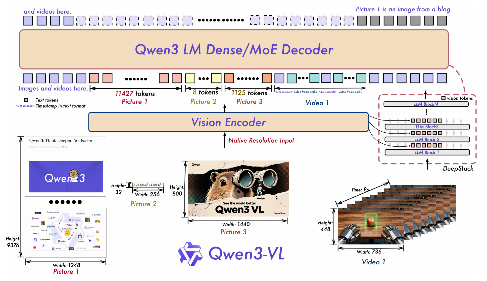
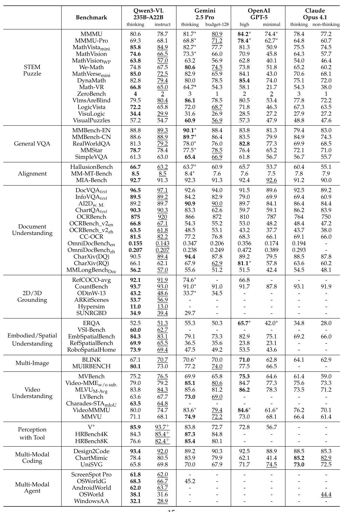

> 💡 **核心解析：Qwen3-VL 四大架构与训练机制升级拆解**
> 
> ### 1. 交错 MRoPE (Interleaved MRoPE)：为什么将 $[t, w, h]$ 像发扑克牌一样交错排列？
> * **RoPE 的“钟表频率效应”**：在特征向量的旋转维度中，排在前面的维度旋转极快（**高频区/秒针**，对近距离微距变化极其敏感，但长距离易转晕周期混叠），排在后面的维度旋转极慢（**低频区/时针**，专门感知数万 Token 跨度的超长距离关系）。
> * **从“分块切分”到“交错发牌”的演进图示**：
>   ```text
>   特征向量的旋转频率分布：
>   [ 高频区 (秒针：看近处微距)  ────────►  中频区 (分针)  ────────►  低频区 (时针：看万米远景) ]
> 
>   ❌ Qwen2-VL 的“分块式 MRoPE”：直接一刀切成三大块
>   [ t, t, t, t, t, t, t, t  |  h, h, h, h, h, h, h, h  |  w, w, w, w, w, w, w, w ]
>     ▲ 痛点：时间 t 全挤在高频区！     ▲ 高度 h 全在中频区！       ▲ 宽度 w 全挤在低频区！
>     （t 只有秒针没有时针，看超长视频时时间轴直接转晕迷路！而宽度 w 只有时针没有秒针，看近处细节变迟钝！）
> 
>   ✅ Qwen3-VL 的“交错式 MRoPE (Interleaved)”：像发扑克牌一样轮流发牌！
>   [ t, w, h,  t, w, h,  t, w, h,  ...  t, w, h,  ...  t, w, h,  t, w, h ]
>     └─高频─┘                           └─中频─┘              └─低频─┘
>     ▲ 完美解决：t、w、h 三个维度各自都均匀拥有了“高频秒针 + 中频分针 + 低频时针”！
>   ```
> * **显式视频时间戳 Token**：由于动态帧率采样或抽帧会导致帧序号 $t$ 与真实物理秒数脱节，Qwen3-VL 在每帧视觉 Token 前直接插入纯文本时间戳（如 `<00:01:23.5>`），让模型无需换算即可直接读出精确到毫秒的物理时间。
> 
> ### 2. 跨层特征融合适配器 (DeepStack)：不增加序列长度的“浅层细节分层注入”
> * **传统做法的局限**：过去（如 LLaVA / Qwen2-VL）只取 ViT **最后一层**的视觉 Token 投影到 LLM 的第 0 层（输入层）。但 ViT 最后一层高度抽象化，虽懂高层语义，却已在逐层池化与变换中丢失了早期的边缘线条、精确坐标与微距纹理。
> * **DeepStack 的破局机制**：在保留最后一层特征之余，把 ViT **浅层（含精细几何笔画）与中层**的视觉 Token 也提取出来并分别经过独立 Projector 投影；但为了**不增加 LLM 的输入序列长度**，它不是将这些浅层 Token 拼接在序列末尾，而是**按层对位相加（残差注入）到 LLM 的前几层 Transformer 对应的视觉 Token 位置上**（如 ViT 浅层特征注入 LLM 第 1 层、中层特征注入 LLM 第 2 层），实现了**“零额外序列长度开销、全保真还原底层视觉几何细节”**。
> 
> ### 3. 平方根归一化 Token 损失 ($\frac{1}{\sqrt{L_i}}$)：与 Lecture 15/16 长度归一化的跨章节对比
> * **核心问题**：多模态混合训练的同一个 Batch 内，不同任务的标准答案长度 $L_i$ 方差极大（如 GUI 坐标点击/看图单选仅 $L_1=4$ 个 Token，而整页报纸 OCR/长视频详述高达 $L_2=1600$ 个 Token）。
> * **为什么不效仿 Lecture 16 中 Dr. GRPO 的做法（对整个 Batch 除以全 Batch 总词数 $\sum_{k=1}^B L_k$）？**
>   * **数学本质**：对于同一个 Batch 内的所有样本，全 Batch 总词数 $N_{\text{batch}} = \sum_{k=1}^B L_k$ 是一个**完全相同的公共常数分母**。因此在单个 Batch 内部，除以 $N_{\text{batch}}$ 完全等价于**“不除以单样本自身长度 $L_i$（每个 Token 权重绝对相等）”**，样本 $i$ 与样本 $j$ 的总梯度话语权之比依然是 $L_i : L_j$。
>   * **场景根本差异（同题防作弊 vs 异构防霸凌）**：
>     1. **Dr. GRPO（强化学习，同题生成）**：针对同一道题采样多个回答，长度 $L_i$ 是**模型自己控制的生成动作**。若除以 $L_i$（或 $\sqrt{L_i}$），模型做错时（$A_i < 0$）会故意把废话写长来稀释单字惩罚；因此必须除以全局常数 $N_{\text{batch}}$（单样本权重 $\propto L_i$），让废话写得越长的错误回答累加挨罚越重，遏制水字数作弊。
>     2. **Qwen3-VL（多模态 SFT/预训练，异构任务混训）**：标准答案长度 $L_i$ 是**数据集预先定死的客观标签**（模型无法靠水字数改变 $L_i$）。若照搬 Dr. GRPO 除以全 Batch 总词数（$1600 + 4 = 1604$），则一条 $1600$ 字的流水账抄写样本将独吞全 Batch **$\frac{1600}{1604} = 99.75\%$** 的梯度，而极高难度但答案仅 $4$ 个词的 GUI 点击/看图推理题只分到 **$0.25\%$** 的梯度，直接沦为“梯度陪跑”！
> * **三种长度归一化方案的全景对比**：
> 
>   | 归一化方案 | 单样本损失形式 | 单 Token 梯度权重 | 单样本总梯度贡献 ($\text{单字权重} \times L_i$) | 极端长度差（$L_{\text{长}}=1600$ vs $L_{\text{短}}=4$）下的表现与适用场景 |
>   | :--- | :---: | :---: | :---: | :--- |
>   | **全局 Token 归一化**<br>*(Lecture 16: Dr. GRPO)* | $\frac{1}{\sum_k L_k}\sum_{t=1}^{L_i} \ell_{i,t}$ | $\propto 1$ | **$\propto L_i$** | **长样本总梯度是短样本的 $400$ 倍**。适用于 RL 同题采样防模型水字数作弊；但在多模态异构混训中会导致长任务彻底霸凌淹没短任务。 |
>   | **样本级均值归一化**<br>*(传统 SFT / Lecture 15: SimPO)* | $\frac{1}{L_i}\sum_{t=1}^{L_i} \ell_{i,t}$ | $\propto \frac{1}{L_i}$ | **$\propto 1$** | **长短样本总梯度强制 $1:1$ 平起平坐**。但导致 $1600$ 字长推导中每个字的梯度被稀释 $400$ 倍，模型在长思维链与长文档任务上严重欠拟合。 |
>   | **平方根归一化损失**<br>*(Lecture 17: Qwen3-VL)* | $\frac{1}{\sqrt{L_i}}\sum_{t=1}^{L_i} \ell_{i,t}$ | $\propto \frac{1}{\sqrt{L_i}}$ | **$\propto \sqrt{L_i}$** | **长样本总梯度是短样本的 $\sqrt{\frac{1600}{4}} = 20$ 倍**（单字梯度也仅温和衰减 $20$ 倍），在“防止长样本独霸梯度”与“防止长样本单字梯度过度稀释”之间取得黄金平衡！ |
> 
> ### 4. 长思维链视觉强化学习 (Vision CoT & RLVR)
> * **核心形态**：思维链本身依然是**纯文本 Token（`<think> ... </think>`）**。它本质上是将 DeepSeek-R1 的“长文本思维链 + 可验证奖励强化学习（RLVR，如几何算术标准答案比对、GUI 点击坐标命中判定）”扩展到了高难度视觉推理任务上。
> * **跨模态独特威力（用文字思考指挥“视觉注意力重聚焦”）**：
>   1. **视线回扫与局部核对**：当模型在 `<think>` 中生成*“让我再仔细核对一下图片右上角的图例颜色与纵轴刻度……”*等文本 Token 时，自注意力机制会驱动这些文本 Token 的 Query **重新对图像右上角对应的视觉 Patch Token 进行高权重检索**，实现类似人类“边打草稿边回头重看图片细节”的自我纠错；
>   2. **交错式视觉动作（Thinking with Images）**：面对超大图中的微小文字，模型还可在 `<think>` 过程中调用图像裁剪放大工具（`crop`），将局部高清子图重新编码插入上下文后再继续推理。

---

## 3. 原生全离散生成模型 (Towards Omni Models: Chameleon)
[论文链接: Chameleon (Meta, 2024)](https://arxiv.org/pdf/2405.09818)

### 离散 Token 化与统一自回归生成
- **现有 VLM 的固有缺陷**：只能“看”（理解图像），不能“画”（生成图像通常需要外挂独立的 Diffusion 扩散模型，系统割裂）；
- **Chameleon 的核心哲学**：将文本与图像**全部映射为离散的离散 Token 字典**，在同一个 Transformer 内进行统一的自回归下一个 Token 预测！

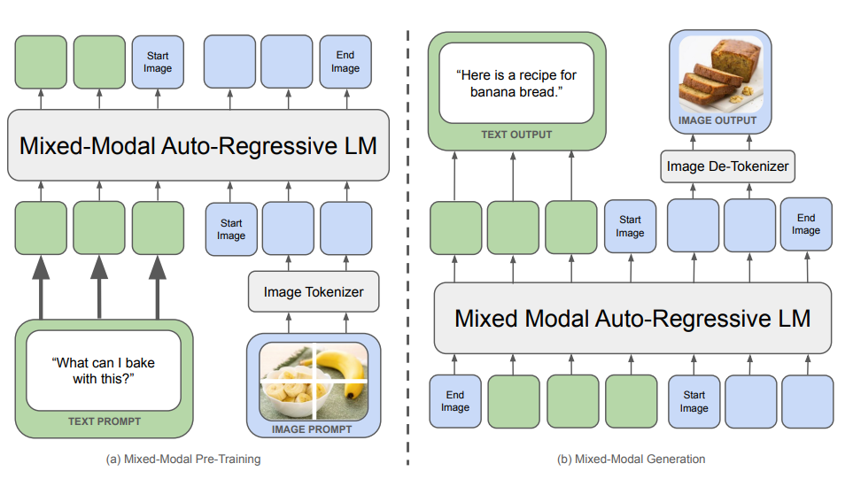
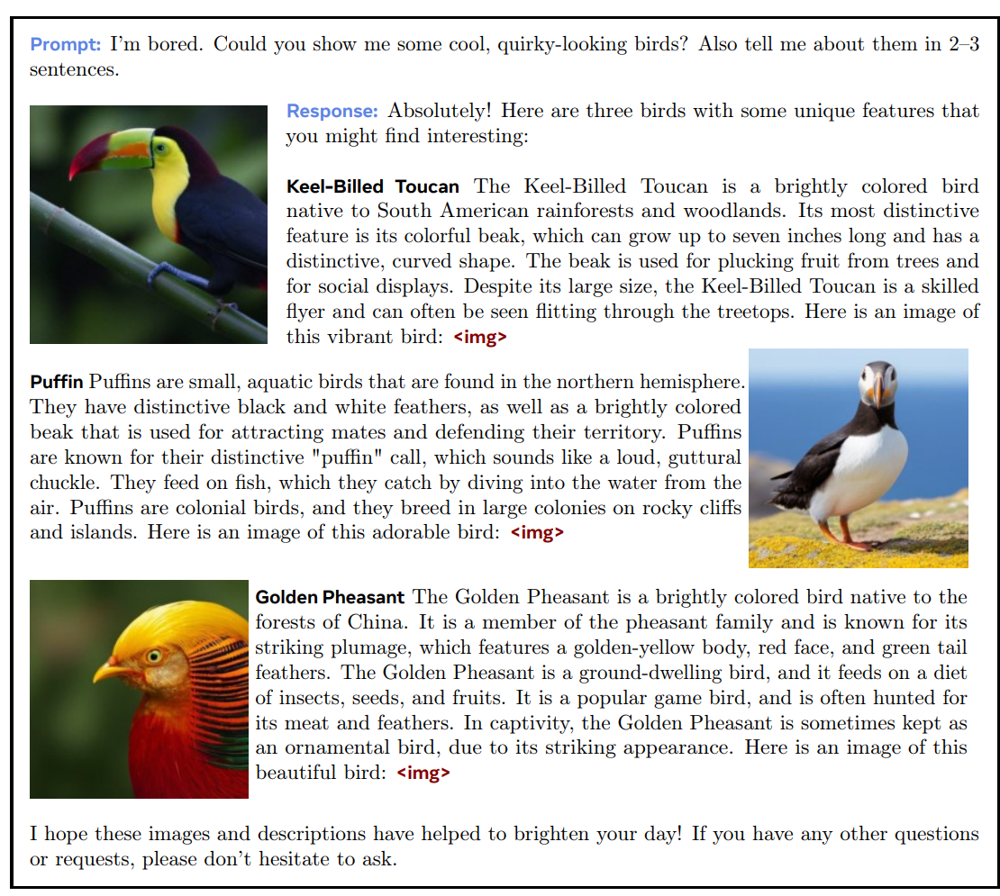

### VQ-VAE 离散图像量化
- **矢量量化自编码器 (VQ-VAE)**：
  - 训练一个包含 8192 个码本向量 (Codebook) 的离散量化自编码器；
  - 将 $512 \times 512$ 分辨率的连续图像压缩编码为 $1024$ 个离散 Token；
  - 解码器可直接将离散 Token 序列高质量还原为连续 RGB 图像。


### 混合模态训练的稳定性挑战
- **Logit 漂移与范数爆炸 (Logit Drift & Norm Growth)**：
  - 文本 Token 的信息熵较低，而图像离散 Token 的信息熵极高；
  - 模态交叉训练极易引发自注意力层的 Query-Key 范数发散与数值溢出；
- **稳定性解决方案**：引入 **QK-Norm（Query/Key 归一化）** 与 **z-loss 正则化**，保证长序列超大 Batch 训练平稳收敛。

### 总结与未来展望
- **优雅性**：统一了图像理解与生成的自回归范式；
- **代价与权衡**：离散化 Token 必然伴随细粒度局部信息的丢失（在精细 OCR 上稍逊于连续嵌入的 VLM）；
- **行业主流趋势**：连续特征编码器 (SigLIP/ViT) + 大语言模型 (LLM) + 扩散解码头 (Diffusion Head) 构成了目前性能最强悍的工业级 Omni 模型架构。

> 💡 **学习注释：VQ-VAE 离散化自回归画图原理、结构性代价与扩散模型（Diffusion）路线深度对比**：
> 
> ---
> 
> ### 1. 核心破局：既然原始像素无法被枚举（$256^{588}$ 种组合），Chameleon 是如何用仅 $8192$ 个离散 Token 自回归生成图像与视频的？
> 开篇我们曾算过：单个微小的像素块在原始 RGB 空间有无穷种排列组合，绝不可能直接枚举进有限词表。Chameleon 的破局之道在于独立预训练的 **VQ-VAE（矢量量化自编码器）**，其核心思想是**“强行四舍五入（矢量量化） + 神经网络脑补磨皮”**：
> 
> * **第一步：VQ-VAE 编码与“查表四舍五入”（把高清图压缩成 $1024$ 个积木编号）**：
>   ```text
>   原始图片 (512×512) 
>     ──► 1. 切分为 32×32 = 1024 个局部小区域（每个区域对应 16×16 像素）
>     ──► 2. CNN 编码器提取出 1024 个“连续特征向量” z_e（此时仍有无穷种可能）
>     ──► 3. 【核心魔法：矢量量化 Vector Quantization（查表四舍五入）】
>            维护一本仅有 8192 个标准向量的“码本字典 (Codebook)” e_1 ~ e_8192（相当于 8192 种标准局部笔触/纹理积木）。
>            为每个 z_e 在码本中寻找欧氏距离最近的标准向量 e_k，直接将其替换为整数编号 k ∈ [0, 8191]！
>   ```
>   * **为什么 $8192$ 个编号就够用？** ① 过滤掉了肉眼无感的像素级微小冗余（如天空中相差 1 个色阶的蓝像素被归并为同一个码本编号）；② 码本存的不是死板的像素，而是高复用率的**局部视觉基元**（如左斜边缘、蓝天渐变、绒毛纹理）；③ VQ-VAE 尾部的**深度卷积解码器（Decoder）**拿到 $32 \times 32 = 1024$ 个标准积木向量后，会纵观全局上下文**自动柔化积木接缝、脑补出平滑逼真的连续光影**。
> * **第二步：同一个 Transformer 如何“自回归画画与生成视频”？**
>   1. **图文共享统一词表**：将 $8,192$ 个图像积木编号直接追加在 $57,344$ 个文本 BPE 词表之后（总词表 $65,536$），外加 `<boi>`（开始画图）与 `<eoi>`（结束画图）控制符；
>   2. **光栅扫描顺序（Raster-scan）逐块吐出**：当模型需要画图时，先吐出 `<boi>`，随后像老式显像管电视一样**从第 1 行左到右、再到第 2 行左到右**，连续自回归预测 **$1024$ 次**（每次用 Softmax 在词表中选出下一个积木编号），最后吐出 `<eoi>`；系统将这 $1024$ 个编号排回 $32 \times 32$ 网格交由 VQ-VAE 解码器，瞬间渲染出 $512 \times 512$ 连续 RGB 图像！
>   3. **视频自回归生成**：同理采用 **3D VQ-VAE**（如 MagViT / VideoPoet）将连续视频帧块压缩为离散“时空积木 Token”，模型按时间帧与空间网格顺序依次自回归吐出 Token 序列，再由视频解码器还原为连续视频。
> * **关键追问：为什么 Chameleon 必须将图片固定死在 $512 \times 512$（固定 $32 \times 32 = 1024$ 个 Token），而不能像 Qwen2-VL 那样支持任意长宽比？**
>   1. **一维序列还原二维网格的“换行对齐难题”（“看图” vs “画图”的本质差异）**：
>      * **Qwen2-VL 只负责“看图”**：图片是外部已知输入，切块时早就知道每行有几个块，可直接算出二维坐标 $(h, w)$ 注入 MRoPE；
>      * **Chameleon 必须在一维序列里凭空“画图”**：Chameleon 既无二维位置编码，也未在词表中设置 `<换行符>`，纯粹把图像当成一维长句子生成。**只有固定死所有图片永远是 $32 \times 32 = 1024$ 个块，模型和解码器才有统一的铁尺——“每数满 $32$ 个 Token 自动换下一行”**（第 $33$ 个 Token 天然位于第 $1$ 个 Token 正下方）。若允许任意长宽比且无换行控制符，解码器既不知按几列折行，且某行一旦少吐 $1$ 个 Token，后续所有行就会像多米诺骨牌一样斜向错位撕裂！
>   2. **推理端“定长强约束解码（Constrained Decoding）”的防崩刚需**：
>      固定为 $1024$ 个 Token 后，一旦模型吐出 `<boi>`，推理引擎可在接下来的第 $1 \sim 1024$ 步直接屏蔽（Mask）所有文本词与 `<eoi>`，强制模型只能从 $8192$ 个图像词中选择，并在第 $1024$ 步结束时自动闭合 `<eoi>` 送入 `reshape(32, 32)`，从而 **100% 杜绝“画到一半提前终止或混入文本词导致无法拼成矩形网格而报错崩溃”**。
> 
> ---
> 
> ### 2. 首尾呼应：强行将连续视觉塞进 $8192$ 离散码本的两大代价，以及 QK-Norm 与 z-loss 数学解剖
> 开篇担心的“视觉难以被有限 Token 枚举”，在 Chameleon 中转化为了两个无法逃避的物理代价：
> 
> 1. **代价一：“查表四舍五入”导致高频细节永久丢失（为什么精细 OCR 逊于连续 VLM？）**
>    * **信息量暴跌 $470$ 倍**：原本一个 $16 \times 16$ 彩色像素块包含 $16 \times 16 \times 3 \times 8 = \mathbf{6144\text{ bits}}$ 信息；强行四舍五入为 $8192$ 个码本编号之一后，信息量骤降至 $\log_2(8192) = \mathbf{13\text{ bits}}$！
>    * 画风景猫狗时少几根毛发肉眼难以察觉；但面对**密集小字发票或报纸（精细 OCR）**时，$16 \times 16$ 像素内的精细汉字笔画一旦被码本“四舍五入”替换为近似纹理，字迹瞬间模糊毁容。相反，LLaVA / Qwen-VL 采用**连续浮点特征向量**（不经码本四舍五入），因此精细 OCR 能力远胜全离散模型。
> 2. **代价二：图像 Token 的“高信息熵”引发训练数值爆炸 —— QK-Norm 与 z-loss 公式级拆解（联动 Lecture 03 & Lecture 04）**
>    * **为什么图文混训极易数值爆炸？** 文本受强语法约束、信息熵极低（“床前明月”后 99% 接“光”）；而图像积木信息熵极高（草地积木后接数百种深浅草叶/小花积木在视觉上全部合理）。当模型在低熵文本与高熵图像间交替训练时，正如我们在 **[Lecture 03（第 53~55 页：警惕 Softmax！）](file:///d:/Code_Project/cs336/lectures/lecture_03.md#L889-L934)** 中所学，整个 Transformer 最脆弱的**两处 Softmax 算子（内部自注意力 Softmax 与顶端输出层 Softmax）**会双双发生指数级数值爆炸：
>    * **第一招：QK-Norm（镇守内部自注意力层 Softmax，防止点积 $Q K^T$ 爆炸）**
>      * **出处彩蛋**：在 Lecture 03 第 55 页我们学过，后来被純文本大模型（Qwen3、Gemma 2、OLMo 2）广泛采用的 QK-Norm，**最初正是源于 Chameleon 与 ViT-22B 等视觉/多模态模型**！
>      * **具体做法与公式**：高熵图像 Token 会刺激权重矩阵 $W_Q, W_K$ 的范数不断膨胀（若 $q, k$ 模长涨 $10$ 倍，内积 $q \cdot k^T$ 即暴涨 $100$ 倍导致 Softmax 溢出 `NaN` 或梯度消失）。Chameleon 在线性投影生成查询向量和键向量**之后**、计算点积**之前**，对二者各自独立执行一次 **LayerNorm（层归一化）**：
>        $$\tilde{q}_i = \text{LayerNorm}_Q(W_Q x_i), \qquad \tilde{k}_j = \text{LayerNorm}_K(W_K x_j), \qquad S_{i,j} = \frac{\tilde{q}_i \cdot \tilde{k}_j^T}{\sqrt{d_k}}$$
>        其中单步归一化展开为 $\text{LayerNorm}(v) = \gamma \odot \frac{v - \mu_v}{\sqrt{\sigma_v^2 + \epsilon}}$。
>      * **变量含义**：$x_i, x_j \in \mathbb{R}^{d_{\text{model}}}$ 为输入隐状态向量；$W_Q, W_K \in \mathbb{R}^{d_k \times d_{\text{model}}}$ 为投影权重矩阵（产生 $v = W_Q x_i \in \mathbb{R}^{d_k}$）；$\mu_v, \sigma_v^2 \in \mathbb{R}$ 分别为向量 $v$ 在特征维度 $d_k$ 上的均值与方差；$\gamma \in \mathbb{R}^{d_k}$ 为可学习缩放参数；$\tilde{q}_i, \tilde{k}_j$ 为被强行拉回“零均值、单位方差”球面上的归一化向量，从物理上锁死了注意力内积 $S_{i,j}$ 的上限。
>    * **第二招：z-loss 正则化（镇守顶端输出层 Softmax，防止词表 Logits 集体漂移）**
>      * **跨章节联动（[Lecture 03 第 54 页 PaLM 输出层 z-loss](file:///d:/Code_Project/cs336/lectures/lecture_03.md#L909-L922) & [Lecture 04 第 48 页 MoE 路由器 z-loss](file:///d:/Code_Project/cs336/lectures/lecture_04.md#L845-L869)）**：
>        1. **痛点根源（Softmax 平移不变性）**：顶层输出概率 $P(y) = \frac{e^{z_y}}{\sum_{v=1}^V e^{z_v}} = \frac{e^{z_y}}{Z}$。由于 $\text{Softmax}(\mathbf{z}) = \text{Softmax}(\mathbf{z} + c)$，主交叉熵损失 $\mathcal{L}_{\text{CE}}$ 只关心候选词 Logits 之间的**相对差值**，完全不约束其**绝对大小**，导致图文争抢概率时所有 $z_v$ 顺着漏洞向正无穷漂移；
>        2. **底层硬件灾难（`bfloat16` 舍入误差的指数放大）**：正如 Lecture 04 所剖析，`bfloat16` 仅有 7 位有效尾数。当 Logits 漂移到 $128$ 附近时，硬件最小刻度间隔劣化为 $1.0$（如 $128.5$ 被直接截断为 $128.0$，产生 $0.5$ 的绝对舍入误差），再经 Softmax 的指数运算 $\exp(0.5) \approx 1.65$ **指数级放大**，直接导致预测概率发生超 $36\%$ 的剧烈跳变并引爆 Loss 尖峰（若超过 $88$ 则直接触发 `exp()` 上溢 `Inf`）！
>      * **具体做法与公式**：在标准交叉熵损失 $\mathcal{L}_{\text{CE}}$ 后追加一项惩罚 **Softmax 分母配分函数对数 $\log Z$ 偏离 $0$** 的平方正则项：
>        $$\mathcal{L}_{\text{total}} = \mathcal{L}_{\text{CE}} + \lambda_z \cdot \mathcal{L}_{\text{z-loss}} = \left( -z_y + \log Z \right) + \lambda_z \cdot \Big( \log Z \Big)^2, \qquad \text{其中 } Z = \sum_{v=1}^{V} e^{z_v}$$
>      * **变量含义与物理直觉**：$V = 65,536$ 为图文统一词表总大小；$z_v \in \mathbb{R}$ 为模型最后一层对词表第 $v$ 个词打出的原始 Logit；$z_y$ 为真实目标词 $y$ 的 Logit；$Z = \sum_{v=1}^V e^{z_v}$ 为 Softmax 的分母配分函数（$\log Z \approx \max_v z_v$ 即最大 Logit 的光滑近似）；$\lambda_z = 10^{-5}$ 为正则化权重系数。最小化 $(\log Z)^2$ 迫使 $\log Z \to 0$，**像一根弹簧一样把所有词的 Logits 牢牢拽回浮点数精度最充裕、舍入误差最小的 $0$ 附近安全区**！
> 
> ---
> 
> ### 3. 为什么工业界绝大多数图像生成采用扩散模型，而顶尖实验室仍在探索离散 Token？
> * **现状格局**：当前 90% 以上的消费级商业图像/视频生成（Midjourney、Stable Diffusion、Flux、Sora）均由**连续扩散模型（Diffusion / Flow Matching）**统治。因为扩散模型基于连续微积分演化，生成的画面光影细腻度与微观写实度远超早期的离散 VQ 码本。
> * **离散 Token（如 Chameleon）的不可替代性 ——“Any-to-Any 终极统一”**：
>   * 外挂 Diffusion 相当于“文本大脑”和“画画手”是两个物理割裂的模型，中间靠文本 Prompt 或隐向量沟通；
>   * 离散 Token 架构让同一个 Transformer 像吐文本汉字一样自回归吐出图像词元，实现了真正的**原生图文交错生成（Interleaved Generation）**（如写一段小说中途自然插入插图，真正做到全模态交融）。
> 
> ---
> 
> ### 4. 扩散模型（Diffusion Models）的核心机制到底是什么？
> 扩散模型的核心哲学在于：**前向不断泼墨水（加噪破坏），反向学习精准擦除墨水（去噪重构）**：
> 
> ```
> 清晰图像 x_0 ──► 前向逐步加高斯噪声 ──► 纯高斯随机白噪声 x_T
>                             ▲                         │
>                             │ 预测真实添加的噪声 ε     │ 逐步擦除预测出的噪声
>                             └──────── (神经网络) ◄────┘
> ```
> 
> * **模型预测的物理实体是什么？**
>   * 绝不是一个标量数值或百分比！模型预测的是一个**与输入图片完全同尺寸、逐通道、逐像素/隐变量的完整噪声张量**；
>   * 例如输入加噪图片 $x_t \in \mathbb{R}^{3 \times 512 \times 512}$，网络（U-Net 或 DiT）预测输出的噪声张量 $\epsilon_\theta \in \mathbb{R}^{3 \times 512 \times 512}$。
> * **损失函数到底在算什么？**
>   * 采用极简优雅的**逐像素均方误差（MSE Loss）**：
>     $$\mathcal{L}_{\text{diffusion}} = \mathbb{E}_{t, x_0, \epsilon} \left[ \| \epsilon - \epsilon_\theta(x_t, t, \text{Prompt}) \|^2 \right]$$
>   * 即真实注入的高斯噪声矩阵 $\epsilon$ 与神经网络预测的矩阵 $\epsilon_\theta$ 在对应像素位置做差后求平方和均值。
> * **为什么预测噪声 $\epsilon$ 而不是直接预测原图 $x_0$？**
>   * 根据加噪解析式 $x_t = \sqrt{\bar{\alpha}_t} x_0 + \sqrt{1 - \bar{\alpha}_t} \epsilon$，已知 $x_t$，猜出 $\epsilon$ 便能闭式推导出 $x_0$；
>   * 标准正态噪声 $\epsilon \sim \mathcal{N}(0, \mathbf{I})$ 具有平稳的零均值与单位方差，预测目标在数学上尺度稳定，彻底规避了极端加噪步下直接预测原图导致的数值崩塌与梯度爆炸。

---

## 本讲核心总结

1. **多模态是大模型的必然演进方向**：理解多模态世界与自主规划行动是通往通用人工智能 (AGI) 的必经之路；
2. **视觉特征对齐两座大山**：CLIP (对比 InfoNCE 损失) 与 SigLIP (解耦 Sigmoid 损失) 奠定了视觉表征的工业基石；
3. **注入范式与动态分辨率**：LLaVA 确立了“Vision Encoder + Projector + LLM”标准模板，AnyRes 与 MRoPE 彻底解决了高分辨率与时空拓扑建模难题；
4. **理解与生成的统一**：从 Chameleon 离散自回归到现代流匹配 (Flow Matching) / 扩散生成，原生多模态生成正在迎来全新爆发！

---

> 💡 **学习注释：多模态深层思辨与前沿演进趋势（终章拓展）**：
> 
> ---
> 
> ### 1. 核心思辨：视觉与语言的“信息熵与表征鸿沟”
> * **离散语言 vs 连续物理世界的本质冲突**：
>   * **文本**是人类对现实经验的高度抽象与离散符号压缩，信息熵较低，天然处于强语法与因果约束的低维语义流形上，因此“自回归预测下一个词”极其有效；
>   * **视觉**是物理世界的连续高维光学投影，信息熵极高，包含了海量高频冗余信号（如背景随机噪点、细微光影变化）。
> * **表征设计的永恒权衡（Trade-off）**：
>   * 若追求**极高语义抽象**（如纯文本对比学习 CLIP），必然在信息瓶颈处过滤掉大量与文本无关的局部微观几何纹理，导致细节辨析力下降；
>   * 若追求**像素级无损保真**，序列长度与计算复杂度将呈二次方爆炸，拖垮大模型的长程注意力。
>   * **演进共识**：正是为了调和这一矛盾，现代多模态技术才先后演进出了多尺度特征融合（CLIP + DINOv2）、原生动态分辨率切片（AnyRes / Qwen2-VL）以及深层跨层视觉注入（DeepStack）。
> 
> ---
> 
> ### 2. 输出范式的终局之争：“双脑外挂” vs “原生 Any-to-Any 统一”
> 针对图像/视频等多模态输出，学术界与工业界正处于技术路线交汇的关键十字路口：
> 
> | 维度 | 方案 A：双脑外挂架构 (LLM + 外部 Diffusion / Flow Matching) | 方案 B：原生统一架构 (如 Chameleon 全离散自回归) |
> | :--- | :--- | :--- |
> | **代表系统** | Midjourney, Stable Diffusion, DALL-E 3, 多数商业 Omni 方案 | Meta Chameleon, 早期 Emu / VQ-LLM 系列 |
> | **工作机制** | LLM 充当“大脑”理解提示并规划连续隐向量，外部扩散模型充当“画笔”逐步去噪重构画面 | 同一个 Transformer 像吐文本汉字一样，直接自回归吐出离散图像 Token 序列 |
> | **核心优势** | **画质天花板高**：基于连续微积分演化，微观纹理与写实光影极其细腻 | **概念极其优雅**：天然实现原生图文交错任意生成 (Any-to-Any)，模态完全统一 |
> | **核心短板** | 系统物理割裂，多轮图文深度穿插交互困难；生图模块无法直接反哺语言大脑的想象力 | **量化信息损失**：离散码本压缩必然丢失高频细节；高信息熵离散图像 Token 自回归易引发梯度数值爆炸 |
> 
> * **未来大一统趋势**：
>   当前的工业演进趋势正在走向融合 —— **自回归长程语义规划 + 连续流匹配（Flow Matching）潜在解码头**，既保留原生 Transformer 的上下文连贯性，又借助连续演化机制攻克高保真画质，驱动大模型真正迈向“原生多模态通用智能体”。
